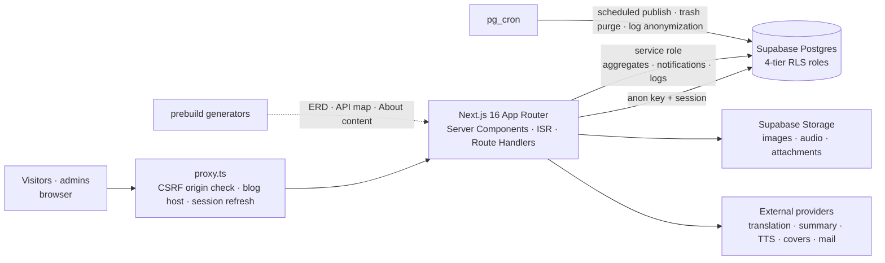
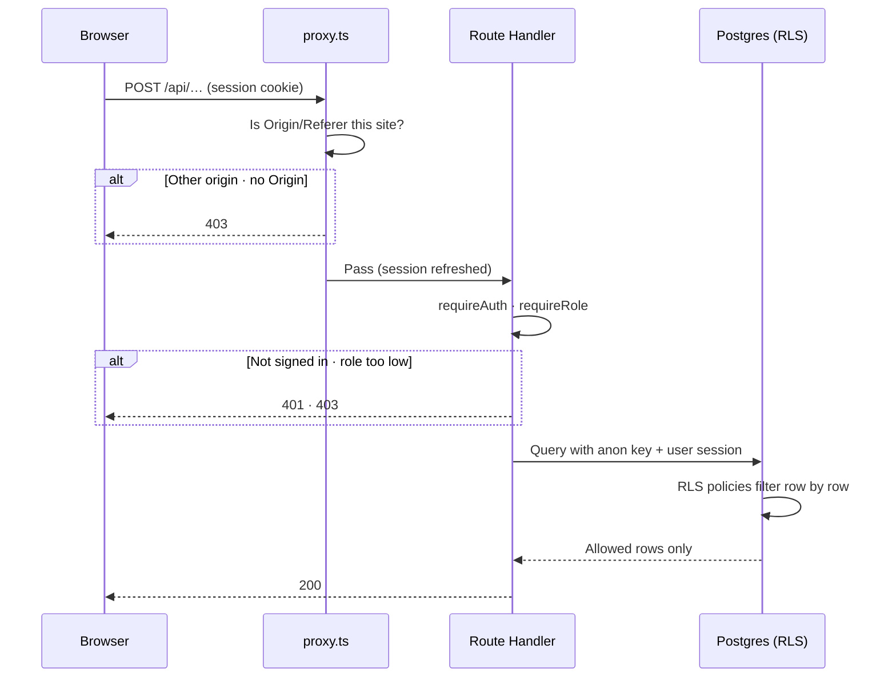

<div align="center">

English | **[한국어](./README.md)**

<br />

<picture>
  <source media="(prefers-color-scheme: dark)" srcset="public/images/logo/wordmark-light.svg" />
  
</picture>

<br />
<br />

**One repository for a personal site that shows work, publishes writing and runs itself.**

It holds both the public site and the admin (CMS) used to write and edit everything on it.

<br />

[](./LICENSE)
[](https://nextjs.org)
[](https://react.dev)
[](https://typescriptlang.org)
[](https://supabase.com)
[](https://threejs.org)
[](https://vercel.com)

**[✦ Visit the site](https://www.hyeoniverse.com)** &nbsp;·&nbsp; **[All features](./docs/en/features.md)** &nbsp;·&nbsp; **[Security](./docs/en/security.md)** &nbsp;·&nbsp; **[Troubleshooting](./docs/en/troubleshooting.md)**

<br />

<picture>
  <source media="(prefers-color-scheme: dark)" srcset="docs/images/readme-banner-dark.png" />
  
</picture>

<sub><b>3,300+</b> commits &nbsp;·&nbsp; <b>980+</b> merged PRs &nbsp;·&nbsp; <b>64</b> troubleshooting write-ups &nbsp;·&nbsp; <b>97.93%</b> type coverage &nbsp;·&nbsp; live since <b>Feb 2026</b></sub>

<sub>▶ <a href="docs/images/readme-tour.mp4">50-second tour video</a>: home scroll · work layouts · narrated gallery · auto-translation</sub>

<details>
<summary><kbd>Contents</kbd></summary>

<br />

<sub>01</sub> [Features](#-features) &nbsp;·&nbsp; <sub>02</sub> [Screens](#-screens) &nbsp;·&nbsp; <sub>03</sub> [Admin · CMS](#-admin--cms) &nbsp;·&nbsp; <sub>04</sub> [Architecture](#-architecture) &nbsp;·&nbsp; <sub>05</sub> [Case studies](#-case-studies)<br />
<sub>06</sub> [How it was built](#-how-it-was-built) &nbsp;·&nbsp; <sub>07</sub> [Tech stack](#-tech-stack) &nbsp;·&nbsp; <sub>08</sub> [Project structure](#-project-structure) &nbsp;·&nbsp; <sub>09</sub> [Quick start](#-quick-start) &nbsp;·&nbsp; <sub>10</sub> [Documentation](#-documentation)

</details>

</div>

---

<sub>01 — FEATURES</sub>

## ✦ Features

<picture>
  <source media="(prefers-color-scheme: dark)" srcset="docs/images/readme-works-dark.gif" />
  
</picture>

### Six work layouts

The same list of works can be shown in six arrangements: Flow · Grid · Cylinder · Fullscreen · Cinematic · Split. The default is picked in the admin, and adding `?layout=` to the address switches it on the spot.

- Cylinder is a cylinder arrangement drawn with Three.js.
- Detail pages carry a slide gallery (narration · captions) and related posts and series.

<br />

<picture>
  <source media="(prefers-color-scheme: dark)" srcset="docs/images/readme-home-dark.gif" />
  
</picture>

### Scroll · 3D interaction

Scrolling down the home page moves the 3D torus along with it, and sentences and sections come in one after another in the scroll direction.

- Infinite scroll loop, mouse parallax, StaggerText, direction-aware scroll cascade, Lenis smooth scrolling
- Three.js 3D: home torus · coffee cup, profile character

<br />

<picture>
  <source media="(prefers-color-scheme: dark)" srcset="docs/images/readme-readaloud-dark.png" />
  
</picture>

### Read aloud

The **Listen** button on post and work pages reads the page with browser speech (Web Speech API). No server TTS is called, so it costs nothing.

- It reads the title → summary → details such as date and author → body blocks, highlights the block being read and scrolls to it when it is off screen.
- A floating bar at the bottom offers previous · pause · next · speed (1 · 1.25 · 1.5 · 0.75×, remembered) · stop. Clicking a paragraph starts reading from there.
- Blocks that make no sense as sound are only announced: a code block as "code block, language, N lines", math as "math", video and embeds by kind.
- Small tables are read row by row with their headers; large tables only announce their size and expand row by row when clicked. Images read their alt text and caption.
- Anything hidden on screen, such as the inside of a closed toggle, is skipped. Each block picks a Korean or English voice on its own.

<br />

<picture>
  <source media="(prefers-color-scheme: dark)" srcset="docs/images/readme-editor-dark.png" />
  
</picture>

### Plate.js editor

The editor is built on Plate.js. The top toolbar is grouped by scope, and selecting text brings up a floating bar for text and background colours.

- Diagram (React Flow) · code playground (Sandpack) · code (CodeMirror 6) · math (KaTeX) blocks
- Autosave and revisions: same-device drafts in `localStorage`, continuing on another device through DB revisions
- `.md` upload (with frontmatter) and export (all · selected · single · series)

<br />

<picture>
  <source media="(prefers-color-scheme: dark)" srcset="docs/images/readme-gallery-dark.gif" />
  
</picture>

### Narrated gallery

The slide gallery on work pages can carry **narration and captions** per slide. Captions are cut from the script by character ratio and follow the voice, and the progress bar below fills one step per slide. 🔊 To hear it, [watch the mp4](public/images/screenshots/cms/01-gallery-playing-light.mp4).

- A prepared voice file (TTS · recording) plays first; without one the script is read with browser speech, and with neither the slide moves on after 4 seconds.
- In the narration editor you pick a voice and press **Generate voice**. If the chosen provider fails, it falls back through Fish Audio → Google Cloud TTS → Edge.
- There is a waveform editor for recordings (split · cut · trim silence) and a reading lexicon that maps written forms to how they are read.
- Dropping a PPTX renders each slide as an image, and each slide's speaker notes become its script.

<br />

<picture>
  <source media="(prefers-color-scheme: dark)" srcset="docs/images/readme-translate-dark.gif" />
  
</picture>

### AI translation · summary

**Switching the KO/EN toggle to EN** at the top of the editor fills the title · subtitle · description · body · gallery scripts in one go. Translations only land in the form and are kept once you save.

- Each feature (translation · summary · TTS · covers) has a provider fallback order, and a provider that keeps failing for the same reason is switched off for a while so no requests go to it.
- On the public site a translation banner appears when the page has no body in the viewer's language, and the AI summary box at the top of detail pages shows Korean and English summaries.

<br />

<picture>
  <source media="(prefers-color-scheme: dark)" srcset="docs/images/readme-theme-dark.png" />
  
</picture>

### Theme · brand

Five colours, the accent plus light and dark background and text, retheme the whole site.

- The 18 presets keep their accents at least ΔE 20 apart, and the current colours can be saved as your own preset.
- A contrast report (WCAG) counts body · link · button text contrast in light and dark. When the accent is used as text, the site shifts only its lightness to reach 4.5:1.
- Colour combinations can be drawn from a colour wheel (analogous · complementary · split complementary · triadic · monochrome) or from an uploaded image.
- The brand section previews the nav · browser tab · loading screen with unsaved settings while you tune the logo.

<br />

#### By area

| Area | Highlights |
|:---|:---|
| **Interaction** | Infinite scroll loop, mouse parallax, StaggerText, Three.js 3D (home torus · coffee cup, profile character), direction-aware scroll cascade |
| **Works** | Six layouts, detail pages, slide gallery (narration · captions) |
| **Posts** | SSR + ISR, series, banner slider, six list layouts, read aloud, guest comments (markdown + emoji reactions) or giscus |
| **Admin** | Dashboard · traffic analytics · notifications · service log, Plate.js editor, `.md` sync, AI translation and summaries, narrated galleries (TTS · recording · PPTX speaker notes), theme presets with WCAG contrast report, revision history, member invites and roles |
| **Security** | Four-tier RLS roles, CSRF origin check (fail-closed in production), 5-attempt login lockout plus email approval for new devices |
| **Design system** | Three token tiers (Raw → Semantic → Component) plus role tokens, all colours in OKLCH |

<div align="right"><sub><a href="#readme">↑ Back to top</a></sub></div>

---

<sub>02 — SCREENS</sub>

## ✦ Screens

| Home · dark | Home · light |
|:---:|:---:|
|  |  |

| Works · Flow | Works · Grid | Works · Cylinder |
|:---:|:---:|:---:|
|  |  |  |
| **Works · Fullscreen** | **Works · Cinematic** | **Works · Split** |
|  |  |  |

| Post list | Post detail |
|:---:|:---:|
|  |  |
| **Profile (Three.js)** | **About — constellation map** |
|  |  |
| **Design system** | **Mobile** |
|  |  |

<sub>The post list and detail were captured with sample posts used for layout checks. On the About page, clicking a star on the constellation map flies into that chapter; its content is built from `content/about/*.md` at build time.</sub>

<div align="right"><sub><a href="#readme">↑ Back to top</a></sub></div>

---

<sub>03 — ADMIN</sub>

## ✦ Admin · CMS

<picture>
  <source media="(prefers-color-scheme: dark)" srcset="docs/images/readme-dashboard-dark.png" />
  
</picture>

`/admin` covers the whole operation, from writing posts and works to visit analytics, notifications, external service status and site settings. How each screen works is written up in **[docs/en/admin.md](./docs/en/admin.md)**.

| Traffic — visit summary · referrers · devices | Post list — filters · status chips · bulk actions |
|:---:|:---:|
|  |  |
| **Notifications — four tabs, action-needed group** | **Service log — success · failure per provider** |
|  |  |
| **Narration editor — script · voice** | **Theme — WCAG contrast report** |
|  |  |
| **Library — multi-select · file preview** | **Appearance — brand preview** |
|  |  |
| **Login — 5-attempt lockout · new-device email approval** | **SEO check — six items** |
|  |  |

<div align="right"><sub><a href="#readme">↑ Back to top</a></sub></div>

---

<sub>04 — ARCHITECTURE</sub>

## ✦ Architecture



- **Rendering.** Server components read data and render pages; post and work details are cached with ISR. Client components are used only where interaction is needed, such as scrolling, 3D and the editor.
- **Data and permissions.** Public reads and signed-in requests go out with the anon key and the session, and Postgres RLS filters rows by four roles: owner · admin · author · visitor. Only site-wide work such as visit aggregates, notifications and the service log runs on the server with the service role.
- **Request path.** Every request passes `src/proxy.ts`. Write requests to `/api/*` only pass when Origin/Referer is this site, and each route checks permissions again with `requireAuth` · `requireRole` ([Security](./docs/en/security.md)).
- **Site settings.** A single `site_settings` row (jsonb) stores **only what differs (delta)** from the code defaults. The defaults at save time are stored too, so when code defaults change a conflict list shows which keys diverged (`src/lib/settingsDelta.ts`).
- **Generated at build time.** `prebuild` builds the ERD from `supabase/setup.sql`, the API map from the route files and the About page data from `content/about/*.md`, so the docs and screens cannot drift away from the code ([Deployment](./docs/en/deploy.md)).
- **Scheduled jobs.** `pg_cron` runs scheduled publishing, trash purges, clearing IPs from old visit records and service-log cleanup inside the database.

#### The three layers a write request passes



<div align="right"><sub><a href="#readme">↑ Back to top</a></sub></div>

---

<sub>05 — CASE STUDIES</sub>

## ✦ Case studies

The measurements are recorded with their conditions in each PR description (Korean).

### Admin post list transfer 44 MB → 0.9 MB · [#974](https://github.com/hyeoniverse/web-portfolio-hyeoniverse/pull/974)

- **Problem.** Video cover thumbnails in the list downloaded the whole source file as soon as they entered the screen. One 15 MB cover was requested three times per load, 43 MB in total and most of the list's 44 MB transfer.
- **Cause.** Fetching only the first frame with `preload="metadata"` and `#t=0.1` is cheap only for mp4 files with the moov atom at the front. Pexels mp4 files keep it at the end, so drawing one frame meant downloading the whole file.
- **Fix.** Thumbnails now use `preload="none"` with a deterministic gradient instead of a still frame. The video is only fetched and played on hover.
- **Result.** List transfer 44 MB → 0.9 MB, idle mp4 requests 3 → 0.

### Admin post list LCP 1468 ms → 1088 ms · [#976](https://github.com/hyeoniverse/web-portfolio-hyeoniverse/pull/976)

- **Problem.** The shell (filter bar · title) appeared around 750 ms, but the table rows only showed up around 1.45 s, with an empty skeleton in between.
- **Cause.** The route entry `page.tsx` was entirely `"use client"`, so hydration → client fetch → render ran in series.
- **Fix.** The first page of the list is read on the server and shipped in the HTML; it is fetched again only when filters, search or sorting change.
- **Result.** LCP 1468 ms → 1088 ms (median of 3). The `/api/posts` round trip left the critical path (1 → 0).

### Post detail LCP equal to FCP · [#949](https://github.com/hyeoniverse/web-portfolio-hyeoniverse/pull/949)

- **Problem.** Even with the cover image already downloaded, the post detail LCP came 0.36–0.38 s after FCP.
- **Cause.** The cover sat inside the Suspense boundary created by `loading.tsx`. React 19.2 reveals a boundary that arrives after the shell has painted only 300 ms after the first paint.
- **Fix.** The cover is drawn in the detail route's layout, outside the boundary, so it paints with the shell. The layout already ran the same query, so no query was added.
- **Result.** On slow 4G mobile, LCP matched FCP every time and the LCP median dropped from 1.86 s to 1.49 s.

### Editor accessibility 80 → 96 · [#981](https://github.com/hyeoniverse/web-portfolio-hyeoniverse/pull/981)

- **Problem.** The post editor scored 80 on Lighthouse accessibility, with 77 axe violation nodes.
- **Cause.** Icon-only toolbar buttons had their labels only as visual tooltips, leaving 54 buttons without a name for screen readers, and the body and code editing areas had no name either. Block handles were 16×22 px, under the 24×24 minimum touch target.
- **Fix.** Buttons and editing areas got accessible names, and the handles became a 24×24 vertical stack.
- **Result.** Lighthouse accessibility 80 → 96–97, axe violations 77 → 9 nodes. The remaining nine come from content, such as text colours and heading order chosen by the author.

#### Other implementation notes

| Topic | How it works | More |
|:---|:---|:---|
| **Permissions · security** | Three layers: CSRF origin check in the proxy → route guards → RLS. A 15-minute lock after 5 failed logins, email approval (24 h) for unknown devices | [security.md](./docs/en/security.md) |
| **Autosave** | Same-device drafts in `localStorage`; continuing on another device through DB revisions saved after a 3-second debounce. Automatic changes right after loading and changes under 10 characters are not saved, and a revision is restored only when it is newer than the saved post | [Troubleshooting 12](./docs/en/troubleshooting/architecture-data.md) |
| **AI provider fallback** | Each feature (translation · summary · TTS · covers) has a fallback order, and a provider that keeps failing for the same reason is switched off so no more requests go to it. Every call is recorded in the service log | `src/lib/ai/health.ts` |
| **Enforcing the design system** | Three token tiers (Raw → Semantic → Component). Stylelint blocks hard-coded values, and the style-ratchet baseline stops the number of rule violations from growing | [design-system.md](./docs/design-system.md) |
| **Performance** | Fixed the LCP image's priority and the streaming reveal delay together, and removed selectors like `:has(:hover)` that triggered full style recalculation | [Troubleshooting Top 10](./docs/en/troubleshooting/top10.md) |
| **Two languages** | UI text comes from Korean/English dictionaries; content keeps separate Korean and English fields and fills empty ones with AI translation. On-the-fly translations on the public site are cached and not requested again | [features.md](./docs/en/features.md) |

<div align="right"><sub><a href="#readme">↑ Back to top</a></sub></div>

---

<sub>06 — PROCESS</sub>

## ✦ How it was built

<p>
  <a href="https://github.com/hyeoniverse/web-portfolio-hyeoniverse/actions/workflows/ci.yml"></a>
  
  
  
</p>

- **Since February 2026**, built and run by one person: about 3,300 commits, 980+ merged PRs and 490+ closed issues (as of October 2026).
- **Workflow.** Work starts as an issue, then a branch and a PR. Commits follow Conventional Commits checked by commitlint, and release-please produces versions and the changelog.
- **CI.** Every PR runs the typecheck, ESLint (warning count locked), Stylelint (token rules), Vitest, knip (unused code · unlisted dependencies) and type-coverage (locked at 97.93%). A weekly audit workflow files unused code and outdated packages as an issue.
- **Tests.** Vitest unit tests and Playwright smoke tests (desktop · mobile · admin · API) ([testing.md](./docs/en/testing.md)).
- **Refactoring.** When `src` passed 220,000 lines, the first round ran on a one-axis-at-a-time rule (#388): safety-net baseline → quality gates → cross-route performance → structure survey → splitting large files per domain → locking the rules. It finished on 2026-09-10 ([refactoring-guide.md](./docs/refactoring-guide.md), Korean).
- **Records.** 64 problems are written up as symptom · cause · fix · conclusion in [Troubleshooting](./docs/en/troubleshooting.md). The top ten include a regex that only fails in the browser because of bundle downleveling, CSS invalidation scope, serial LCP gates, a transition cover tied to the route commit, and a static 404 hydration mismatch.

<div align="right"><sub><a href="#readme">↑ Back to top</a></sub></div>

---

<sub>07 — STACK</sub>

## ✦ Tech stack

<p align="center">
  
</p>

| Area | Used |
|:---|:---|
| Framework | Next.js 16 (App Router, Turbopack) · React 19 · TypeScript 6 |
| Styling | CSS Modules + three-tier CSS variable tokens, enforced by stylelint rules |
| Animation | Framer Motion · GSAP · Lenis |
| 3D | Three.js · React Three Fiber · Drei |
| Backend | Supabase (PostgreSQL · Auth · Storage · RLS) |
| Editor | Plate.js (Slate) + Markdown · React Flow · Sandpack · CodeMirror 6 · KaTeX |
| Comments | Built-in (marked + isomorphic-dompurify) or giscus, switchable in the admin |
| Speech | Fish Audio · Google Cloud TTS · Edge TTS (narrated gallery), Web Speech API (read aloud · script fallback) |
| Integrations | Unsplash · Pexels (covers), DeepL · Google · Gemini · OpenAI · Claude · Groq (translation · summaries), Resend (mail), NanoBanana · Hugging Face (AI images) |
| Testing | Vitest + Testing Library · Playwright smoke tests |

<div align="right"><sub><a href="#readme">↑ Back to top</a></sub></div>

---

<sub>08 — STRUCTURE</sub>

## ✦ Project structure

```
src/
├─ app/                 # App Router
│  ├─ (home) works posts about profile privacy design-system   # public pages
│  ├─ admin/            # admin: (auth) login · (dashboard) dashboard · posts · works · settings · traffic …
│  └─ api/              # Route Handlers (28 groups)
├─ components/          # per-screen components + ui/ shared components (Button · Modal · Select …)
├─ lib/                 # server · shared logic: api/ (permission guards · handlers) · ai/ (provider state) · tts · supabase/
├─ hooks/ stores/ utils/ providers/   # client hooks · global state · theme · language · site config
├─ styles/              # tokens/ (raw) · globals/ (semantic · component) · layers.css
├─ config/              # site.config.ts: code defaults for site settings
├─ data/generated/      # prebuild output (ERD · API map · About content)
├─ locales/             # Korean · English UI text
└─ proxy.ts             # CSRF origin check · blog host routing · session refresh
content/                # .md sources: posts · works sync with the database, about is built into page data
supabase/               # setup.sql (26 tables · RLS · pg_cron) · migrations
scripts/                # prebuild generators · sync · screenshots
e2e/                    # Playwright smoke tests
docs/                   # documentation (docs/images: images used only by the docs)
```

Good places to start reading:

| File | What it holds |
|:---|:---|
| `src/proxy.ts` | Where every request passes: CSRF · blog host · session |
| `src/lib/api/requireRole.ts` | Route permission checks |
| `supabase/setup.sql` | All tables · RLS policies · scheduled jobs |
| `src/lib/getSiteConfig.ts` · `src/lib/settingsDelta.ts` | How site settings are built from code defaults plus the stored delta |
| `src/components/posts/PlateEditor.tsx` · `src/hooks/useEditorAutoSave.ts` | The editor and autosave |
| `src/lib/ai/health.ts` | AI provider state · automatic switch-off · fallback order |
| `src/styles/tokens/` | The raw design-token tier |

<div align="right"><sub><a href="#readme">↑ Back to top</a></sub></div>

---

<sub>09 — QUICK START</sub>

## ✦ Quick start

```bash
npm install
cp .env.example .env.local   # fill in the Supabase URL and keys
npm run dev                  # http://localhost:3000
```

> [!IMPORTANT]
> Posts, works and the admin need a Supabase project. The table SQL, storage buckets, creating the admin account and optional keys (cover images, translation and so on) are laid out step by step in **[docs/en/supabase-setup.md](./docs/en/supabase-setup.md)**.

```bash
npm run build          # production build
npm test               # unit tests (Vitest)
npm run test:smoke     # smoke e2e (needs a build)
npm run audit:full     # typecheck + eslint + stylelint + knip
npm run sync-all       # sync content/*.md with the database (the About page is built from md at build time, not read from the database)
```

<div align="right"><sub><a href="#readme">↑ Back to top</a></sub></div>

---

<sub>10 — DOCS</sub>

## ✦ Documentation

| Document | Contents |
|:---|:---|
| [Features](./docs/en/features.md) | Every feature by screen (interaction, works, posts, admin, performance, security) |
| [Admin · CMS](./docs/en/admin.md) | How each admin screen works: dashboard · traffic · content lists · notifications · settings · narration · translation · theme |
| [Supabase setup](./docs/en/supabase-setup.md) | Environment variables, tables, storage, admin account, cover images |
| [Deployment](./docs/en/deploy.md) | Vercel, domains, mail, post-deploy checks |
| [Testing](./docs/en/testing.md) | Vitest, smoke e2e, preparing the admin session |
| [Design system](./docs/design-system.md) | Three token tiers, per-axis rules with enforcement status, `@layer` (token values in the [generated table](./docs/tokens.md)); decisions in [design-system-decisions.md](./docs/design-system-decisions.md) (Korean) |
| [Troubleshooting](./docs/en/troubleshooting.md) | What broke, why, and how it was fixed |
| [Components](./docs/en/components.md) · [DB design](./docs/en/db-design.md) · [Security](./docs/en/security.md) · [User flow](./docs/en/user-flow.md) | Area deep dives |
| [Editor guide](./docs/en/editor-guide.md) | Using the editor |
| [Refactoring guide](./docs/refactoring-guide.md) · [Performance baseline](./docs/perf-baseline.md) · [Commit convention](./docs/commit-convention.md) | Structural cleanup notes, bundle baseline, commit rules (Korean) |

Commits follow [Conventional Commits](https://www.conventionalcommits.org/en/v1.0.0/). Types and examples are in **[docs/commit-convention.md](./docs/commit-convention.md)** (Korean).

<div align="right"><sub><a href="#readme">↑ Back to top</a></sub></div>

---

<div align="center">

**[PolyForm Noncommercial License 1.0.0](./LICENSE)**

Free to use, modify and share, but **not for commercial use**.

<br />

<sub>✦ Made by <a href="https://www.hyeoniverse.com">HYEONIVERSE</a></sub>

</div>
