<div align="center">

**[English](./README.en.md)** | 한국어

<br />

<picture>
  <source media="(prefers-color-scheme: dark)" srcset="public/images/logo/wordmark-light.svg" />
  
</picture>

<br />
<br />

**작업물을 보여 주고, 글을 쓰고, 운영까지 하는 개인 사이트를 한 저장소로.**

공개 화면과 그 내용을 직접 쓰고 고치는 관리자 화면(CMS)이 함께 들어 있습니다.

<br />

[](./LICENSE)
[](https://nextjs.org)
[](https://react.dev)
[](https://typescriptlang.org)
[](https://supabase.com)
[](https://threejs.org)
[](https://vercel.com)

**[✦ 사이트 보기](https://www.hyeoniverse.com)** &nbsp;·&nbsp; **[기능 전체](./docs/features.md)** &nbsp;·&nbsp; **[설계 결정](./docs/design-system-decisions.md)** &nbsp;·&nbsp; **[트러블슈팅](./docs/troubleshooting.md)**

<br />

<picture>
  <source media="(prefers-color-scheme: dark)" srcset="docs/images/readme-banner-dark.png" />
  
</picture>

<sub><b>3,300+</b> 커밋 &nbsp;·&nbsp; <b>980+</b> 머지한 PR &nbsp;·&nbsp; <b>64</b> 트러블슈팅 기록 &nbsp;·&nbsp; <b>97.93%</b> 타입 커버리지 &nbsp;·&nbsp; <b>2026.02 ~</b> 운영 중</sub>

<p align="center">
  <a href="#-하이라이트">하이라이트</a> ·
  <a href="#-미리보기">미리보기</a> ·
  <a href="#-관리자--cms">관리자 · CMS</a> ·
  <a href="#-아키텍처">아키텍처</a> ·
  <a href="#-구현-포인트">구현 포인트</a> ·
  <a href="#-만든-과정">만든 과정</a> ·
  <a href="#-기술-스택">기술 스택</a> ·
  <a href="#-프로젝트-구조">프로젝트 구조</a> ·
  <a href="#-빠른-시작">빠른 시작</a> ·
  <a href="#-문서">문서</a>
</p>

</div>

---

## ✦ 하이라이트

<table>
  <tr>
    <td width="33%" valign="top">
      
      <br /><strong>작업물 레이아웃 여섯 가지</strong>
      <br /><sub>Flow · Grid · Cylinder · Fullscreen · Cinematic · Split 을 관리자 설정이나 <code>?layout=</code> 으로 바꿉니다.</sub>
    </td>
    <td width="33%" valign="top">
      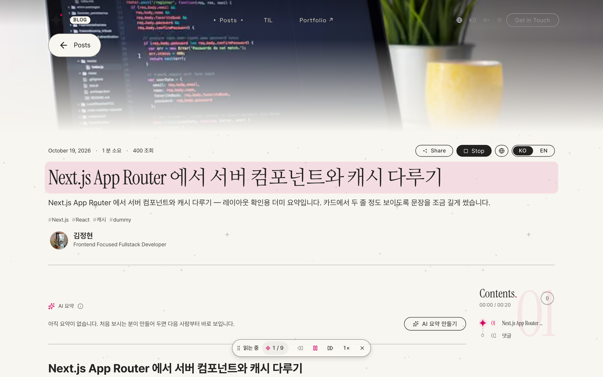
      <br /><strong>글 읽어 주기</strong>
      <br /><sub>브라우저 음성으로 제목부터 본문까지 블록 단위로 읽고, 읽는 자리를 강조합니다.</sub>
    </td>
    <td width="33%" valign="top">
      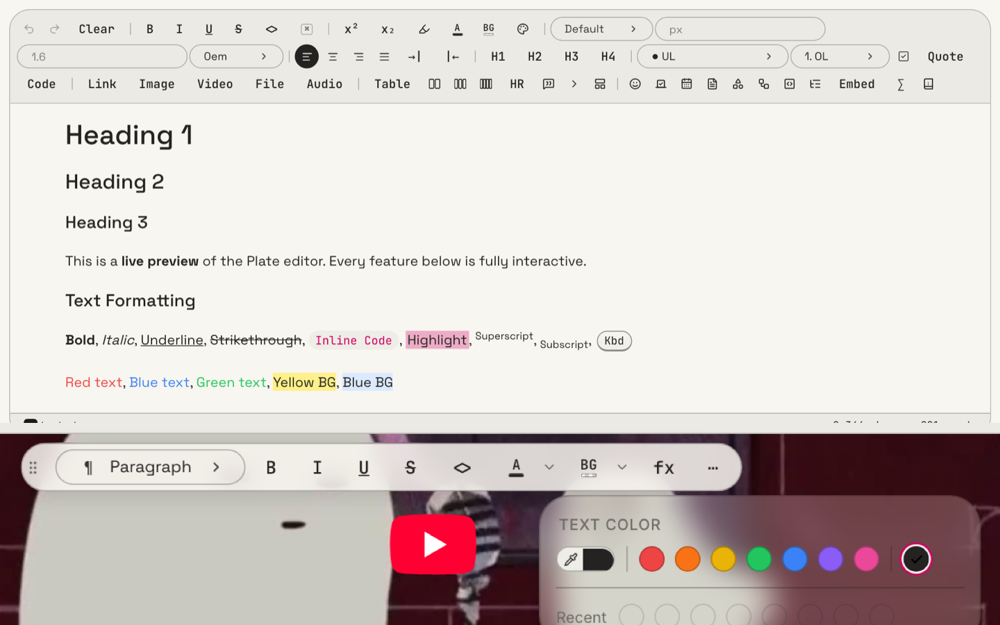
      <br /><strong>Plate.js 편집기</strong>
      <br /><sub>다이어그램 · 코드 플레이그라운드 · 수식 블록, 선택하면 떠오르는 색 도구, 자동저장과 리비전.</sub>
    </td>
  </tr>
  <tr>
    <td width="33%" valign="top">
      
      <br /><strong>발표 갤러리 음성</strong>
      <br /><sub>슬라이드마다 TTS · 녹음 음성과 자막을 붙이고, PPTX 발표자 노트를 대본으로 가져옵니다.</sub>
    </td>
    <td width="33%" valign="top">
      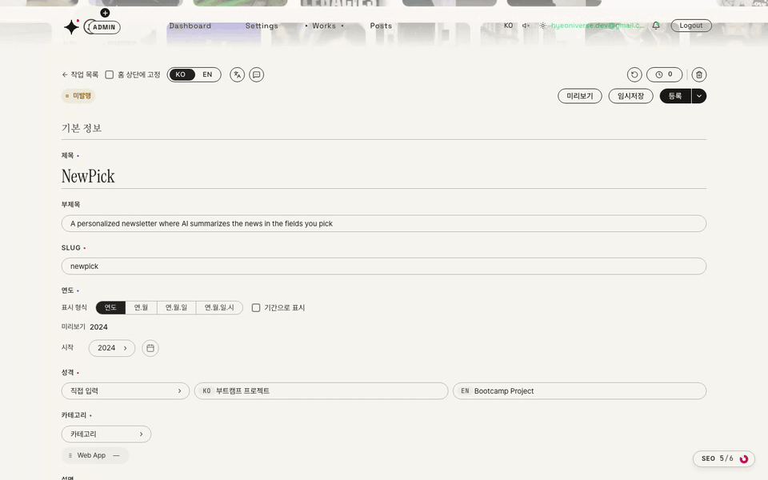
      <br /><strong>AI 번역 · 요약</strong>
      <br /><sub>KO/EN 스위치 하나로 제목부터 갤러리 대본까지 채우고, 공급자가 실패하면 대체 순서로 넘어갑니다.</sub>
    </td>
    <td width="33%" valign="top">
      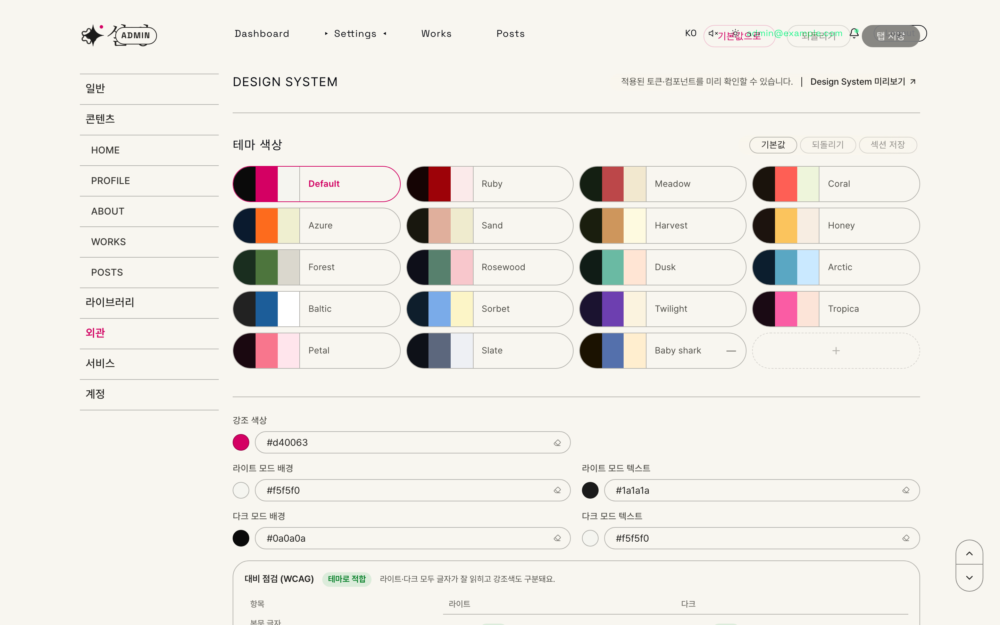
      <br /><strong>테마 · 브랜드</strong>
      <br /><sub>색 다섯으로 사이트 전체 테마를 바꾸고, WCAG 대비를 바로 점검합니다. 로고는 저장 전 미리보기로 맞춥니다.</sub>
    </td>
  </tr>
</table>

| 영역 | 핵심 |
|:---|:---|
| **인터랙션** | 무한 스크롤 루프, 마우스 패럴랙스, StaggerText, Three.js 3D(홈 토러스 · 커피잔, 프로필 캐릭터), 방향별 Scroll Cascade |
| **작업물** | 여섯 가지 레이아웃, 상세 페이지, 슬라이드 갤러리(음성 · 자막) |
| **글** | SSR + ISR, 시리즈, 배너 슬라이더, 여섯 가지 목록 레이아웃, 읽어 주기, 게스트 댓글(마크다운 + 이모지 반응) 또는 giscus |
| **관리자** | 대시보드 · 트래픽 분석 · 알림 · 서비스 호출 기록, Plate.js 편집기, `.md` 동기화, AI 번역 · 요약, 발표 갤러리 음성(TTS · 녹음 · PPTX 발표자 노트), 테마 프리셋 + WCAG 대비 점검, 리비전 히스토리, 멤버 초대와 역할 |
| **보안** | RLS 4단계 권한, CSRF Origin 체크(운영은 fail-closed), 로그인 5회 실패 잠금 + 새 기기 메일 승인 |
| **디자인 시스템** | 3층 토큰(Raw → Semantic → Component) + 역할 토큰, 전체 색 OKLCH |

---

## ✦ 미리보기

### 홈

| 다크 | 라이트 |
|:---:|:---:|
|  |  |

홈 아래쪽은 작업물과 글을 차례로 스크롤로 훑는 구성입니다.

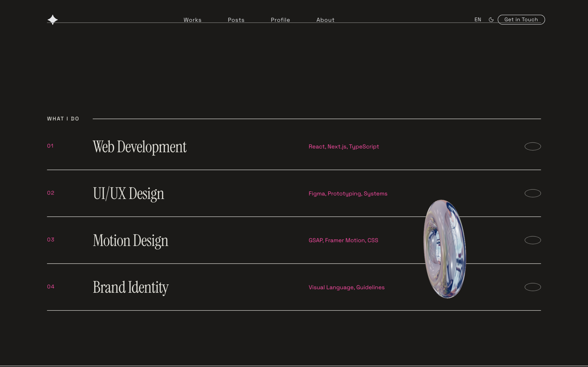

### 작업물

`?layout=` 쿼리나 관리자 설정으로 여섯 가지 레이아웃을 바꿔 끼웁니다. Flow(기본) · Grid · Cylinder · Fullscreen · Cinematic · Split 입니다.

| Flow | Grid | Cylinder |
|:---:|:---:|:---:|
|  |  |  |

<details>
<summary><strong>나머지 레이아웃과 상세 화면</strong></summary>

<br />

| Fullscreen | Cinematic | Split |
|:---:|:---:|:---:|
|  |  |  |


</details>

### 글

| 목록 | 상세 |
|:---:|:---:|
|  |  |

<sub>글 목록 · 상세 캡처는 레이아웃 확인용 예시 글로 찍었습니다.</sub>

### 읽어 주기

글과 작업물 상세의 **Listen** 단추를 누르면 브라우저 음성(Web Speech API)으로 글을 읽습니다. 서버 TTS 를 부르지 않아 비용이 들지 않습니다.

- 제목 → 요약 → 날짜 · 작성자 같은 정보 → 본문 블록 순서로 읽고, 읽는 블록을 강조하며 화면 밖이면 따라 스크롤합니다.
- 화면 아래 떠 있는 막대에서 이전 · 일시정지 · 다음 · 빠르기(1 · 1.25 · 1.5 · 0.75배, 고른 값은 기억) · 멈춤을 고릅니다. 문단을 누르면 거기서부터 읽습니다.
- 소리로 들어서는 소용없는 블록은 무엇인지만 알립니다. 코드 블록은 "코드 블록, 언어, N줄", 수식은 "수식", 동영상 · 삽입은 종류만 말합니다.
- 작은 표는 행마다 머리글을 붙여 읽고, 큰 표는 크기만 알린 뒤 누르면 행 단위로 펼쳐 읽습니다. 이미지는 대체 글과 캡션을 읽습니다.
- 닫힌 토글 안처럼 화면에 보이지 않는 것은 읽지 않습니다. 블록마다 한국어 · 영어 목소리를 따로 고릅니다.


<sub>▶ 제목을 읽는 중입니다. 읽는 블록이 강조되고, 아래 막대에 "읽는 중 1/9" 와 이전 · 일시정지 · 다음 · 빠르기 · 멈춤이 있습니다.</sub>

### 프로필 · 소개

| 프로필 (Three.js) | 소개 |
|:---:|:---:|
|  |  |

소개 페이지는 별자리 지도에서 시작합니다. 별을 누르면 그 장으로 가고, 아래로 굴리면 01 한눈에 보기부터 10 자주 묻는 질문까지 차례로 넘어갑니다. 내용은 `content/about/*.md` 에서 빌드 때 만들어집니다.


### 편집기 · 디자인 시스템

Plate.js 로 만든 편집기입니다. 위 툴바는 작용 범위별로 묶여 있고, 글을 선택하면 떠오르는 바에서 글자색 · 배경색을 바로 입힙니다.

| 편집기 | 색 도구 |
|:---:|:---:|
| 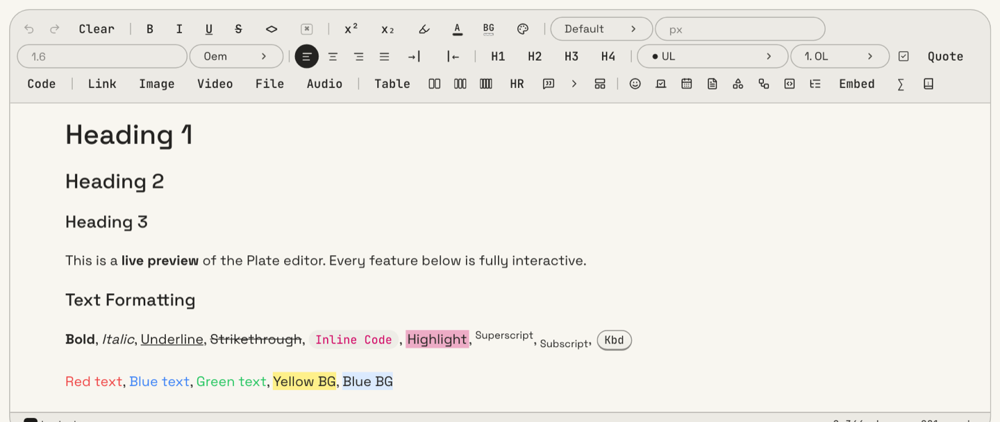 | 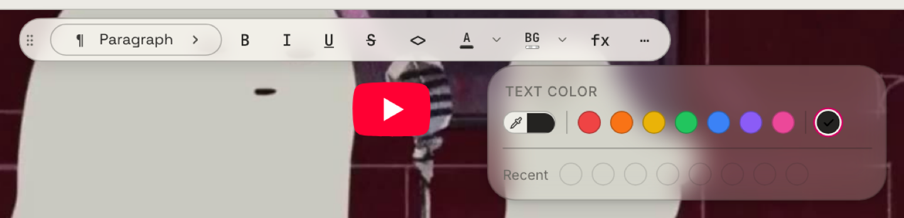 |

토큰과 컴포넌트는 `/design-system` 화면에서 바로 확인합니다.

| 디자인 시스템 | 모바일 |
|:---:|:---:|
|  |  |

---

## ✦ 관리자 · CMS

> [!NOTE]
> 관리자 화면 캡처는 `npx tsx scripts/screenshots-cms.ts` 로 찍습니다(로그인 세션 필요, [scripts/SCREENSHOTS.md](./scripts/SCREENSHOTS.md)). 연속 동작(재생 · 미리 듣기 · 녹음 편집 · PPTX 변환 · 번역)은 핵심 구간만 `.gif` 로 넣었습니다. 각 절의 **자세히** 를 펼치면 동작 설명이 나옵니다.

### 대시보드

| 빠른 작업 · 통계 | 일별 방문자 · 날짜별 분석 |
|:---:|:---:|
| 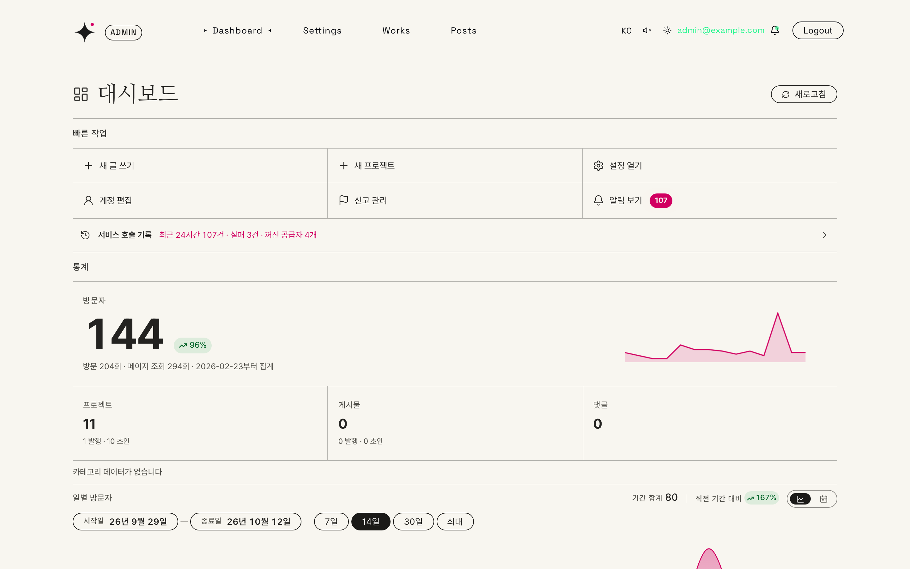 | 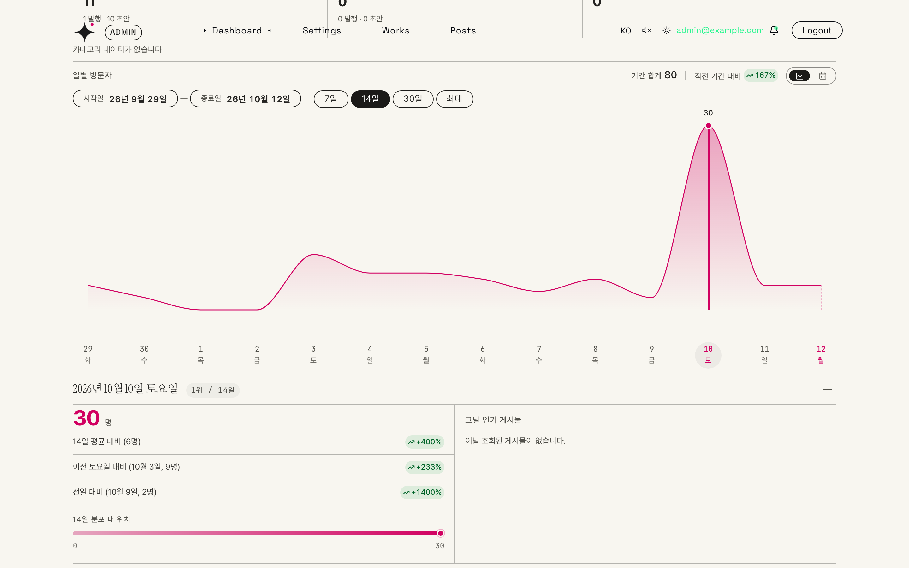 |

<details>
<summary><strong>자세히</strong></summary>

<br />

`/admin` 첫 화면은 운영 현황 한 장입니다. 위쪽 **빠른 작업**(새 글 · 새 프로젝트 · 설정 · 신고 · 알림, 대기 중인 신고와 안 읽은 알림 수는 배지)과 **서비스 호출 기록** 띠(최근 24시간 호출 · 실패 수, 꺼진 공급자)가 있습니다. **통계** 패널 맨 위는 방문자 수(지난 7일 대비 변화율 + 스파크라인)이고, 그 아래 한 줄에 방문 수 · 페이지 조회수 · 평균 머문 시간과 언제부터 센 값인지를 적습니다. 이어서 프로젝트 · 게시물의 발행 · 초안 수, 댓글 수를 셉니다. 옆의 도넛은 조회 기준 카테고리 분포입니다.

**일별 방문자**는 기간을 직접 골라(최대 90일) 곡선으로 보고, 아래 달력 히트맵에서 날짜를 누르면 그날의 순위 · 기간 평균 대비 · 같은 요일 대비 · 전일 대비와 그날 많이 본 글이 패널로 열립니다. 그 아래로 **최근 활동**(글 · 프로젝트 · 댓글), **신고 내역**, **인기**(게시물별 조회 · 좋아요 · 댓글, 참여도, 인기 태그), **트래픽** 요약(유입 경로 · 기기 · 30일 방문 · 신규/재방문 · 방문당 조회), 서비스 키 설정 여부가 이어집니다.

</details>

### 트래픽

| 방문 요약 · 추이 · 유입 경로 · 기기 | IP 분석 · UTM 링크 만들기 |
|:---:|:---:|
|  | 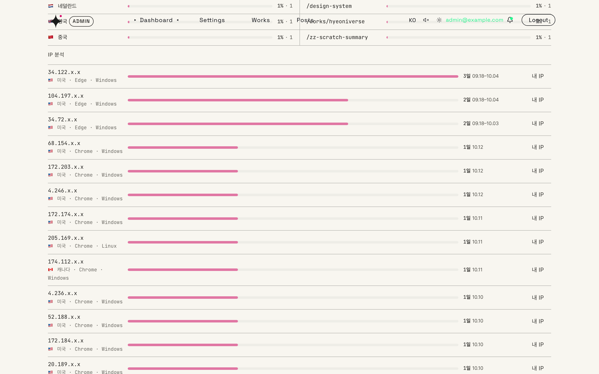 |

<details>
<summary><strong>자세히</strong></summary>

<br />

조회 기록은 `page_views` 하나입니다. 페이지가 보일 때마다(사이트 안 이동 포함) 한 줄을 남기고, 같은 IP 가 같은 페이지를 30분 안에 다시 보면 한 번으로 셉니다. 방문은 30분 동안 아무것도 안 보면 끝나는 세션이고, 방문의 첫 조회에 UA(기기 · 브라우저) · referrer · 국가 · `utm_*` 를 담습니다. 떠날 때는 화면에 보인 시간을 머문 시간으로 더합니다. 사이트 운영자(owner · admin) 본인과 운영자가 **내 IP** 로 지정한 주소는 기록하지 않고, 크롤러(봇)는 따로 표시해 집계에서 뺍니다. 오늘 방문이 최근 7일 평균의 3배를 넘으면 **방문 급증** 알림을 하루 한 번 만듭니다. 90일이 지난 기록의 IP 는 예약 작업이 비웁니다.

`/admin/traffic` 은 기간(7 · 14 · 30 · 90일)을 바꾸면 페이지 전체가 같이 바뀝니다. 방문 요약(방문 · 신규 · 재방문 · 방문당 조회, 봇 제외 표시), 일별 방문 추이, 유입 경로, 기기, 국가, 랜딩 페이지, 인기 콘텐츠, 요일 × 시간대 히트맵, UTM 캠페인, 페이지별 조회와 평균 머문 시간, **방문 흐름**(이탈률 · 들어온 페이지 → 다음 페이지 · 나간 페이지 · 최근 방문의 이동 경로)이 있습니다. **IP 분석**은 마스킹한 IP 별 방문 일수 · 첫/최근 방문 · 국가 · 기기를 보여 주고, 내 IP 로 지정하면 그 뒤 방문은 기록되지 않고 이미 쌓인 것도 집계에서 빠집니다. **UTM 링크 만들기**는 이력서 · LinkedIn · X · 카카오 · 이메일 같은 출처 프리셋으로 `utm_source/medium/campaign` 을 붙인 주소를 만들어 줍니다. referrer 가 남지 않는 메신저 · PDF 경로도 유입이 구분됩니다.

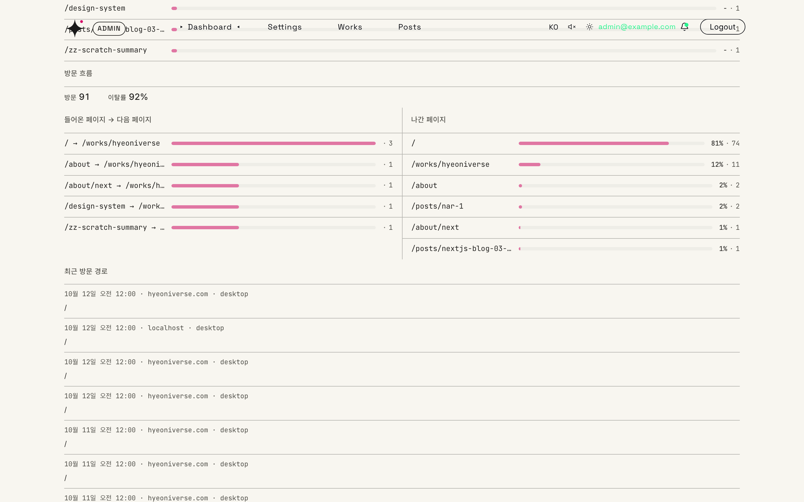

</details>

### 글 · 작업물 관리

| 글 목록 — 필터 · 상태 칩 · 선택 작업 | 작업물 목록 — 순서 · GitHub 불러오기 · 휴지통 |
|:---:|:---:|
|  | 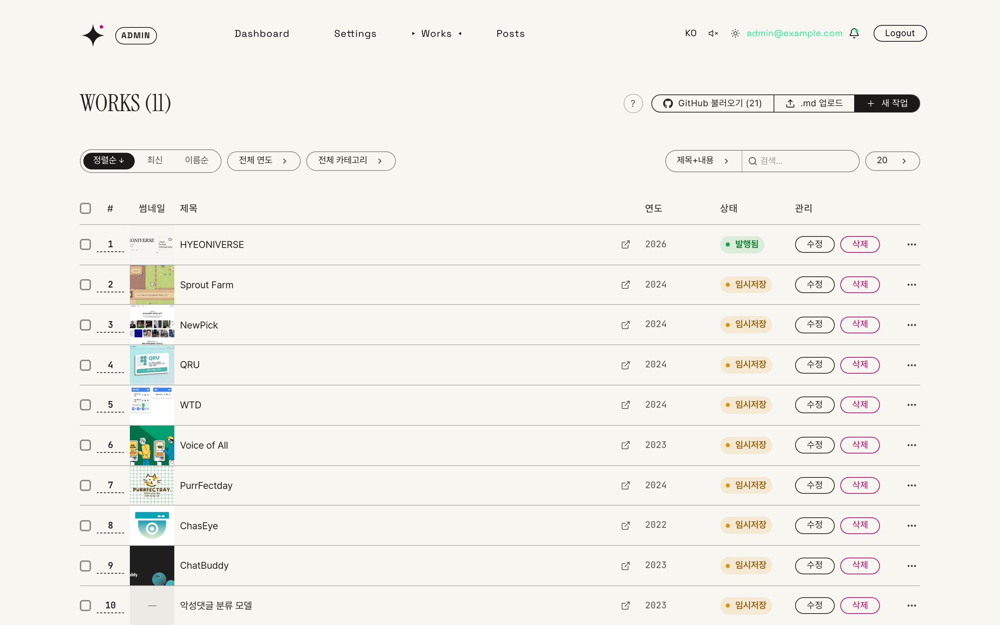 |

<details>
<summary><strong>자세히</strong></summary>

<br />

`/admin/posts` · `/admin/works` 목록은 검색 범위(제목+내용 · 제목 · 내용) · 정렬 · 카테고리 · 시리즈 · 연도 필터와 페이지 크기를 위쪽 유리 띠에 두고, 스크롤해도 따라옵니다. 상태 칩을 누르면 그 자리에서 **발행 ↔ 미발행**이 바뀌고, 체크박스 열에서 끌어 여러 행을 고른 뒤 **선택 삭제 · 카테고리 일괄 변경**을 합니다. 발행된 행은 공개 상세로 바로 가는 단추가, 미발행 행은 게시 화면과 똑같이 그리는 **미리보기**가 있습니다. 글은 **예약 발행**(시간이 되면 `pg_cron` 이 발행하고 알림 · 메일)과 상단 고정, **시리즈** 탭(순서 · 묶어서 내보내기)을 갖습니다. 작업물은 끌기 · 행 번호 클릭 · 행 메뉴(맨앞 · 맨뒤 · 위치)로 순서를 바꾸고, **GitHub 저장소의 README 를 작업물로 불러올** 수 있습니다.

**휴지통**은 soft delete 입니다. 일반 항목은 30일, 인기글(조회 · 좋아요 상위)은 90일 뒤 자동으로 영구 삭제되고, 행마다 남은 기간과 **연장(+30일)** 이 있습니다. 복구는 한 번에, 영구 삭제는 제목을 똑같이 입력해야 합니다. `.md` 는 **업로드**(frontmatter 포함, 새 카테고리는 만들지 물어봄)와 **내보내기**(전체 · 선택 · 개별 · 시리즈) 양쪽으로 오갑니다.

</details>

### 알림 · 신고 · 댓글 · 서비스 기록

| 알림 — 네 탭, 처리 필요 그룹 | 서비스 호출 기록 — 공급자별 성공 · 실패 |
|:---:|:---:|
|  |  |

<details>
<summary><strong>자세히</strong></summary>

<br />

**알림**(`/admin/notifications`)은 전체 · 댓글 · 시스템 · 신고 네 탭으로, 새 댓글 · 답글 · 좋아요 · 댓글 신고 · 권한 요청 · 새 기기 로그인 · 방문 급증과 시스템 알림(로그인 잠금 · 모든 기기 로그아웃 · AI 공급자 실패 · 메일 발송 실패 · 예약 작업 오류 · 설정 변경)을 받습니다. 처리가 필요한 것(권한 요청 · 새 기기)은 따로 묶이고, 알림을 눌러 넘어간 항목은 다음 조작 전까지 천천히 깜빡여 어디로 왔는지 알려 줍니다. **신고** 탭은 대기 · 처리됨 · 반려로 걸러 원본 댓글로 가거나 그 자리에서 댓글을 지웁니다. **댓글 관리**(`/admin/comments`)는 글과 작업물 댓글을 한 표에 모아 활성 · 삭제됨으로 거르고, 여러 개를 골라 지우거나 지운 댓글을 복구합니다.

**서비스 호출 기록**(`/admin/service-log`)은 AI(번역 · 요약 · TTS · 커버) · 이미지 검색 · Resend 메일 · GitHub API · 예약 작업 · 문의 첨부의 성공 · 실패를 새것부터 보입니다. 위에는 공급자 · 작업마다 성공 · 실패 수와 마지막 실패 원인(키 없음 · 한도 · 결제 · 서버 오류 등), 아래에는 기록 줄이고, 종류 · 공급자 · 결과로 거릅니다. 설정 › 서비스의 상태 패널과 대시보드에서 걸러진 채로 들어옵니다(`?provider=gemini` · `?result=fail`).

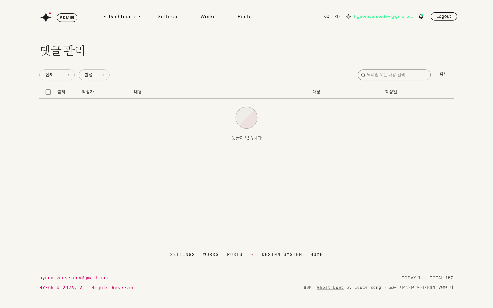

</details>

### 설정

| 라이브러리 — 여러 개 고르기 · 파일 미리보기 | 외관 — 브랜드 미리보기 · 로고 방식 |
|:---:|:---:|
|  |  |

<details>
<summary><strong>자세히</strong></summary>

<br />

`/admin/settings` 는 여섯 탭입니다. **일반**(개인 정보 · 연락처 · SEO 메타데이터 · 배경 음악), **콘텐츠**(홈의 히어로 · 인트로 · 작업물 묶음 · 마퀴 · 푸터 · 소셜 · 배너, 페이지네이션, 태그 · 카테고리, 작업물 인트로 영상, 그리고 PROFILE 서브탭), **라이브러리**(달력 · 투표 · 커스텀 이모지 · 커버 이미지 기록 · 업로드한 파일), **외관**(디자인 시스템 미리보기 · 테마 색상 · 브랜드 · 날짜 선택 스타일 · 타이포그래피와 폰트 업로드), **서비스**(기능별 공급자 우선순위 · 이메일 · 댓글 시스템과 giscus · 보안 · 업로드 형식과 크기 한도 · 공급자 상태 패널 · 환경 변수), **계정**(인증 · 이메일 변경 · 비밀번호 정책, 등록된 기기와 **모든 기기 로그아웃**, 멤버와 역할(소유자 · 관리자 · 저자))입니다.

저장은 탭 전체 또는 섹션 하나씩이고, 되돌리기와 코드 기본값이 있습니다. 비울 수 없는 값(사이트 제목 · 이름 · 테마 색 다섯 · 멤버 이름, giscus 를 고르면 저장소 정보)은 UI · API · DB 세 겹에서 막습니다. 코드 기본값이 바뀐 뒤에는 **충돌 리스트**가 섹션별로 새 값을 보여 주어 골라 반영합니다.

**라이브러리**의 업로드한 파일 · 커버 이미지 기록 · 댓글 이미지 · 이모지 · 달력은 칸을 누르거나 끌어서 여러 개를 고르고 한꺼번에 지웁니다. 업로드한 파일 가운데 쓰는 곳이 있는 것은 고를 수 없게 표시되고, 파일은 음원 · 문서 · 폰트까지 그 자리에서 미리 봅니다. **외관**의 브랜드는 맨 위 미리보기 띠에 저장 전 설정으로 그린 네비 · 브라우저 탭(숏로고)과 로딩 화면(풀로고)을 보여 주고, 그 아래에서 로고 방식(이미지 / 텍스트)을 고른 뒤 숏로고 · 풀로고 · 효과를 파트별로 조절합니다.

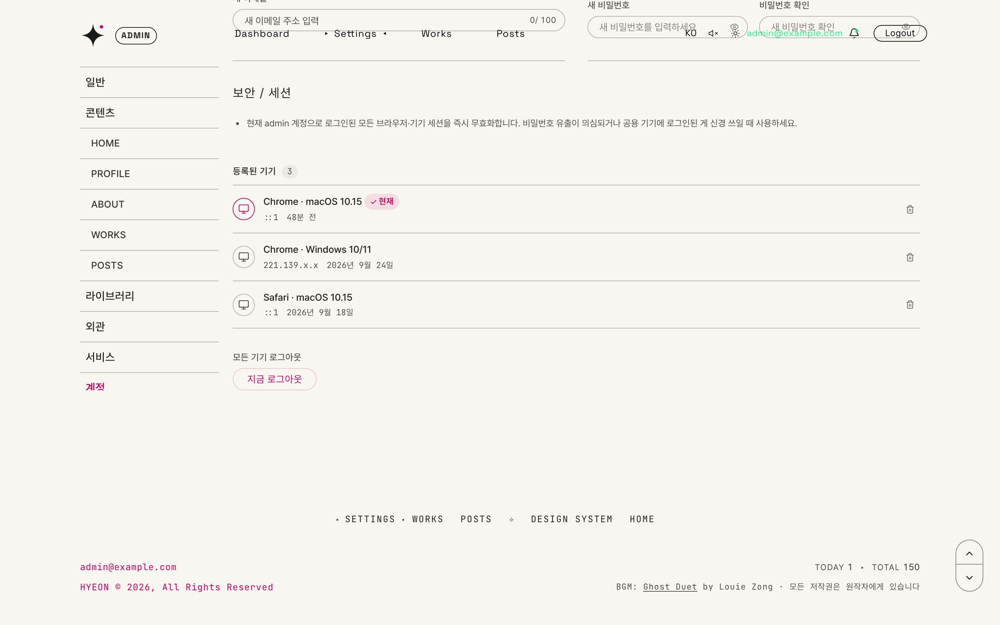

</details>

### 로그인과 보안


소유자는 이메일 · 비밀번호로, 초대받은 멤버는 **GitHub 로 로그인**합니다. OAuth 는 인증만 하고, 서버가 소유자 · 기존 역할 · 초대 행을 확인한 뒤에야 들여보냅니다. 5회 틀리면 15분 잠기고 남은 횟수와 카운트다운이 보입니다. 처음 보는 기기는 자동으로 로그아웃하고 이메일로 승인 링크(24시간)를 보내며, 한 탭에서 로그아웃하면 열린 탭이 모두 함께 나갑니다.

### 발표 갤러리와 음성


<sub>▶ 재생 중에는 음성에 맞춰 자막이 바뀌고 진행 막대가 채워집니다 · 🔊 소리까지 들으려면 [mp4 로 보기](public/images/screenshots/cms/01-gallery-playing-light.mp4) (갤러리가 실제로 트는 TTS 음성을 입힌 27초)</sub>

작업물 상세의 슬라이드 갤러리는 장마다 **음성과 자막**을 붙일 수 있습니다. 음성은 미리 만든 파일(TTS · 녹음)을 먼저 틀고, 없으면 대본을 브라우저 음성으로 읽고, 둘 다 없으면 4초 뒤 넘어갑니다. 자막은 대본에서 글자 비율로 잘라 음성에 맞춰 나오고, 아래 진행 막대는 장마다 한 칸씩 채워집니다. 브라우저가 소리를 막으면 "음성과 함께 보기 / 음성 없이 보기"를 먼저 묻습니다.

| 대본 · 목소리 · 음성 만들기 | 미리 듣기 — 가사처럼 강조 |
|:---:|:---:|
|  | 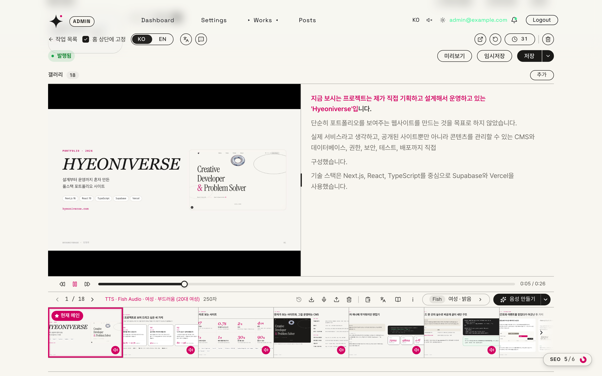 |

<details>
<summary><strong>자세히 · 음성 편집기 · 읽기 사전 · 녹음 · PPTX</strong></summary>

<br />

관리자 작업물 편집기의 **갤러리 음성 편집기**는 작업대(왼쪽 슬라이드 · 오른쪽 대본)와 아래 썸네일 줄로 되어 있습니다. 썸네일을 누르면 그 장이 작업대에 올라오고, 음성이 있는 장은 스피커, 대본만 있는 장은 글줄 표시가 붙습니다. 조작 막대에는 장 이동, 음성 이력, 녹음하기, 녹음 올리기, 음성 지우기, 대본 편집, 대본 번역, 읽기 사전이 있고, 오른쪽 끝에서 목소리(공급자 · 성별 · 톤)를 고른 뒤 **음성 만들기**를 누릅니다. 긴 대본은 600자 안팎으로 잘라 만든 뒤 하나로 합치고, 고른 공급자가 실패하면 설정의 대체 순서(Fish Audio → Google Cloud TTS → Edge)대로 같은 성별 목소리로 넘어갑니다. 미리 들을 때는 대본이 **가사처럼** 글자 단위로 채워지고, 낱말을 누르면 그 자리로 건너뜁니다.


**읽기 사전**은 `?all=true → 올 트루 조건` 처럼 대본 표기와 읽을 말을 짝지어 둡니다. 음성을 만들 때만 가장 긴 표기부터 바꿔 읽고, 자막은 원래 표기를 그대로 둡니다. 한국어 · 영어 대본에 사전이 따로 있고, 대본 안의 `[표기|읽을 말]` 이 사전보다 먼저입니다. 여러 줄을 `표기 = 읽을 말` 꼴로 붙여 넣어 한 번에 넣을 수도 있습니다.

**녹음 파형 편집기**는 마이크로 녹음한 뒤 파형을 눌러 커서를 두거나 끌어 구간을 고르고, 나누기 · 잘라내기 · 복사 · 붙여넣기 · 지우기 · 선택만 남기기 · 앞뒤 무음 자르기로 클립을 다듬습니다(되돌리기 · 다시 하기 포함). 클립은 끌어서 순서를 바꾸고, 다른 장에 붙일 수도 있습니다. 완료하면 WAV 로 올라가 그 장의 음성이 됩니다(최대 6분).

| 읽기 사전 | 녹음 편집 — 구간 선택, 클립 나누기 |
|:---:|:---:|
| 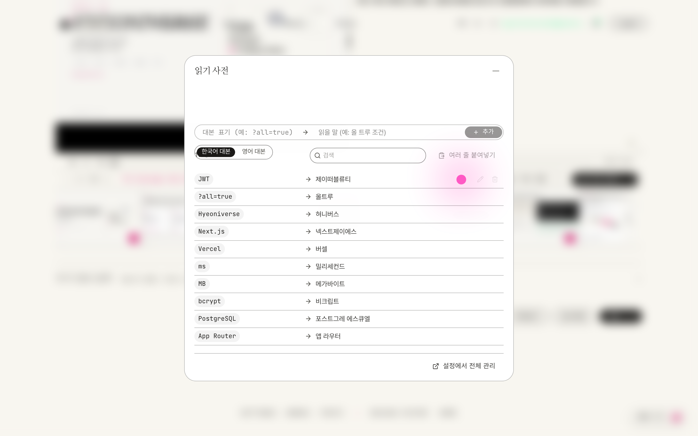 | 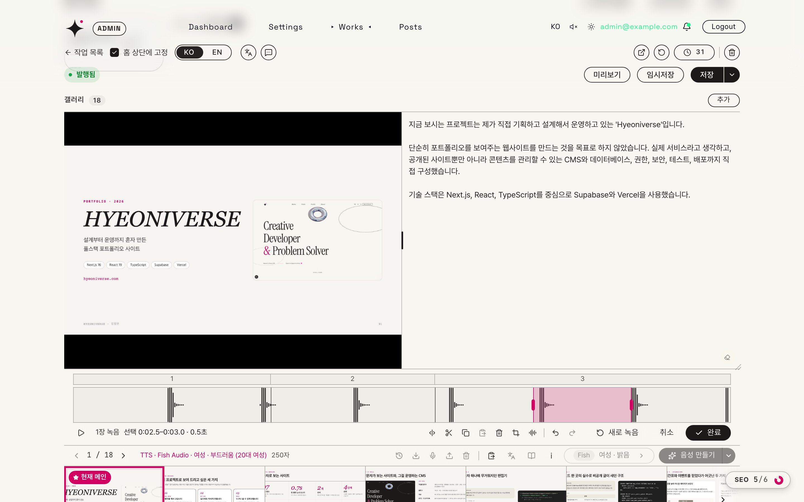 |

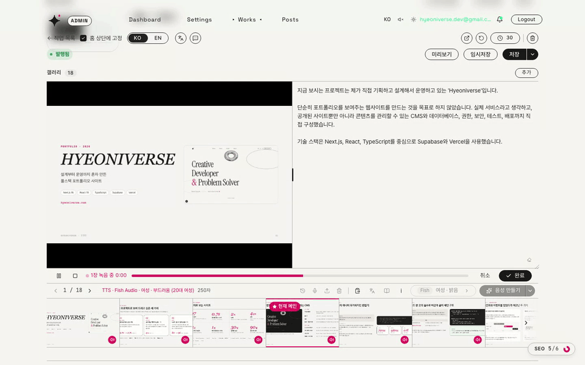

**PPTX 를 갤러리에 끌어 놓으면** 브라우저 안에서 장마다 그림(JPEG, 최대 1600px)으로 그려 올리고, 각 장의 **발표자 노트는 그 장의 대본**으로 들어갑니다. 갤러리 제목 줄에 "파일 이름 — n/N쪽 그리는 중" 진행이 보이고, 끝나면 썸네일마다 대본 표시가 붙습니다. PDF 도 같은 길로 들어옵니다.

| 변환 중 — "n/N쪽 그리는 중" | 끝난 뒤 — 노트가 대본으로 들어간 장 |
|:---:|:---:|
| 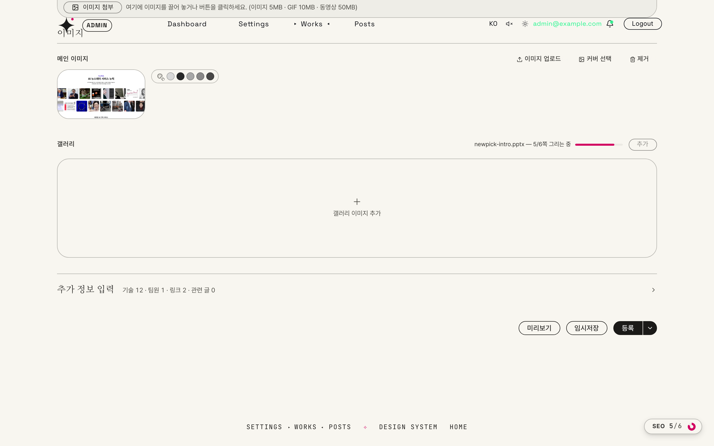 | 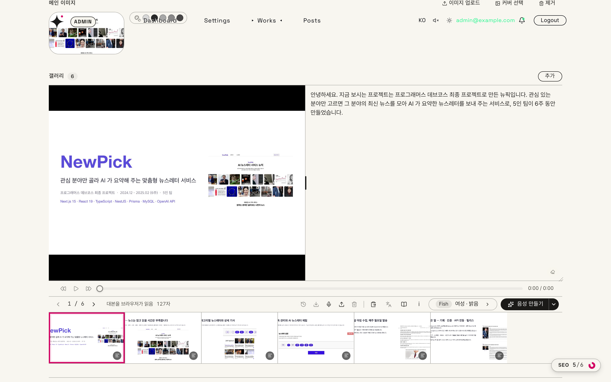 |


</details>

### 자동 번역과 AI 요약


<sub>▶ EN 으로 바꾸고 재번역 › 전체를 누르면 "번역 중…" 띠가 뜬 뒤 영어 칸이 채워집니다</sub>

편집기 위쪽의 KO/EN 스위치를 **EN 으로 바꾸면** 원문이 있고 영어 칸이 모두 비어 있을 때 제목 · 부제목 · 설명 · 본문 · 갤러리 대본까지 한 번에 채웁니다. 영어 칸이 일부 차 있으면 스위치 옆 **재번역** 단추에서 범위를 골라 다시 받습니다. 번역은 폼에만 들어오고 저장을 눌러야 남습니다.

| 설정 › 서비스 — AI · 외부 서비스 | 공개 화면 — 번역 배너 |
|:---:|:---:|
| 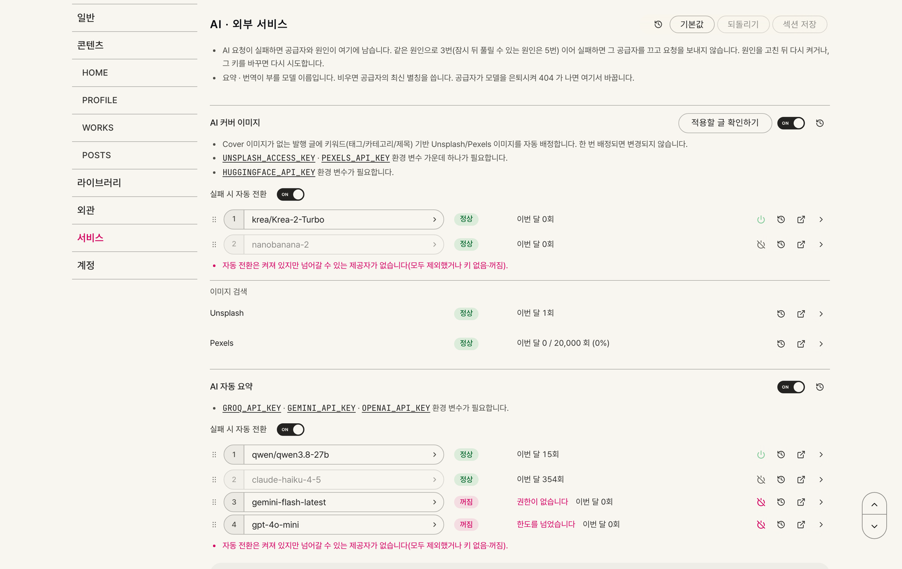 | 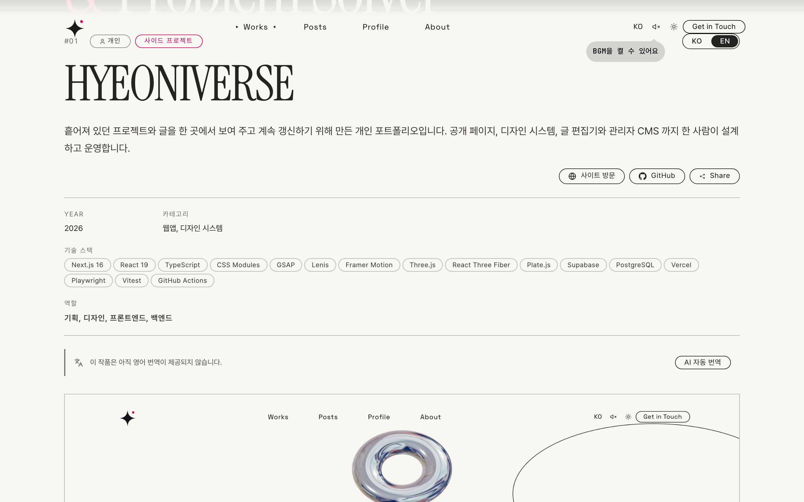 |

<details>
<summary><strong>자세히</strong></summary>

<br />

공급자는 **설정 › 서비스 › AI · 외부 서비스** 한 섹션에서 다룹니다. 기능마다(AI 커버 · AI 요약 · 번역 · TTS) 켜기 · 실패 시 자동 전환 · 대체 순서를 정하고, 공급자 줄마다 상태 · 이번 달 사용량 · 다시 켜기 · 호출 기록 · 콘솔 바로가기가 있습니다. 글 공급자 줄에서는 부를 모델을 고르고, 비우면 공급자의 최신 별칭을 씁니다. 같은 원인으로 거듭 실패한 공급자는 잠시 꺼져 "꺼짐" 배지와 원인(권한이 없습니다 · 한도를 넘었습니다 등)이 보입니다. 같은 표는 서비스 호출 기록 페이지 위에도 있습니다. 관리자 알림 가운데 **메일로도 받을 종류**는 같은 탭의 알림 메일에서 고릅니다. 기본은 새 댓글 · 신고 · 새 기기 로그인 · 권한 요청처럼 사람이 바로 봐야 하는 것만이고, 잇따라 생기는 운영 알림은 한 시간에 한 번만 보냅니다.

공개 화면에서는 보는 언어의 본문이 없으면 **번역 배너**가 뜨고, 단추 하나로 그 자리에서 AI 번역을 받아 봅니다(글 · 작업물 상세 공통). 상세 위쪽의 **AI 요약** 상자는 발행할 때 만든 한국어 · 영어 요약을 보는 언어로 펼쳐 보여 주고, 접을 수 있습니다.

</details>

### 테마

| 프리셋 목록 | 대비 점검 |
|:---:|:---:|
|  |  |

<details>
<summary><strong>자세히 · 색 조합 추천 · 프리셋 비교</strong></summary>

<br />

**설정 › 외관 › 테마 색상**에서 강조색과 라이트 · 다크의 배경 · 글자색 다섯을 정합니다. 프리셋 18종(Default · Ruby · Meadow · Coral · Azure · Sand · Harvest · Honey · Forest · Rosewood · Dusk · Arctic · Baltic · Sorbet · Twilight · Tropica · Petal · Slate)은 강조색끼리 ΔE 20 이상 떨어뜨려 두었고, 지금 고른 다섯 색은 **+** 로 내 프리셋으로 저장해 둘 수 있습니다. 색을 고르면 **대비 점검(WCAG)** 표가 라이트 · 다크에서 본문 · 흐린 글자 · 강조 링크 · 강조색 그래픽 · 버튼 글자의 대비와 링크↔본문 색 차이를 바로 셉니다. 강조색이 글자로 쓰일 때는 사이트가 명도만 옮겨 4.5:1 을 맞추고, 표에는 "자동 보정"으로 표시됩니다.

**색 조합 추천**은 색상환(유사색 · 보색 · 분할 보색 · 삼각 · 단색)으로 뽑거나, 이미지를 올려 그 안의 색 여섯을 뽑아 후보로 만듭니다. 이미지는 브라우저 안에서만 읽고 올리지 않습니다.

| 색상환 추천 | 이미지에서 색 뽑기 |
|:---:|:---:|
| 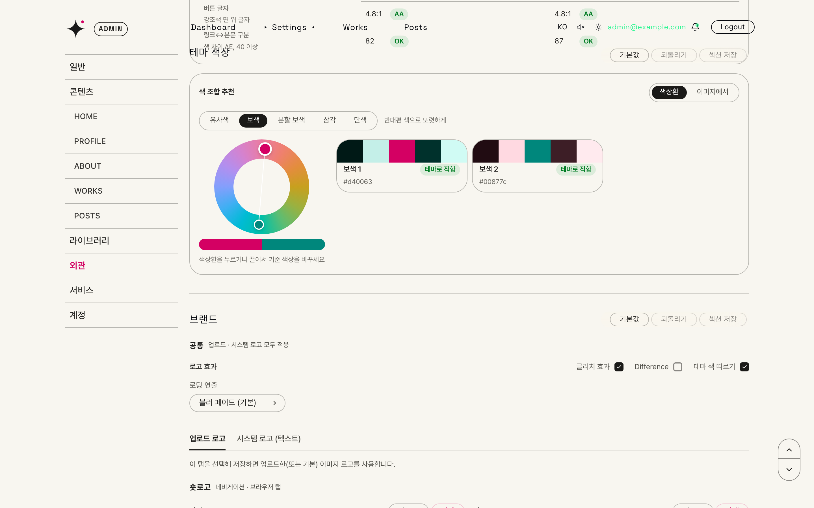 | 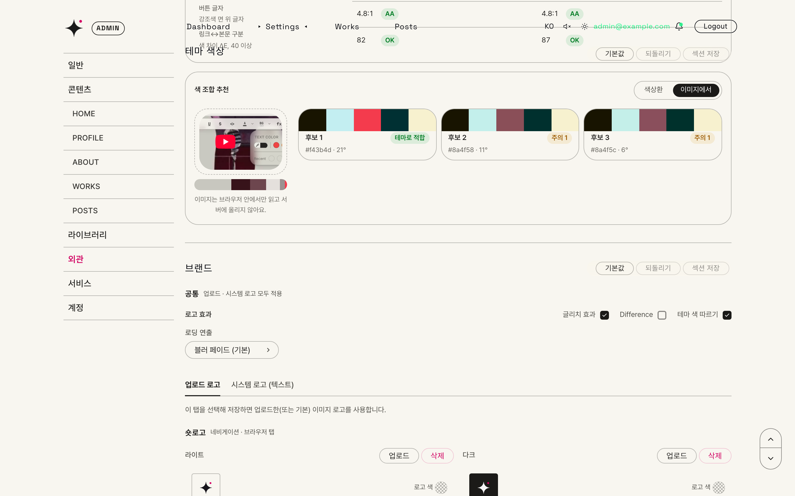 |

같은 홈을 프리셋만 바꿔 본 모습입니다(Arctic · Rosewood · Meadow, 라이트와 다크). 배경 · 글자 · 강조색 다섯 값만 바뀌고 나머지 무채색 단계는 그 값에서 사이트가 계산합니다.

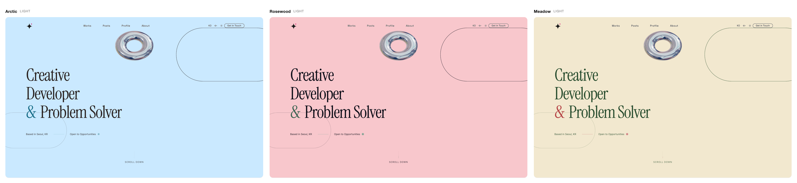

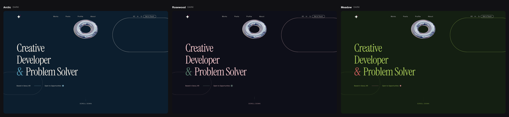

</details>

### 글과 작업물 잇기 · SEO 점검

| 관련 프로젝트 연결 — 글 편집기 | SEO 점검 |
|:---:|:---:|
| 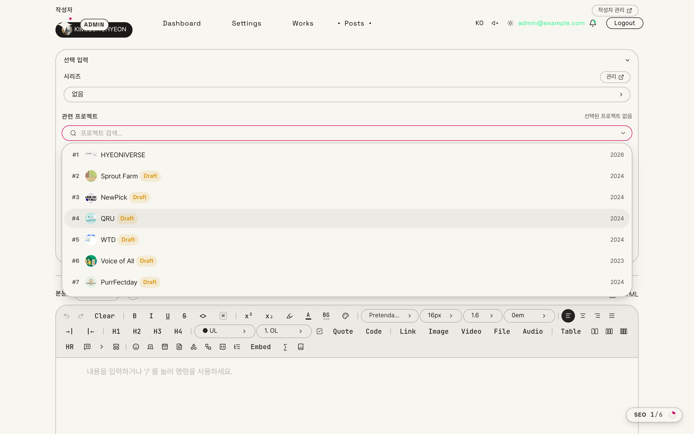 |  |

작업물에는 관련 글 · 시리즈를, 글에는 관련 프로젝트를 검색해 붙입니다. 고른 칩은 끌어 순서를 바꾸고, 공개 상세의 정보 칸에 그대로 나옵니다. 편집기 오른쪽 아래 **SEO 점검** 알약은 제목 · 슬러그 · 요약(30자 이상) · 커버 · 카테고리 · 태그 여섯을 세어 "5/6" 처럼 보여 주고, 항목을 누르면 그 칸으로 데려가 깜빡여 줍니다.

---

## ✦ 아키텍처

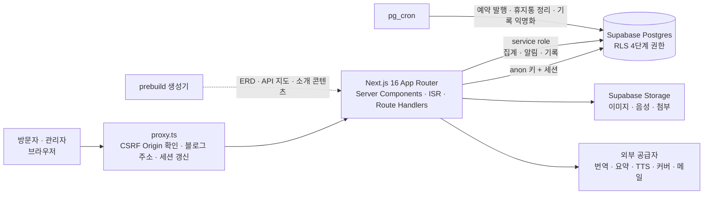

- **렌더링.** 페이지는 서버 컴포넌트가 데이터를 읽어 그리고, 글 · 작업물 상세는 ISR 로 캐시합니다. 클라이언트 컴포넌트는 스크롤 · 3D · 편집기처럼 상호작용이 필요한 곳에만 둡니다.
- **데이터와 권한.** 공개 읽기와 로그인한 사용자의 요청은 anon 키와 세션으로 보내고, Postgres RLS 가 owner · admin · author · visitor 네 단계로 행을 거릅니다. 방문 집계 · 알림 · 서비스 기록처럼 사이트 전체를 다루는 일만 서버에서 service role 로 처리합니다.
- **요청 경로.** 모든 요청은 `src/proxy.ts` 를 지납니다. `/api/*` 의 쓰기 요청은 Origin/Referer 가 이 사이트여야 통과하고, 라우트마다 `requireAuth` · `requireRole` 로 권한을 다시 확인합니다([보안](./docs/security.md)).
- **사이트 설정.** `site_settings` 한 행(jsonb)에 코드 기본값과 **다른 부분(delta)만** 저장합니다. 저장할 때의 기본값도 함께 남겨서, 코드 기본값이 바뀌면 어느 키가 어긋났는지 충돌 리스트로 보여 줍니다(`src/lib/settingsDelta.ts`).
- **빌드 때 만드는 것.** `prebuild` 가 `supabase/setup.sql` 로 ERD, 라우트 파일로 API 지도, `content/about/*.md` 로 소개 페이지 데이터를 만듭니다. 문서와 화면이 코드에서 떨어져 낡지 않게 하려는 구조입니다([배포](./docs/deploy.md)).
- **예약 작업.** `pg_cron` 이 예약 발행 · 휴지통 정리 · 오래된 방문 기록의 IP 비우기 · 서비스 기록 정리를 DB 안에서 돌립니다.

---

## ✦ 구현 포인트

| 주제 | 어떻게 풀었나 | 더 보기 |
|:---|:---|:---|
| **권한 · 보안** | proxy 의 CSRF Origin 확인 → 라우트 가드 → RLS 세 겹. 로그인 5회 실패 시 15분 잠금, 처음 보는 기기는 메일 승인(24시간) | [security.md](./docs/security.md) |
| **자동저장** | 같은 기기 초안은 `localStorage`, 다른 기기에서 이어 쓰기는 3초 debounce 로 DB 리비전에 저장. 불러오기 직후의 자동 변경과 10자 미만 변경은 저장하지 않고, 복원은 저장본보다 나중일 때만 적용 | [트러블슈팅 12](./docs/troubleshooting/architecture-data.md) |
| **AI 공급자 대체** | 기능마다(번역 · 요약 · TTS · 커버) 대체 순서를 두고, 같은 원인으로 이어 실패한 공급자는 자동으로 꺼서 요청을 보내지 않는다. 모든 호출은 서비스 기록에 남는다 | `src/lib/ai/health.ts` |
| **디자인 시스템 집행** | Raw → Semantic → Component 3층 토큰. 하드코딩 값은 stylelint 가 막고, 규칙 위반 수는 style-ratchet 기준선으로 늘지 못하게 잠근다 | [design-system.md](./docs/design-system.md) |
| **성능** | LCP 이미지의 우선순위와 스트리밍 공개 지연을 함께 풀고, `:has(:hover)` 처럼 전체 스타일 재계산을 부르는 선택자를 걷어 냈다 | [트러블슈팅 Top 10](./docs/troubleshooting/top10.md) |
| **다국어** | 화면 글은 한 · 영 사전, 콘텐츠는 한 · 영 칸을 따로 두고 비어 있으면 AI 번역으로 채운다. 공개 화면의 즉석 번역은 캐시해 다시 부르지 않는다 | [features.md](./docs/features.md) |

---

## ✦ 만든 과정

- **2026년 2월부터** 혼자 만들고 운영하고 있습니다. 커밋 3,300여 개, 머지한 PR 980여 개, 닫은 이슈 490여 개입니다(2026-10 기준).
- **작업 흐름.** 할 일은 이슈로 먼저 열고, 브랜치를 따서 PR 로 올립니다. 커밋은 Conventional Commits 를 commitlint 로 검사하고, 버전과 변경 기록은 release-please 가 만듭니다.
- **CI.** PR 마다 타입 검사, ESLint(경고 총량 잠금), Stylelint(토큰 규칙), Vitest, knip(미사용 코드 · 미등록 의존성), type-coverage(97.93% 잠금)를 돌립니다. 매주 한 번 감사 워크플로가 미사용 코드 · 오래된 패키지를 이슈로 정리합니다.
- **테스트.** Vitest 단위 테스트와 Playwright 스모크(데스크톱 · 모바일 · 관리자 · API)를 씁니다([testing.md](./docs/testing.md)).
- **리팩토링.** `src` 가 22만 줄을 넘었을 때 한 번에 한 축만 바꾸는 원칙으로 첫 라운드를 진행했습니다(#388). 안전망 기준선 → 품질 게이트 → 전 라우트 성능 → 구조 조사 → 도메인별 거대 파일 분해 → 규칙 잠금 순서이고, 2026-09-10 에 모두 마쳤습니다([refactoring-guide.md](./docs/refactoring-guide.md)).
- **기록.** 막혔던 문제는 증상 · 원인 · 해결 · 결론으로 [트러블슈팅](./docs/troubleshooting.md)에 64건 남겼습니다. 대표 10건은 번들 다운레벨링으로 브라우저에서만 죽는 정규식, CSS 무효화 범위, LCP 직렬 관문, 전환 덮개와 경로 커밋, 정적 404 하이드레이션 불일치 등입니다.

---

## ✦ 기술 스택

<p align="center">
  
</p>

| 분류 | 사용 |
|:---|:---|
| 프레임워크 | Next.js 16 (App Router, Turbopack) · React 19 · TypeScript 6 |
| 스타일 | CSS Modules + CSS 변수 3층 토큰 · stylelint 규칙으로 집행 |
| 애니메이션 | Framer Motion · GSAP · Lenis |
| 3D | Three.js · React Three Fiber · Drei |
| 백엔드 | Supabase (PostgreSQL · Auth · Storage · RLS) |
| 편집기 | Plate.js (Slate) + Markdown · React Flow · Sandpack · CodeMirror 6 · KaTeX |
| 댓글 | 자체 구현(marked + isomorphic-dompurify) 또는 giscus (관리자에서 전환) |
| 음성 | Fish Audio · Google Cloud TTS · Edge TTS (발표 갤러리), Web Speech API (읽어 주기 · 대본 대체) |
| 외부 연동 | Unsplash · Pexels (커버 이미지), DeepL · Google · Gemini · OpenAI · Claude · Groq (번역 · 요약), Resend (메일), NanoBanana · Hugging Face (AI 이미지) |
| 테스트 | Vitest + Testing Library · Playwright 스모크 |

---

## ✦ 프로젝트 구조

```
src/
├─ app/                 # App Router
│  ├─ (home) works posts about profile privacy design-system   # 공개 화면
│  ├─ admin/            # 관리자: (auth) 로그인 · (dashboard) 대시보드 · 글 · 작업물 · 설정 · 트래픽 …
│  └─ api/              # Route Handlers (28개 그룹)
├─ components/          # 화면별 컴포넌트 + ui/ 공통 컴포넌트(Button · Modal · Select …)
├─ lib/                 # 서버 · 공용 로직: api/(권한 가드 · 핸들러) · ai/(공급자 상태) · tts · supabase/
├─ hooks/ stores/ utils/ providers/   # 클라이언트 훅 · 전역 상태 · 테마 · 언어 · 사이트 설정
├─ styles/              # tokens/(Raw) · globals/(Semantic · Component) · layers.css
├─ config/              # site.config.ts: 사이트 설정의 코드 기본값
├─ data/generated/      # prebuild 생성물(ERD · API 지도 · 소개 콘텐츠)
├─ locales/             # 한 · 영 화면 글
└─ proxy.ts             # CSRF Origin 확인 · 블로그 주소 라우팅 · 세션 갱신
content/                # .md 원본: posts · works 는 DB 와 동기화, about 은 빌드 때 페이지 데이터로
supabase/               # setup.sql(테이블 26개 · RLS · pg_cron) · 마이그레이션
scripts/                # prebuild 생성기 · 동기화 · 화면 캡처
e2e/                    # Playwright 스모크
docs/                   # 문서 (docs/images: 문서 전용 이미지)
```

처음 읽는다면 이 파일들이 흐름을 잡기 좋습니다.

| 파일 | 내용 |
|:---|:---|
| `src/proxy.ts` | 모든 요청이 지나는 곳. CSRF · 블로그 주소 · 세션 |
| `src/lib/api/requireRole.ts` | 라우트의 권한 확인 |
| `supabase/setup.sql` | 테이블 · RLS 정책 · 예약 작업 전체 |
| `src/lib/getSiteConfig.ts` · `src/lib/settingsDelta.ts` | 코드 기본값 + DB 변경분으로 사이트 설정을 만드는 방법 |
| `src/components/posts/PlateEditor.tsx` · `src/hooks/useEditorAutoSave.ts` | 편집기와 자동저장 |
| `src/lib/ai/health.ts` | AI 공급자 상태 · 자동 끄기 · 대체 순서 |
| `src/styles/tokens/` | 디자인 토큰 Raw 층 |

---

## ✦ 빠른 시작

```bash
npm install
cp .env.example .env.local   # Supabase URL·키 채우기
npm run dev                  # http://localhost:3000
```

> [!IMPORTANT]
> Supabase 프로젝트가 있어야 글 · 작업물 · 관리자가 돕니다. 테이블 생성 SQL, Storage 버킷, 관리자 계정 만들기, 커버 이미지 · 번역 같은 선택 키까지 **[docs/supabase-setup.md](./docs/supabase-setup.md)** 에 순서대로 정리해 두었습니다.

```bash
npm run build          # 프로덕션 빌드
npm test               # 단위 테스트 (Vitest)
npm run test:smoke     # 스모크 e2e (빌드 산출물 필요)
npm run audit:full     # typecheck + eslint + stylelint + knip
npm run sync-all       # content/*.md ↔ DB 동기화 (소개 페이지는 DB 대신 빌드 때 md 에서 만든다)
```

---

## ✦ 문서

| 문서 | 내용 |
|:---|:---|
| [기능](./docs/features.md) | 화면별 기능 전체(인터랙션, 작업물, 글, 관리자, 성능, 보안) |
| [Supabase 세팅](./docs/supabase-setup.md) | 환경변수, 테이블, Storage, 관리자 계정, 커버 이미지 |
| [배포](./docs/deploy.md) | Vercel, 도메인, 메일, 배포 후 점검 |
| [테스트](./docs/testing.md) | Vitest, 스모크 e2e, admin 세션 준비 |
| [디자인 시스템](./docs/design-system.md) · [결정 기록](./docs/design-system-decisions.md) | 토큰 3층, 축별 규칙과 강제 상태, `@layer` (토큰 값은 [자동 생성 표](./docs/tokens.md)) |
| [트러블슈팅](./docs/troubleshooting.md) | 막혔던 지점과 원인 · 해결 기록 |
| [컴포넌트](./docs/components.md) · [DB 설계](./docs/db-design.md) · [보안](./docs/security.md) · [사용자 흐름](./docs/user-flow.md) | 영역별 상세 |
| [편집기 가이드](./docs/editor-guide.md) · [.md 콘텐츠 안내](./docs/md-content-guide.md) | 편집기 사용법과 글 · 작업물 · 소개 `.md` 작성 규칙 |
| [리팩토링 가이드](./docs/refactoring-guide.md) · [성능 baseline](./docs/perf-baseline.md) · [커밋 컨벤션](./docs/commit-convention.md) | 구조 정리 기록, 번들 기준선, 커밋 규칙 |

커밋은 [Conventional Commits](https://www.conventionalcommits.org/ko/v1.0.0/) 를 따릅니다. 타입 목록과 예시는 **[docs/commit-convention.md](./docs/commit-convention.md)** 에 있습니다.

---

<div align="center">

**[PolyForm Noncommercial License 1.0.0](./LICENSE)**

자유롭게 사용 · 수정 · 배포할 수 있으나, 상업적 이용은 불가합니다.

<br />

<sub>✦ Made by <a href="https://www.hyeoniverse.com">HYEONIVERSE</a></sub>

<sub><a href="#readme">↑ 맨 위로</a></sub>

</div>
