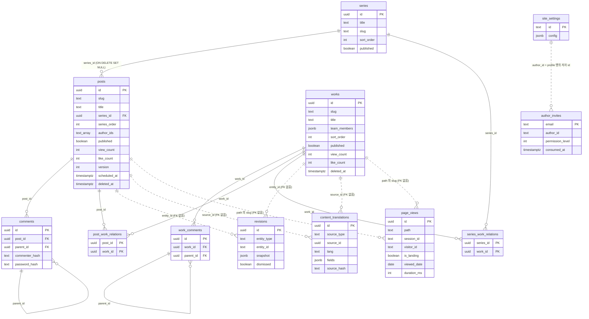

# DB 설계 결정

### 핵심 테이블 관계

아래 그림은 [`supabase/setup.sql`](../supabase/setup.sql) 의 26개 테이블 중 글 · 작업물 · 시리즈를 중심으로 한 테이블만 그린 것이다. 칼럼은 관계와 이 문서가 설명하는 것만 적었다. 실선은 외래 키(FK)이고, 점선은 FK 없이 값으로만 이어지는 논리 관계다.



- 저자는 별도 테이블이 없다. 역할은 `auth.users.app_metadata` 에, 저자 프로필은 `site_settings` 의 `profile` 행에 있고, `posts.author_ids` 가 그 프로필 id 를 담는다. 작업물은 `team_members` 안의 `author_id` 로 저자를 가리킨다.
- `revisions` · `content_translations` 는 posts 와 works 를 함께 가리켜 FK 를 하나로 둘 수 없다. `page_views` 는 경로(`/posts/<slug>`, `/works/<slug>`)를 문자열로 남긴다.
- `likes` · `comment_reactions` · `comment_reports` 도 대상 종류를 칼럼 값(`target_type` · `comment_type`)으로 나누는 다형 참조라 FK 가 없다. `likes` 와 `comment_reactions` 는 아래 각 절에서 설명한다.

### 통합 좋아요 테이블: `likes`

모든 좋아요(포스트, 작업물, 포스트 댓글, 작업물 댓글)를 단일 `likes` 테이블에서 `target_type`으로 구분합니다.

> 현재 댓글 좋아요는 UI 에서 [이모지 반응](#댓글-이모지-반응-comment_reactions)으로 대체됐습니다. 호출부가 없던 `/api/comment-likes` 라우트는 제거했고, `target_type` 의 `post_comment` / `work_comment` 값만 스키마에 남아 있습니다 — 기존 행이 있으면 CHECK 재정의가 실패하고 남아 있어도 무해하므로 마이그레이션 없이 둡니다.

**검토한 대안:**

| 방식 | 장점 | 단점 |
|------|------|------|
| **단일 테이블** (현재 구조) | Single Source of Truth, 하나의 UNIQUE 제약으로 전체 중복 방지, 새 엔티티 추가 시 CHECK 값 하나만 추가 | `target_type`이 4개 |
| **완전 분리** (post_likes, work_likes, ...) | 쿼리 단순 | 테이블 과다, 스키마 중복 |
| **2테이블** (likes + comment_likes) | 콘텐츠/댓글 관심사 분리 | 동기화 로직 분산, 테이블 수 증가 |

**선택 근거:** `UNIQUE(target_type, target_id, ip)` 하나로 모든 엔티티의 중복을 DB 레벨에서 차단합니다. 댓글 좋아요는 실시간 `COUNT(*)` 쿼리로 조회하고, Posts만 목록 성능을 위해 `posts.like_count` 캐시 컬럼에 동기화합니다. 인덱스가 적용된 상태에서 수천 건까지 성능 차이가 없으므로, 정합성과 단순성을 우선합니다.

### 비정규화 카운트 캐싱: `posts.like_count`

`likes` 테이블이 좋아요의 **source of truth**이고, `posts.like_count`는 목록 조회 성능을 위한 **캐시 컬럼**입니다.

| 엔티티 | 카운트 방식 | 근거 |
|--------|------------|------|
| **Posts** | `posts.like_count` 캐시 컬럼 동기화 | 목록 조회 시 JOIN 없이 즉시 표시 |
| **Works / 댓글** | 실시간 `COUNT(*)` 쿼리 | 목록에서 카운트 불필요, 상세 페이지에서만 조회 |

**선택 근거:** 포트폴리오 사이트는 읽기 >> 쓰기 비율입니다. Posts만 목록에서 좋아요 수를 표시하므로 캐시 컬럼이 필요하고, 나머지는 실시간 조회로 충분합니다.

### 에디터 리비전 히스토리: `revisions`

Posts/Works 에디터의 자동저장 시 폼 전체를 JSONB snapshot으로 영구 저장하는 다형적 테이블입니다.

**검토한 대안:**

| 방식 | 장점 | 단점 |
|------|------|------|
| **별도 DB 테이블** (현재 구조) | 기기·탭·세션 간 영속, 엔티티별 자동 정리, diff 비교 가능 | 자동저장마다 DB 쓰기 발생 |
| **sessionStorage** (이전 구조) | 즉시 접근, DB 부하 없음 | 탭 닫으면 소멸, 기기 간 공유 불가 |

**선택 근거:** 포트폴리오 관리자(1인)가 사용하므로 DB 쓰기 비용은 무시 가능합니다. 기기·탭·세션 간 리비전 공유와 diff 기반 상세 비교가 더 중요합니다. `entity_type` CHECK 컬럼으로 posts/works를 단일 테이블에서 구분하고, 목록 조회 시 snapshot을 제외하여 경량 로딩합니다. JSON.stringify 해시 비교로 동일 snapshot 중복 저장을 방지하며, 상세 뷰에서 카테고리·태그·시리즈 등 메타 항목도 diff로 표시합니다.

`entity_id` 는 uuid 가 아니라 **text** 입니다. 저장 전 새 글은 아직 `posts.id` 가 없어 draft sentinel 문자열(예: `"draft-new-post"`)을 `entity_id` 로 쓰기 때문입니다 — uuid 였을 때 새 글 autosave 가 전부 500 나던 것을, 컬럼을 text 로 바꿔 해결했습니다.

**자동저장 주기 결정:** 초기에는 5초 debounce로 구현했으나, Google Docs(OT/diff 방식)·Notion(즉시 저장이지만 서버엔 patch)·WordPress(60초)와 비교했을 때 **전체 스냅샷 방식에서 5초는 너무 잦아** 리비전이 무의미하게 누적되는 문제가 있었습니다. diff 방식은 단일 사용자 환경과 스냅샷 50개 제한(~2.5MB) 규모에서 복잡도 대비 이득이 없어 채택하지 않았습니다. 현재는 **3초 debounce + 페이지 이탈 시 강제 저장**을 씁니다. 서버 리비전은 **append-only** 로 쌓이고 **dismissed 플래그**로 복원 후보에서만 제외되므로, 잦은 저장이 무의미한 누적으로 남지 않습니다. 이탈 저장은 두 경로로 처리합니다: 브라우저 닫기·새로고침은 `navigator.sendBeacon`(비동기 보장), Next.js SPA 라우팅은 컴포넌트 언마운트 cleanup에서 `fetch({ keepalive: true })`를 사용합니다.

서버(cross-device) 자동복원은 **현재 비활성**이고 localStorage(같은 기기) 복원만 씁니다 — 기존 글의 과거 저장이 `updated_at` 을 올리지 않아, 로드 시 stale revision 이 최신 내용을 옛 버전으로 롤백하는 사고가 있었기 때문입니다.

### 익명 댓글 이중 인증

로그인 없는 댓글 시스템에서 수정/삭제 권한을 **2개 경로**로 검증합니다.

| 인증 경로 | 저장 위치 | 지속성 | 용도 |
|-----------|----------|--------|------|
| `commenter_hash` | 브라우저 localStorage UUID → SHA-256 | 같은 브라우저에서 영구 | 자동 인증 (비밀번호 입력 불필요) |
| `password_hash` | bcrypt (salt round 10) | 사용자가 기억하는 한 영구 | 다른 기기/브라우저에서 인증 |

**왜 둘 다 필요한가:** `commenter_hash`만 있으면 브라우저 변경 시 수정 불가. `password`만 있으면 매번 입력 필요. 병행하면 같은 브라우저에서는 자동 인증, 다른 환경에서는 비밀번호 fallback으로 UX와 보안을 모두 확보합니다.

### 댓글 시스템 기능

| 기능 | 설명 |
|------|------|
| **닉네임 셔플** | 랜덤 이모지+이름 조합, 셔플 버튼으로 변경 가능 |
| **답글 이메일 알림** | 댓글 작성 시 이메일(선택) 입력하면 답글 알림 발송 (`notify_email` 컬럼) |
| **관리자 댓글** | 로그인 상태에서 비밀번호 없이 Admin 뱃지로 댓글 작성, 서버 측 Supabase Auth 재검증 |
| **마크다운 본문** | `marked`(gfm + breaks) → `isomorphic-dompurify` sanitize, 태그·속성 화이트리스트 |
| **이모지 반응** | giscus 식 고정 8종 (아래 `comment_reactions`) |

### 댓글 이모지 반응: `comment_reactions`

댓글의 단일 "좋아요" 를 giscus 식 고정 8종 이모지 반응(👍 👎 😄 🎉 😕 ❤️ 🚀 👀 — `src/utils/commentReactions.ts` 의 `REACTION_EMOJIS`)으로 대체한 테이블입니다.

| 컬럼 | 설명 |
|------|------|
| `id` | uuid PK |
| `comment_id` | uuid NOT NULL, **FK 없음** — `comment_type` 에 따라 `comments` 또는 `work_comments` 를 가리키는 다형 참조 |
| `comment_type` | text CHECK (`post` / `work`) |
| `emoji` | text — 고정 8종 중 하나 (서버가 `isReactionEmoji` 로 검증) |
| `reactor_hash` | text DEFAULT `''` — 반응자 식별자 (아래) |
| `created_at` | timestamptz |

**검토한 대안:**

| 방식 | 장점 | 단점 |
|------|------|------|
| **전용 테이블** (현재 구조) | 이모지 축이 스키마에 명시, 집계가 단순 | `likes` 와 개념이 겹치는 테이블이 하나 더 |
| **`likes` 재사용** (`target_type='post_comment'` + emoji 컬럼) | 테이블 수 유지 | `UNIQUE(target_type, target_id, ip)` 가 이모지 축을 모름 — 한 사람이 여러 이모지를 못 남김. 제약 재설계가 필요해 "재사용" 의 이득이 사라짐 |

**선택 근거:** 좋아요는 `(대상, 사람)` 2축이지만 반응은 `(대상, 사람, 이모지)` 3축이라 `likes` 의 UNIQUE 제약과 축이 맞지 않습니다. 별도 테이블에서 4컬럼 unique 로 토글 단위를 정확히 표현합니다.

중복 방지는 테이블 제약이 아니라 **unique index** `idx_comment_reactions_unique(comment_id, comment_type, emoji, reactor_hash)` 입니다 — `ON CONFLICT` 에는 4컬럼 추론 목록이 필요하고, 이름으로 지정할 named constraint 는 없습니다. 조회용 인덱스는 `(comment_id, comment_type)` 별도.

`comment_id` 에 FK 를 두지 않은 것은 참조 대상 테이블이 `comment_type` 에 따라 갈리는 다형 참조라 단일 FK 로 표현할 수 없기 때문입니다. 따라서 ON DELETE CASCADE 도 없고, 댓글이 완전 삭제돼도 반응 행은 남습니다 (조회가 클라이언트가 보유한 `comment_ids` 기준이라 노출되지는 않음).

**반응자 식별 (`reactor_hash`):** 좋아요의 IP 방식과 같은 취지지만, 원문 IP 를 저장하지 않고 `sha256(IP + ":" + UA)` 의 앞 32자만 보관합니다. IP 단독보다 공용 IP(회사·카페) 뒤 사용자들이 서로를 덮어쓸 확률이 낮고, 저장값 자체가 개인 식별정보가 아닙니다. 로그인 없는 반응이므로 완벽한 식별이 아니라 **일상적 중복 차단**이 목표입니다.

RLS 는 조회 공개(`FOR SELECT USING (true)`) + 쓰기 service_role. 집계·토글은 admin client 로 처리합니다.

### 투표 블록 집계: `poll_votes`

본문 에디터의 투표(poll) 블록 응답을 집계하는 테이블입니다. 투표의 **구조(질문·옵션)는 별도 테이블이 없고**, 에디터 블록의 저장 HTML/JSON 안에 들어 있습니다.

| 컬럼 | 설명 |
|------|------|
| `id` | uuid PK |
| `poll_id` | 에디터가 블록 생성 시 부여하는 고정 text id (저장 HTML `data-poll-id`) |
| `option_id` | 투표 옵션 고정 text id (`data-option-id`) |
| `ip` | 투표자 IP (DEFAULT `''`), 중복 방지용 |
| `created_at` | timestamptz |

**검토한 대안:**

| 방식 | 장점 | 단점 |
|------|------|------|
| **단일 집계 테이블** (현재 구조) | 투표 구조를 에디터 콘텐츠와 함께 저장, 스키마 단순 | poll_id/option_id 가 FK 가 아닌 text |
| **`polls` + `poll_options` 정규화** | 참조 무결성 | 본문 블록을 저장할 때마다 별도 테이블 동기화 필요, 테이블 증가 |

**선택 근거:** 투표 블록의 질문·옵션은 본문 콘텐츠의 일부이므로 게시물 HTML 안에 함께 저장하고, `poll_votes` 는 **순수 집계**만 담당합니다. 그래서 `poll_id` / `option_id` 는 FK 가 아닌 에디터가 부여한 text id입니다. `UNIQUE(poll_id, option_id, ip)` 로 같은 IP 의 같은 옵션 중복 투표를 DB 레벨에서 차단하고, `poll_id` 인덱스로 집계 조회를 최적화합니다. 단일 선택 투표는 API 가 `(poll_id, ip)` 행을 지우고 다시 넣어 교체하고, 복수 선택은 옵션별 토글(insert/delete)로 처리합니다. RLS 는 public SELECT + service_role ALL (집계/투표는 admin client 로 처리).

### 시리즈↔프로젝트 연결: `series_work_relations`

프로젝트(work)에 관련 시리즈를 연결하는 다대다 테이블로, 기존 `post_work_relations` 와 동일한 패턴입니다.

| 컬럼 | 설명 |
|------|------|
| `series_id` | uuid FK → `series(id)` ON DELETE CASCADE |
| `work_id` | uuid FK → `works(id)` ON DELETE CASCADE |
| `created_at` | timestamptz |

PRIMARY KEY 는 `(series_id, work_id)` 복합키이고, `series_id` / `work_id` 각각에 인덱스가 있습니다. RLS 는 public SELECT + service_role ALL.

**선택 근거:** posts↔works 양방향 연결(`post_work_relations`)이 이미 검증된 다대다 패턴이므로 시리즈↔프로젝트 연결도 동일 구조로 통일했습니다. 양쪽 FK 에 ON DELETE CASCADE 를 걸어 시리즈나 작품 삭제 시 연결 행이 자동 정리되고, 복합 PK 로 같은 쌍의 중복 연결을 차단합니다.

### 캘린더 블록 연결형 저장: `calendars`

에디터의 캘린더 블록이 참조하는 공유 달력 테이블입니다. 블록은 `calendarId` 만 갖고, 실제 이벤트 데이터는 이 테이블에 있습니다.

| 컬럼 | 설명 |
|------|------|
| `id` | uuid PK |
| `title` | text NOT NULL DEFAULT `''` |
| `data` | jsonb NOT NULL DEFAULT `'{}'` — 월/이벤트 등 달력 전체 상태 |
| `created_at` / `updated_at` | timestamptz |
| `deleted_at` | timestamptz — soft delete |
| `purge_after` | timestamptz — 휴지통 TTL (30일) |

**검토한 대안:**

| 방식 | 장점 | 단점 |
|------|------|------|
| **연결형 저장** (현재 구조) | 여러 글이 같은 달력 공유, 한 곳만 고치면 전부 반영, admin 에서 일괄 관리 | 블록 렌더에 fetch 1회 추가, 글 삭제해도 달력은 남음 |
| **블록 내장 저장** (투표 블록 방식) | fetch 없음, 글과 수명 동일 | 같은 달력을 여러 글에 넣으면 사본이 갈라짐 |

**선택 근거:** 투표 블록은 "이 글의 투표" 라 콘텐츠에 내장하는 게 맞지만, 달력은 **여러 글이 같은 일정을 참조**하는 성격이라 사본이 갈라지면 곧바로 오답이 됩니다. 그래서 투표와 반대로 연결형을 택했습니다. 대신 글과 수명이 분리되므로 posts/works 와 같은 soft delete + `purge_after` 휴지통을 두고, `/api/cron/purge-trash` 가 posts·works 와 함께 `purge_after < NOW()` 인 달력도 hard delete 합니다.

인덱스는 `calendars_purge_after_idx (purge_after) WHERE deleted_at IS NOT NULL` — 휴지통 행만 담는 partial index 로 posts/works 와 동일 패턴입니다. RLS 는 조회 공개 + 쓰기 service_role (달력 블록은 공개 글에서 읽히지만 편집은 admin 전용).

### 커스텀 이모지: `custom_emojis`

EmojiPicker 에 업로드한 커스텀 이미지 아이콘 기록입니다. 값 형식은 `img:<url>`.

| 컬럼 | 설명 |
|------|------|
| `id` | uuid PK |
| `name` | text NOT NULL DEFAULT `''` (서버에서 120자 slice) |
| `src` | text NOT NULL — 업로드된 이미지 URL |
| `created_at` | timestamptz |

**선택 근거:** 원래 `localStorage` 에만 있어 기기·브라우저를 옮기면 업로드한 이모지가 사라졌습니다. DB 로 올려 기기 간 공유되게 하고, `localStorage` 는 **오프라인 캐시 + 첫 페인트용**으로 남겼습니다. picker 를 열면 서버 목록을 fetch 하되, 실패(로그아웃·오프라인) 시 로컬 캐시를 지우지 않고 그대로 유지합니다. 로컬에만 있고 서버에 없는 항목은 POST 로 백필 후 `src` 기준 dedup 병합 — 서버 목록으로 통째 replace 하면 백필 실패 시 그 항목들이 삭제 불가 상태로 남기 때문입니다.

RLS 는 `FOR ALL` service_role 정책 **하나뿐**이라 공개 읽기 정책이 없습니다 (admin 전용, anon 조회는 0행). 조회는 `created_at DESC` 인덱스 + `limit(200)`.

> **주의:** 이 테이블은 `supabase/setup.sql` 에만 있고 `supabase/migrations/` 에 대응 파일이 없습니다. 마이그레이션만 순서대로 적용한 DB 에는 생성되지 않습니다.

### 게시물 낙관적 동시성 제어: `posts.version`

여러 탭·기기에서 같은 글을 편집할 때 마지막 저장이 앞선 저장을 조용히 덮어쓰는 것(lost update)을 막습니다.

| 방식 | 장점 | 단점 |
|------|------|------|
| **낙관적 잠금** (현재 구조 — `version` 컬럼) | 락 없음, 실패 시점에만 사용자에게 물어봄, 컬럼 1개 | 충돌 시 사용자가 해소해야 함 |
| **비관적 잠금** (편집 중 row lock) | 충돌 자체가 없음 | 탭 강제종료 시 락 해제 문제, 1인 admin 에 과함 |
| **CRDT / OT 실시간 병합** | 동시 편집 가능 | 에디터 전체 재설계, 단일 작성자에 이득 없음 |

**선택 근거:** 작성자가 1인이라 실제 충돌은 "내가 두 탭에서 열어둔" 경우가 대부분입니다. 이 빈도에 실시간 병합은 과하고, 그렇다고 조용한 덮어쓰기는 데이터 유실입니다. 로드 시점 버전을 `baseVersion` 으로 보내고 서버가 `UPDATE ... WHERE id = ? AND version = baseVersion` 로 갱신 — 0행이면 그 사이 누가 저장한 것이므로 `409 { error: "version_conflict", currentVersion }` 를 돌려주고, `SaveConflictDialog` 가 **취소 / 최신 불러오기 / 덮어쓰기** 3선택지를 띄웁니다.

보조로 `usePostPresence` 가 Supabase Realtime presence 채널(`post-edit:{postId}`)로 다른 세션을 감지해 **저장 전에** 비차단 경고 배너를 띄웁니다. presence 는 DB 테이블 없이 Realtime 채널 상태만 사용하므로 스키마 영향이 없습니다.

### 그 밖의 컬럼 추가

| 컬럼 | 타입 | 용도 |
|------|------|------|
| `posts.cover_position` | `real NOT NULL DEFAULT 50` | 커버 이미지 세로 초점(%) — 에디터에서 드래그한 위치 영속화 |
| `posts.cover_zoom` | `real NOT NULL DEFAULT 1` | 커버 이미지 확대 배율 |
| `posts.icon` | `text NOT NULL DEFAULT ''` | 글 아이콘 (EmojiPicker 값 — native / `img:url` / `icon:id`) |
| `posts.author_ids` | `text[] NOT NULL DEFAULT '{}'` | 글별 작성자 연결 — 멤버 프로필 id 배열 (멤버/역할은 Supabase `app_metadata` + `author_invites` 로 관리, 아래 참고) |
| `works.icon` | `text NOT NULL DEFAULT ''` | `posts.icon` 미러 |
| `works.title_en` | `text NOT NULL DEFAULT ''` | 작품 제목 영문 (`title`=국문/기본, 빈 값이면 반대 언어로 fallback) |

`cover_position` 은 0–100, `cover_zoom` 은 1–2.5 를 의도하지만 **CHECK 제약은 없고 주석상의 범위**입니다 (검증은 에디터 UI 담당).

`author_ids` 를 별도 `authors` 테이블 + 조인 테이블로 정규화하지 않은 이유: 작성자(멤버) 신원과 권한은 이미 Supabase Auth 에 삽니다 — 역할은 `auth.users.app_metadata`, 초대는 `author_invites` 테이블이 관리합니다 (더 이상 `site.config.ts` 의 정적 `authors[]` 가 아님). `posts.author_ids` 는 그 멤버들을 글에 연결하는 얇은 id 배열일 뿐이라 글 조회마다 조인을 추가할 만큼의 쿼리 요구가 없고, `text[]` 만으로 목록 렌더에 충분합니다. 에디터는 새 글에 로그인한 사용자를 `author_ids` 로 자동 지정하고, 공동 작성자를 추가할 수 있습니다.

> 목록 카드 레이아웃(`magazine` / `grid` / `list` / `compact` / `masonry` / `featured`)은 **DB 컬럼이 아니라 사이트 설정** `siteConfig.posts.layout` 입니다 — 글마다가 아니라 사이트 전역으로 적용됩니다.

### 저자 초대 + 역할: `app_metadata` / `author_invites`

멤버(소유자/편집자/저자)와 권한을 별도 `members` 테이블로 두지 않고 **Supabase Auth 에 위임**합니다.

| 저장소 | 무엇 | 이유 |
|--------|------|------|
| `auth.users.app_metadata` | 역할 (`owner` / `editor` / `author`) + `permission_level` (편집자 2 / 저자 1) | **service_role 만 쓰기 가능** — 사용자가 스스로 편집할 수 있는 `user_metadata` 에 넣으면 권한 상승이 가능해짐 |
| `author_invites` 테이블 | 초대 대기열 (`email` PK, `author_id` text — site_settings.profile 프로필 id 참조, `permission_level` int, `invited_by` text, `created_at`, `consumed_at`) | 초대는 아직 계정이 없을 수 있어 user row 로 표현 불가 — 이메일을 PK 로 미리 예약. RLS 는 service_role 전용 |

- **이메일이 PK**: OAuth 로그인 시점에 인증된 이메일로 초대를 조회해 역할을 부여하므로, 이메일이 자연 키입니다.
- **`consumed_at`**: 초대 소비 시각 — 로그인으로 역할이 부여되면 채워지며, 재사용을 막고 대기/완료 초대를 구분합니다.
- **소유자는 env 로 부트스트랩 후 DB 에 고정(claim-and-close)**: 소유자는 초대 테이블에 없고 `OWNER_EMAIL` 환경변수로 지정합니다 — "첫 소유자를 초대할 사람이 없는" 닭과 달걀 문제를 회피. 소유자가 처음 로그인하면 그 시점에 `app_metadata.role="owner"` 를 1회 못박아, 이후 `OWNER_EMAIL` 이 바뀌거나 비어도 소유권이 유지됩니다.
- **인가는 `/auth/callback` 에서 강제**: OAuth 는 인증만 하므로, 이메일이 `OWNER_EMAIL` 이거나 이미 역할이 있거나 `author_invites` 에 있어야 통과하고, 아니면 계정을 삭제합니다. 단 `OWNER_EMAIL` 이 미설정이면 소유자를 판정할 수 없으므로 계정을 삭제하지 않고 설정 에러만 표시합니다(배포 초기 소유자 자기 삭제 방지).

### 제목 길이 CHECK 제약

| 제약 | 대상 | 상한 | 비고 |
|------|------|------|------|
| `series_title_maxlen` / `series_title_en_maxlen` | `series.title` / `title_en` | 80자 | `NOT VALID` — 기존 행은 검사 안 함 |
| `posts_title_len` / `posts_title_en_len` | `posts.title` / `title_en` | 120자 | 마이그레이션은 즉시 검증(기존 행이 길면 실패), `setup.sql` 은 `NOT VALID` |

**선택 근거:** 서버 코드에도 검증이 있지만(`SERIES_TITLE_MAX = 80`), API 가 여러 경로(에디터·`.md` 싱크·수동 SQL)로 열려 있어 DB 제약을 최종 방어선으로 둡니다. 시리즈 쪽은 이미 배포된 데이터가 있어 `NOT VALID` 로 신규·수정 행만 검사하게 했습니다.

> **주의:** `posts_title_len` / `posts_title_en_len` 은 `2026_07_13_posts_title_len.sql` 과 `setup.sql` 양쪽에 있다. 마이그레이션은 기존 행까지 바로 검사하고, `setup.sql` 은 `NOT VALID` 로 걸어 새로 쓰거나 고치는 행만 검사한다.

### 예전 About ERD 설정 검증: about_erd_valid

관리자 About Studio 와 그 ERD 편집기는 없어졌다. About 페이지의 ERD 는 빌드 전에 `scripts/gen-erd.ts` 가 `supabase/setup.sql` 에서 만든 `src/data/generated/erdSchema.ts` 를 그린다. `site_settings.config` 의 `about.erdTables` / `about.erdRelations` 는 읽지 않는다.

검증 두 겹은 남아 있다. 예전에 저장된 값이 남아 있거나 누가 그 경로에 다시 쓰는 경우를 막기 위해서다.

| 계층 | 위치 | 역할 |
|------|------|------|
| API | `checkAboutErd` (`src/lib/api/validateAboutErd.ts`) | `/api/admin/settings` PATCH 에서 검사. 위반 시 400 |
| DB | `about_erd_valid(cfg jsonb)` + `site_settings_about_erd_valid` CHECK | API 를 거치지 않은 쓰기의 마지막 방어선 |

검사 규칙은 테이블 이름 필수 · 중복 금지, 테이블당 칼럼 1개 이상, 칼럼 이름과 타입 필수다. `erdTables` 가 없는 저장은 그대로 통과한다. 함수는 `IMMUTABLE`, 제약은 `NOT VALID` 로 추가돼 기존 행은 검사하지 않는다. 마이그레이션 파일은 `2026_07_21_about_erd_valid.sql` 이고 `setup.sql` 에도 들어 있다.

### 사이트 설정 필수값 검증: settings_required_valid

관리자 설정(General·Appearance·Services 탭)에는 비워두면 사이트 렌더나 기능이 깨지는 필수 값이 있습니다. 예전엔 전역 "저장" 버튼에만 부분 검증이 있었고 **섹션별 저장 버튼이 그 검증을 우회**해서, 사이트 제목·테마 색상 등을 빈 값으로 저장할 수 있었습니다. 그래서 **UI · API · DB 3중 검증**으로 막습니다.

| 계층 | 위치 | 역할 |
|------|------|------|
| UI | `validationError` (`settings/page.tsx`) + `SectionHeader` 저장 가드 | 빈 값이면 전역·섹션 저장 버튼 모두 비활성 + 사유 표시 |
| API | `checkRequiredSettings` (`src/lib/api/validateRequiredSettings.ts`) | `/api/admin/settings` PATCH 에서 검사 — 위반 시 400 |
| DB | `settings_required_valid(cfg jsonb)` + `site_settings_required_valid` CHECK | 수동 SQL 등 API 도 우회한 경우의 최종 방어선 |

**검사 규칙** (세 계층 동일):
- **사이트 제목**(`metadata.title`) · **이름**(`personal.name`) · **테마 색상 5종**(`theme.accentColor`/`lightBg`/`lightText`/`darkBg`/`darkText`) — 비울 수 없음
- **이메일**(`contact.email`) — 입력했다면 형식이 맞아야 함 (빈 값은 허용)
- 댓글 provider 가 `giscus` 면 `repo`·`repoId`·`category`·`categoryId` 필수
- **멤버**(`authors`) 각 항목의 이름 필수

**구현 노트:**
- `about_erd_valid` 와 같이 `config` 의 `{ delta, savedDefaults }` wrapper 를 언랩합니다. 기본값이 비어있지 않은 필드(제목·이름·테마색)는 "delta 에 있으면서 빈 값"일 때만 위반으로 봅니다 — 건드리지 않은 저장은 그냥 통과합니다. giscus 필드는 기본값이 `""` 라 provider 가 `giscus` 일 때 실효값으로 검사합니다.
- 함수는 `IMMUTABLE`, 제약은 `NOT VALID` 로 추가합니다(기존 행 미검사). `setup.sql` 에도 포함되어 처음부터 세팅한 DB 에서도 동일하게 적용됩니다. 마이그레이션 파일: `2026_08_02_settings_required.sql`.


### 작업물 인기 신호: `works.is_pinned` / `view_count` / `like_count`

홈 Selected Works 를 "핀 → 인기순 → 최신순" 으로 정렬하기 위해 posts 에만 있던 신호를 works 에도 같은 모양으로 더했다(`2026_09_15_works_pinned_views_likes.sql`). 인기 점수 계산은 posts 와 같은 `lib/popularity.ts` 를 쓴다(`view_count + like_count*3 + comments*5`). 조회수는 아래 `page_views` 의 기록 함수가 올린다.

### 조회 기록 하나로: `page_views`

예전에는 방문(`site_visits`) · 글 조회(`post_views`) · 작업물 조회(`work_views`)가 테이블 셋에 따로 쌓였다. 2026-10-14 ~ 10-17 마이그레이션이 이를 `page_views` 하나로 옮기고 옛 테이블과 옛 조회 함수를 지웠다(`2026_10_17_drop_legacy_views.sql`). 옮긴 행은 `migrated_from` 에 출처가 남는다.

페이지가 보일 때마다 `record_page_view(path, ip, session, visitor, meta)` RPC 가 한 행을 쓴다.

- 같은 IP · 같은 경로는 30분 안에 한 번만 센다. 동시 요청이 둘 다 새 행을 만들지 않게 `pg_advisory_xact_lock` 으로 줄을 세운다.
- 방문(세션)은 `session_id`, 방문자는 `visitor_id` 로 구분한다. 세션의 첫 조회는 `is_landing = true` 이고, 유입 경로 · 기기 · 국가 · UTM 은 그 행에만 적는다.
- 경로가 `/posts/<slug>` · `/works/<slug>` 이고 봇이 아니면 그 글 · 작업물의 `view_count` 를 1 올린다.
- 머문 시간은 `record_page_duration` 이 더한다. 같은 IP 가 하루 안에 보낸 값만 받는다.
- 봇은 `device_kind = 'bot'` 으로 남기고 집계 함수(`daily_page_views` · `page_view_totals` · `page_view_stats`)에서 뺀다.
- IP 는 90일 뒤 비운다(`anonymize_old_site_visits`, pg_cron). 운영자가 지정한 IP(`traffic_excluded_ips`)는 기록하지 않는다.

RLS 는 켜고 정책은 두지 않았다. anon · authenticated 의 권한도 회수했다. 읽기와 쓰기는 모두 service_role 로 서버가 한다.

### 다른 언어 번역 캐시: `content_translations`

글 · 작업물의 ko · en 은 각 테이블의 칼럼(`title_en`, `content_en` 등)에 있다. 그 밖의 언어로 읽을 때 만든 번역은 이 테이블에 한 행씩 쌓는다.

| 칼럼 | 설명 |
|------|------|
| `source_type` | 무엇의 번역인가. `post` · `work` 본문, 목록 카드의 짧은 칸(`post_meta` · `work_meta` · `series_meta`), 본문 안 라벨(`ui`), 방문자 화면 글(`site_ui`) 등 |
| `source_id` | 원본의 id. posts · works 를 함께 가리켜 FK 를 두지 않는다. `ui` · `site_ui` 처럼 원본이 하나뿐인 것은 고정값을 쓴다 |
| `lang` | 번역 언어 |
| `fields` | 번역된 칸들(JSONB) |
| `source_hash` | 번역에 쓴 원문의 해시 |

`UNIQUE (source_type, source_id, lang)` 로 원본 · 언어마다 한 행만 둔다. 요청이 오면 지금 원문의 해시를 `source_hash` 와 비교해, 다르면 다시 번역해 덮어쓴다. 원문을 고쳐도 따로 지울 필요가 없다. RLS 는 켜고 정책은 두지 않았으며, 공개 API(`/api/content-translate` 등)가 서버에서 읽고 쓴다.

### 갤러리 장별 음성: `works.gallery_notes`

갤러리는 그림 주소 목록(`gallery text[]`)만 들고 있었는데, 장마다 대본과 음성을 붙이기 위해 그림 주소를 키로 한 `jsonb` 를 더했습니다(`2026_09_21_works_gallery_notes.sql`). 배열 인덱스가 아니라 주소를 키로 쓰므로 장의 차례를 바꾸거나 한 장을 지워도 음성이 다른 장으로 밀리지 않습니다.

```json
{ "<그림 주소>": { "script": "읽을 대본", "audio": "음성 파일 주소",
                  "audioSource": "tts | recorded", "audioScript": "음성을 만든 대본" } }
```
