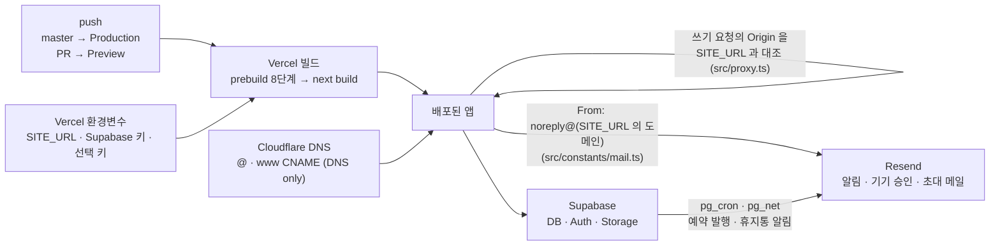

# 배포

[← README](../README.md)

## 배포

Vercel 기준입니다. 실제 배포에서 막혔던 지점을 순서대로 담았습니다.

### 1. Vercel 프로젝트 만들기

1. [Vercel](https://vercel.com) 에서 GitHub 저장소를 Import 합니다.
2. 빌드 설정은 건드리지 않습니다. Next.js 와 npm 은 자동으로 인식되고, `npm run build` 앞에 `prebuild` 가 함께 실행됩니다(아래 표).
3. 아래 환경변수를 넣고 Deploy 합니다.

Production 배포는 저장소 기본 브랜치(`master`) push 로, Preview 배포는 PR 로 만들어집니다.

`build` 는 `next build` 만 실행한다. 그 앞의 `prebuild` 는 아래 여덟 단계를 차례로 돌린다. 하나라도 실패하면 빌드가 멈춘다. 배포된 서버는 저장소 파일을 런타임에 읽지 못하므로, 필요한 값을 빌드 시점에 파일로 굳힌다.

| 순서 | 스크립트 | 하는 일 |
|---|---|---|
| 1 | `scripts/scan-fonts.mjs` | `public/fonts/` 의 폰트 파일 목록을 `src/config/localFonts.generated.ts` 로 만든다 |
| 2 | `scripts/copy-ffmpeg.mjs` | `@ffmpeg/ffmpeg` 의 ESM 파일을 `public/vendor/ffmpeg` 로 복사한다. Turbopack 이 이 패키지의 워커 주소를 해석하지 못해 정적 파일로 둔다 |
| 3 | `scripts/sync-content-assets.ts` | `content/**` 의 이미지 · 영상 · PDF 를 `public/content/**` 로 복사하고, 원본이 사라진 파일을 지운다 |
| 4 | `scripts/gen-about-fallback.ts` | `content/about/**.md` 를 `src/data/generated/aboutContent.ts` 로 굽는다 |
| 5 | `scripts/gen-erd.ts` | `supabase/setup.sql` 에서 About 의 ERD(`src/data/generated/erdSchema.ts`)를 만든다 |
| 6 | `scripts/gen-api-map.ts` | `src/app/api` · `src/app/auth` 의 `route.ts` 에서 API 지도(`src/data/generated/apiMap.ts`)를 만든다 |
| 7 | `scripts/gen-token-sky.ts` | 토큰 CSS 에서 About 디자인 장의 토큰 목록(`src/data/generated/tokenSky.ts`)을 만든다 |
| 8 | `scripts/gen-about-dict.ts` | About 코드의 `{ ko, en }` 글 중 영어 쪽을 모아 번역 원문 목록(`src/data/generated/aboutDict.ts`)을 만든다 |

`npm run dev` 도 1번을 뺀 같은 단계를 먼저 돌린다. 글 · 작업물 동기화(`sync-posts` · `sync-works`)는 빌드에 들어 있지 않다([md-content-guide.md](./md-content-guide.md#2-2-폴더-동기화)).

배포에 관련된 요소는 다음과 같이 이어진다.



### 2. 환경변수

`.env.local` 의 내용을 Environment Variables 의 Key 칸에 그대로 붙여넣으면 키마다 나뉘어 들어갑니다. macOS 파일 선택창은 `.env.local` 같은 숨김 파일을 감추므로, 파일로 불러오려면 선택창에서 `⌘⇧.` 를 눌러 표시합니다.

아래 블록은 [`.env.example`](../.env.example) 의 키를 필수와 선택으로 나눈 것이다. 선택 키는 비워 두면 그 기능만 꺼진다. API 키는 관리자 설정 › 서비스 › 환경 변수에도 저장할 수 있고, 저장된 값이 환경변수보다 먼저 쓰인다.

```
필수 환경변수:
  NEXT_PUBLIC_SUPABASE_URL
  NEXT_PUBLIC_SUPABASE_ANON_KEY
  SUPABASE_SERVICE_ROLE_KEY
  OWNER_EMAIL                  # 사이트 소유자(owner) 계정 이메일. 다중 저자 권한의 기준
  SITE_URL                     # 사이트가 실제로 열리는 주소 (예: https://www.your-domain.com)
                               # proxy 의 CSRF Origin 체크 기준이자 메일 발신 도메인의 출처.
                               # production 에 미설정 시 /api/* 의 mutation 이 모두 403 (fail-closed)

선택 환경변수:
  BLOG_SUBDOMAIN_REDIRECT      # 1 이면 메인 주소의 /posts/* 를 블로그 서브도메인으로 보낸다(DNS · Vercel 도메인 연결 뒤에 켠다)
  ADMIN_EMAIL                  # 문의 · 알림 메일을 받을 주소. 사이트 설정의 연락처 이메일이 있으면 그쪽이 먼저
  NEXT_PUBLIC_WEB3FORMS_KEY    # 문의 폼 — Web3Forms
  NEXT_PUBLIC_FORMSPREE_ID     # 문의 폼 — Formspree
  NEXT_PUBLIC_EMAILJS_SERVICE_ID   # 문의 폼 — EmailJS (아래 셋과 한 벌)
  NEXT_PUBLIC_EMAILJS_TEMPLATE_ID
  NEXT_PUBLIC_EMAILJS_PUBLIC_KEY
  EMAILJS_PRIVATE_KEY          # EmailJS 를 서버(/api/contact)에서 부를 때의 비공개 키
  NEXT_PUBLIC_RECAPTCHA_SITE_KEY   # 문의 폼 reCAPTCHA — 공개 site key
  RECAPTCHA_SECRET_KEY         # 문의 폼 reCAPTCHA — 서버 검증용 비밀 키. reCAPTCHA 를 켰는데 비어 있으면 폼이 보내지지 않는다
  RESEND_API_KEY               # 관리자 알림 · 새 기기 승인 · 댓글 답글 · 작성자 초대 메일
  UNSPLASH_ACCESS_KEY          # Cover Image — Unsplash
  PEXELS_API_KEY               # Cover Image — Pexels (Unsplash 대안)
  HUGGINGFACE_API_KEY          # Cover Image — AI (HuggingFace)
  NANOBANANA_API_KEY           # Cover Image — AI (NanoBanana)
  DEEPL_API_KEY                # 번역 — DeepL
  GOOGLE_TRANSLATE_API_KEY     # 번역 — Google
  GEMINI_API_KEY               # 번역 + AI 요약 — Gemini
  OPENAI_API_KEY               # AI 요약 — OpenAI
  GROQ_API_KEY                 # AI 요약 — Groq(무료 등급, OpenAI 호환)
  ANTHROPIC_API_KEY            # 번역 + AI 요약 — Claude
  FISH_AUDIO_API_KEY           # 슬라이드 음성(TTS) — Fish Audio. 실패하면 Google → Edge(키 없음) 순으로 넘어간다
  GOOGLE_TTS_API_KEY           # 슬라이드 음성(TTS) — Google Cloud TTS
  GITHUB_TOKEN                 # 프로필·홈 GitHub 연동(저장소·조직 저장소·잔디는 GraphQL 이라 인증 필수)
                               # + giscus 저장소 조회. 공개 저장소 읽기 PAT. admin Services 탭 시크릿이 우선.
                               # 조직은 만료 366일 초과 fine-grained 토큰을 거부할 수 있음 — 1년 이하로 발급
  CRON_SECRET                  # 예약 발행 · 휴지통 정리 라우트(/api/cron/*)를 외부에서 부를 때의 비밀 값.
                               # 평소엔 Supabase pg_cron 이 돌아서 비워 둬도 된다
  E2E_ADMIN_EMAIL              # e2e 관리자 테스트(test:smoke:admin · test:api)의 로그인 계정. 로컬 .env.local 에만
  E2E_ADMIN_PASSWORD
```

**`SITE_URL` 은 네 가지를 지킵니다.**

- **실제로 열리는 주소**를 넣습니다. `www` 를 메인으로 쓰는 배포라면 `https://www.example.com` 입니다. 실제 주소와 다르면 `/api/*` 의 저장 · 수정 · 삭제 요청이 전부 403 으로 막힙니다. 화면 보기는 정상이라 겉으로 드러나지 않습니다.
- 끝의 `/` 는 코드가 떼어내므로 붙어 있어도 됩니다.
- **이름에 `NEXT_PUBLIC_` 을 붙이지 않습니다.** 붙이면 브라우저로 나가는 값이 되고, Vercel 은 그런 변수를 Secret 으로 저장하지 못하게 막아 Save 자체가 눌리지 않습니다. 이 값은 서버에서만 씁니다.
- 값을 바꾼 뒤에는 **Redeploy** 합니다.

### 3. 커스텀 도메인 (Cloudflare 기준)

Cloudflare 에서 산 도메인은 네임서버를 옮길 수 없으므로 DNS 레코드로 연결합니다.

1. Vercel → **Settings → Domains** 에서 `example.com` 과 `www.example.com` 을 모두 추가합니다. 한쪽은 Production 에 연결하고 다른 쪽은 그리로 redirect(308) 합니다.
2. Cloudflare → **DNS → Records** 에 Vercel 화면이 보여주는 레코드를 그대로 넣습니다. 프로젝트마다 값이 다릅니다.

| Type | Name | Value | Proxy |
|------|------|-------|-------|
| CNAME | `@` | Vercel 이 보여주는 `xxxx.vercel-dns-0nn.com` | **DNS only (회색 구름)** |
| CNAME | `www` | 같은 값 | **DNS only (회색 구름)** |

- **Proxy 는 반드시 끕니다.** 기본값이 주황(Proxied)인데, 켜져 있으면 인증서 발급이 막히거나 redirect 가 무한 반복됩니다.
- **`@` 와 `www` 를 모두 등록합니다.** 한쪽이 다른 쪽으로 redirect 되는 구조라, 목적지 쪽 레코드가 없으면 사이트 전체가 열리지 않습니다.
- Cloudflare 는 루트(`@`)에 CNAME 을 쓸 수 있습니다. 레코드의 Type 은 편집으로 바꿀 수 없으므로 기존 A 레코드를 지우고 CNAME 으로 새로 만듭니다.
- 예전 값(A `76.76.21.21`, CNAME `cname.vercel-dns.com`)도 동작하지만, Vercel 이 **DNS Change Recommended** 안내를 계속 띄웁니다. 새 값으로 바꾸면 사라집니다.
- `SITE_URL` 은 redirect 되는 쪽이 아니라 **최종 목적지 주소**와 같아야 합니다.

DNS 를 고친 뒤에도 안 열린다면 조회 결과가 캐시에 남은 것입니다. "없는 주소" 라는 응답은 최대 30분 기억됩니다. `sudo dscacheutil -flushcache; sudo killall -HUP mDNSResponder` 로 지우거나, 휴대폰에서 모바일 데이터로 확인합니다.

### 4. 외부 서비스에 도메인 등록

- **Supabase** → Authentication → URL Configuration
  - Site URL: `https://www.example.com`
  - Redirect URLs: `https://www.example.com/auth/callback` (GitHub 로그인이 이 주소로 돌아옵니다)
- **reCAPTCHA** 관리 콘솔의 허용 도메인에 사이트 도메인을 추가합니다.
- 문의 폼 서비스(Formspree 등)에 도메인 제한을 걸어 두었다면 거기에도 추가합니다.

### 5. 메일 (Resend)

도메인 인증 전에는 발신 주소가 Resend 의 임시 주소(`onboarding@resend.dev`)입니다. 이 주소는 **Resend 계정 본인에게만** 발송되므로 댓글 답글 알림과 작성자 초대가 나가지 않고, 본인에게 가는 메일도 스팸으로 분류되기 쉽습니다.

1. Resend → **Domains → Add Domain** 에서 도메인을 추가합니다(지역은 가까운 곳, 한국이면 Tokyo).
2. 화면에 나오는 DNS 레코드를 Cloudflare 에 그대로 넣습니다. 메일 서명(TXT `resend._domainkey`), 발송 허용 목록(TXT `send`), 반송 처리(MX `send`) 입니다. TXT · MX 에는 Proxy 설정이 없습니다.
3. **Verify** 를 눌러 Verified 가 되면 끝입니다. 발신 주소는 코드가 `SITE_URL` 의 도메인에서 만들어 씁니다(`www` 는 뗍니다). 따로 설정할 값은 없습니다.

예약 발행과 휴지통 자동 정리 알림만은 Next.js 가 아니라 **Supabase 가 직접** 보냅니다. Vault 에 세 개가 모두 있어야 발송됩니다.

| Vault secret | 값 | 비고 |
|---|---|---|
| `resend_api_key` | `re_...` | 없으면 메일만 skip, DB 작업은 정상 |
| `admin_email` | 받는 사람 주소 | |
| `notify_from` | 보내는 주소 | **Resend 에서 인증한 도메인**이어야 합니다. Gmail 주소를 넣으면 발송이 거부됩니다 |

값은 SQL Editor 에서도 바꿀 수 있습니다.

```sql
select vault.update_secret(
  (select id from vault.secrets where name = 'notify_from'),
  'Site <noreply@example.com>'
);
```

### 6. 방문 통계

`@vercel/analytics`(방문 수)와 `@vercel/speed-insights`(체감 성능)는 이미 들어 있습니다. Vercel 대시보드의 **Analytics** · **Speed Insights** 탭에서 Enable 만 하면 됩니다. 두 스크립트는 브라우저에서 실행될 때 주입되므로 HTML 소스에는 보이지 않습니다. 광고 차단 확장이 켜져 있으면 본인 방문은 집계되지 않습니다.

Hobby 플랜에서 Web Analytics 는 월 5만 이벤트, Speed Insights 는 최근 30일 1만 이벤트까지 무료입니다. 넘으면 과금되지 않고 수집이 일시 중단됩니다.

### 7. 첫 로그인

처음 보는 기기는 승인 메일을 거쳐야 들어갈 수 있습니다. 로그인은 성공해도 세션이 곧바로 회수되고 승인 링크가 메일로 갑니다.

- 메일이 보이지 않으면 **스팸함**을 확인합니다. 도메인 인증 전에는 특히 스팸으로 갑니다.
- 메일을 끝내 못 찾으면 Supabase **Table Editor → `admin_known_devices`** 에서 해당 행의 `approved` 를 `true` 로 바꾸면 들어갈 수 있습니다.

### 배포 후 점검

- [ ] 사이트가 열리는가 (`@` 와 `www` 양쪽)
- [ ] admin 로그인 후 글이 저장되는가 (403 이면 `SITE_URL` 확인)
- [ ] 문의 폼 전송과 댓글 작성이 되는가 (같은 CSRF 검사를 지납니다)
- [ ] 새 기기 승인 메일이 받은편지함으로 오는가
- [ ] Analytics · Speed Insights 탭에 데이터가 들어오는가

### 자주 막히는 곳

| 증상 | 원인 | 해결 |
|------|------|------|
| 화면은 보이는데 저장 · 댓글 · 문의가 전부 안 됨 | `SITE_URL` 이 없거나 실제 주소와 다름 | 실제로 열리는 주소로 넣고 Redeploy |
| 환경변수 Save 버튼이 눌리지 않음 | 이름에 `NEXT_PUBLIC_` 이 붙어 Secret 으로 저장 불가 | 접두사 없는 이름을 쓰거나 Config 로 저장 |
| 도메인 연결 후 사이트가 안 열림 | `@` 나 `www` 중 한쪽 레코드가 없음 | 두 개 모두 등록 |
| 고쳤는데도 계속 안 열림 | "없는 주소" 응답이 캐시에 남음(최대 30분) | DNS 캐시 비우기 또는 다른 회선에서 확인 |
| Vercel 에 DNS Change Recommended 표시 | 예전 레코드 값을 사용 중 | Vercel 이 보여주는 새 값으로 교체 |
| 로그인이 되지 않음 | 새 기기 승인 대기 | 승인 메일(스팸함 포함) 확인 |
| 예약 발행 알림 메일만 오지 않음 | Vault 의 `notify_from` 이 인증되지 않은 도메인 | 인증된 도메인 주소로 변경 |

### 기타 플랫폼

Next.js 를 지원하는 플랫폼이면 배포할 수 있습니다. 자세한 내용은 [Next.js deployment documentation](https://nextjs.org/docs/app/building-your-application/deploying) 을 참고하세요.

