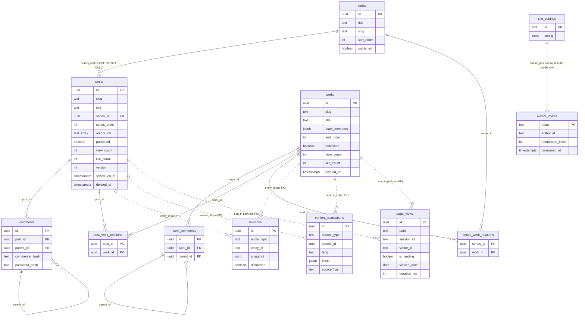

# DB Design Decisions

### Core table relationships

The diagram below draws only the tables around posts, works, and series, out of the 26 tables in [`supabase/setup.sql`](../../supabase/setup.sql). Columns are limited to the relationships and to what this document explains. Solid lines are foreign keys (FK). Dotted lines are logical relationships joined only by value, without an FK.



- Authors have no table of their own. Roles live in `auth.users.app_metadata`, author profiles live in the `profile` row of `site_settings`, and `posts.author_ids` holds those profile ids. Works point to authors through `author_id` inside `team_members`.
- `revisions` · `content_translations` point at both posts and works, so a single FK cannot express them. `page_views` keeps the path (`/posts/<slug>`, `/works/<slug>`) as a string.
- `likes` · `comment_reactions` · `comment_reports` are also polymorphic references that split the target kind by a column value (`target_type` · `comment_type`), so they have no FK. `likes` and `comment_reactions` are explained in their own sections below.

### Unified Likes Table: `likes`

All likes (posts, works, post comments, work comments) are managed in a single `likes` table, distinguished by `target_type`.

> Comment likes have since been replaced in the UI by [emoji reactions](#comment-emoji-reactions-comment_reactions). The unused `/api/comment-likes` route has been removed; only the `post_comment` / `work_comment` values of `target_type` remain in the schema — redefining the CHECK would fail if any rows still carry them, and they're harmless, so they stay without a migration.

**Alternatives considered:**

| Approach | Pros | Cons |
|------|------|------|
| **Single table** (current) | Single Source of Truth, one UNIQUE constraint prevents all duplicates, only need to add a CHECK value for new entities | 4 `target_type` values |
| **Fully separated** (post_likes, work_likes, ...) | Simple queries | Too many tables, schema duplication |
| **2 tables** (likes + comment_likes) | Content/comment separation of concerns | Distributed sync logic, increased table count |

**Rationale:** A single `UNIQUE(target_type, target_id, ip)` constraint prevents duplicates for all entities at the DB level. Comment likes are queried via real-time `COUNT(*)`, and only Posts sync to a `posts.like_count` cache column for list performance. With indexes applied, there is no performance difference up to thousands of records, so consistency and simplicity take priority.

### Denormalized Count Caching: `posts.like_count`

The `likes` table is the **source of truth** for likes, and `posts.like_count` is a **cache column** for list query performance.

| Entity | Count Method | Rationale |
|--------|------------|------|
| **Posts** | `posts.like_count` cache column sync | Instant display in lists without JOIN |
| **Works / Comments** | Real-time `COUNT(*)` query | Count not needed in lists, only queried on detail pages |

**Rationale:** A portfolio site has a read >> write ratio. Only Posts display like counts in lists, so a cache column is needed; the rest are fine with real-time queries.

### Editor Revision History: `revisions`

A polymorphic table that permanently stores the entire form as a JSONB snapshot on each auto-save of the Posts/Works editor.

**Alternatives considered:**

| Approach | Pros | Cons |
|------|------|------|
| **Separate DB table** (current) | Persistent across devices, tabs, and sessions; automatic cleanup per entity; diff comparison possible | DB write on each auto-save |
| **sessionStorage** (previous) | Instant access, no DB load | Lost when tab closes, no cross-device sharing |

**Rationale:** Since only one admin uses this, DB write costs are negligible. Cross-device/tab/session revision sharing and diff-based detailed comparison are more important. A `entity_type` CHECK column distinguishes posts/works in a single table, and snapshots are excluded from list queries for lightweight loading. JSON.stringify hash comparison prevents duplicate snapshot storage, and the detail view displays diffs for metadata items like categories, tags, and series.

`entity_id` is **text**, not uuid. A pre-save new post has no `posts.id` yet, so it uses a draft sentinel string (e.g. `"draft-new-post"`) as the `entity_id` — when it was uuid, new-post autosave all 500'd, which was fixed by changing the column to text.

**Auto-save interval decision:** Initially implemented with a 5-second debounce, but comparing against Google Docs (OT/diff), Notion (immediate save but server receives patches), and WordPress (60 seconds) revealed that **5 seconds is too frequent for a full-snapshot approach** — revisions accumulated meaninglessly. A diff-based approach was considered but rejected: no benefit over the complexity for a single-user environment with a 50-revision cap (~2.5MB). Now uses a **3-second debounce + forced save on page leave**. Server revisions are **append-only** and are only excluded from restore candidates via a **dismissed flag**, so frequent saves don't pile up as meaningless revisions. Leave-save is handled via two paths: browser close/refresh uses `navigator.sendBeacon` (async-safe), and Next.js SPA navigation uses `fetch({ keepalive: true })` in the component unmount cleanup.

Server (cross-device) auto-restore is **currently disabled**, using only localStorage (same-device) restore — because past saves of an existing post don't bump `updated_at`, so on load a stale revision could roll the latest content back to an old version.

### Anonymous Comment Dual Authentication

In a login-free comment system, edit/delete permissions are verified through **2 paths**.

| Auth Path | Storage | Persistence | Purpose |
|-----------|----------|--------|------|
| `commenter_hash` | Browser localStorage UUID -> SHA-256 | Permanent on same browser | Auto authentication (no password input needed) |
| `password_hash` | bcrypt (salt round 10) | As long as user remembers | Authentication from different device/browser |

**Why both are needed:** With only `commenter_hash`, editing is impossible when changing browsers. With only `password`, input is required every time. Using both provides auto authentication on the same browser and password fallback in other environments, securing both UX and security.

### Comment System Features

| Feature | Description |
|------|------|
| **Nickname Shuffle** | Random emoji+name combination, changeable via shuffle button |
| **Reply Email Notification** | Enter email (optional) when commenting to receive reply notifications (`notify_email` column) |
| **Admin Comments** | Post comments with Admin badge without password when logged in, server-side Supabase Auth re-verification |
| **Markdown Body** | `marked` (gfm + breaks) → `isomorphic-dompurify` sanitize with tag/attribute allowlists |
| **Emoji Reactions** | Fixed giscus-style set of 8 (`comment_reactions` below) |

### Comment Emoji Reactions: `comment_reactions`

A table that replaces the single comment "like" with a fixed giscus-style set of 8 emoji reactions (👍 👎 😄 🎉 😕 ❤️ 🚀 👀 — `REACTION_EMOJIS` in `src/utils/commentReactions.ts`).

| Column | Description |
|------|------|
| `id` | uuid PK |
| `comment_id` | uuid NOT NULL, **no FK** — polymorphic reference to either `comments` or `work_comments` depending on `comment_type` |
| `comment_type` | text CHECK (`post` / `work`) |
| `emoji` | text — one of the fixed 8 (server-validated via `isReactionEmoji`) |
| `reactor_hash` | text DEFAULT `''` — reactor identifier (below) |
| `created_at` | timestamptz |

**Alternatives considered:**

| Approach | Pros | Cons |
|------|------|------|
| **Dedicated table** (current) | Emoji axis is explicit in the schema, tallying is simple | One more table conceptually overlapping `likes` |
| **Reuse `likes`** (`target_type='post_comment'` + emoji column) | No new table | `UNIQUE(target_type, target_id, ip)` knows nothing about the emoji axis — one person could not leave several emojis. Redesigning the constraint erases the benefit of "reuse" |

**Rationale:** A like is 2-axis `(target, person)` while a reaction is 3-axis `(target, person, emoji)`, so the axes do not line up with the `likes` UNIQUE constraint. A separate table expresses the toggle unit exactly, via a 4-column unique.

Duplicate prevention is a **unique index**, not a table constraint: `idx_comment_reactions_unique(comment_id, comment_type, emoji, reactor_hash)` — so `ON CONFLICT` needs the 4-column inference list, and there is no named constraint to target. A separate `(comment_id, comment_type)` index serves lookups.

`comment_id` has no FK because the referenced table branches on `comment_type` — a polymorphic reference a single FK cannot express. There is therefore no ON DELETE CASCADE, and reaction rows survive a hard-deleted comment (they are never surfaced, since reads are keyed by the `comment_ids` the client already holds).

**Reactor identification (`reactor_hash`):** Same intent as the IP-based likes, but the raw IP is never stored — only the first 32 chars of `sha256(IP + ":" + UA)`. Adding the UA makes users behind a shared IP (office, cafe) less likely to overwrite each other than IP alone, and the stored value is not itself personally identifying. Since reactions are login-free, the goal is **everyday duplicate prevention**, not perfect identification.

RLS is public read (`FOR SELECT USING (true)`) + service_role writes. Tallying and toggling go through the admin client.

### Poll Block Tally: `poll_votes`

A table that tallies responses to the content editor's poll block. The poll's **structure (question, options) has no separate table** — it lives inside the editor block's saved HTML/JSON.

| Column | Description |
|------|------|
| `id` | uuid PK |
| `poll_id` | Fixed text id the editor assigns on block creation (saved HTML `data-poll-id`) |
| `option_id` | Fixed option text id (`data-option-id`) |
| `ip` | Voter IP (DEFAULT `''`), for duplicate prevention |
| `created_at` | timestamptz |

**Alternatives considered:**

| Approach | Pros | Cons |
|------|------|------|
| **Single tally table** (current) | Poll structure stored alongside editor content, simple schema | poll_id/option_id are text, not FKs |
| **Normalized `polls` + `poll_options`** | Referential integrity | Needs separate-table sync on every content save, more tables |

**Rationale:** A poll block's question and options are part of the post content, so they are stored inside the post HTML, and `poll_votes` handles **pure tallying** only. Hence `poll_id` / `option_id` are editor-assigned text ids rather than FKs. `UNIQUE(poll_id, option_id, ip)` blocks duplicate votes from the same IP on the same option at the DB level, and a `poll_id` index optimizes tally queries. For single-select polls the API deletes and re-inserts the `(poll_id, ip)` rows to replace the choice; multi-select toggles per option (insert/delete). RLS is public SELECT + service_role ALL (tally/vote handled by the admin client).

### Series ↔ Project Linking: `series_work_relations`

A many-to-many table linking related series onto a project (work), following the same pattern as the existing `post_work_relations`.

| Column | Description |
|------|------|
| `series_id` | uuid FK → `series(id)` ON DELETE CASCADE |
| `work_id` | uuid FK → `works(id)` ON DELETE CASCADE |
| `created_at` | timestamptz |

The PRIMARY KEY is the composite `(series_id, work_id)`, with an index on each of `series_id` / `work_id`. RLS is public SELECT + service_role ALL.

**Rationale:** Since posts↔works bidirectional linking (`post_work_relations`) is an already-proven many-to-many pattern, series↔project linking reuses the same structure for consistency. ON DELETE CASCADE on both FKs auto-cleans relation rows when a series or work is deleted, and the composite PK blocks duplicate links of the same pair.

### Linked Storage for Calendar Blocks: `calendars`

The shared-calendar table referenced by the editor's calendar block. The block holds only a `calendarId`; the actual event data lives here.

| Column | Description |
|------|------|
| `id` | uuid PK |
| `title` | text NOT NULL DEFAULT `''` |
| `data` | jsonb NOT NULL DEFAULT `'{}'` — the whole calendar state (month, events, …) |
| `created_at` / `updated_at` | timestamptz |
| `deleted_at` | timestamptz — soft delete |
| `purge_after` | timestamptz — trash TTL (30 days) |

**Alternatives considered:**

| Approach | Pros | Cons |
|------|------|------|
| **Linked storage** (current) | Multiple posts share one calendar, one edit updates all of them, manageable from admin | One extra fetch to render the block; the calendar outlives a deleted post |
| **Embedded in the block** (the poll-block approach) | No fetch, lifetime tied to the post | Putting the same calendar in several posts forks the copies |

**Rationale:** A poll is "this post's poll", so embedding it in the content is right — but a calendar is the kind of thing **several posts reference as the same schedule**, and forked copies become wrong answers immediately. So calendars took the opposite choice from polls. Because their lifetime is decoupled from posts, they get the same soft delete + `purge_after` trash as posts/works, and `/api/cron/purge-trash` hard-deletes calendars with `purge_after < NOW()` alongside posts and works.

The index is `calendars_purge_after_idx (purge_after) WHERE deleted_at IS NOT NULL` — a partial index holding only trashed rows, the same pattern as posts/works. RLS is public read + service_role writes (calendar blocks are read on public posts, but editing is admin-only).

### Custom Emojis: `custom_emojis`

A record of custom image icons uploaded through the EmojiPicker. The value format is `img:<url>`.

| Column | Description |
|------|------|
| `id` | uuid PK |
| `name` | text NOT NULL DEFAULT `''` (sliced to 120 chars server-side) |
| `src` | text NOT NULL — uploaded image URL |
| `created_at` | timestamptz |

**Rationale:** These previously lived only in `localStorage`, so uploaded emojis vanished on a different device or browser. Moving them to the DB makes them shared across devices, while `localStorage` remains as an **offline cache and first-paint source**. Opening the picker fetches the server list, but a failure (logged out, offline) keeps the local cache rather than clearing it. Entries present locally but missing server-side are back-filled via POST and merged with dedup by `src` — replacing wholesale with the server list would leave those entries undeletable whenever the back-fill failed.

RLS has **only one policy**, `FOR ALL` for service_role, with no public read policy (admin-only; anon reads return zero rows). Reads use a `created_at DESC` index with `limit(200)`.

> **Note:** This table exists only in `supabase/setup.sql` — there is no corresponding file in `supabase/migrations/`. A DB provisioned by applying migrations alone will not have it.

### Optimistic Concurrency Control for Posts: `posts.version`

Prevents a later save from silently overwriting an earlier one (lost update) when the same post is edited from multiple tabs or devices.

| Approach | Pros | Cons |
|------|------|------|
| **Optimistic locking** (current — `version` column) | No locks, asks the user only at the moment of failure, one column | The user has to resolve the conflict |
| **Pessimistic locking** (row lock while editing) | No conflicts at all | Lock release problems on a force-closed tab, overkill for a single admin |
| **CRDT / OT real-time merge** | True concurrent editing | Requires redesigning the whole editor, no benefit for a single author |

**Rationale:** With a single author, real conflicts are mostly "I left it open in two tabs." Real-time merge is overkill at that frequency, but a silent overwrite is data loss. The load-time version is sent as `baseVersion`, and the server updates via `UPDATE ... WHERE id = ? AND version = baseVersion` — zero rows means someone saved in between, so it returns `409 { error: "version_conflict", currentVersion }` and `SaveConflictDialog` offers three choices: **cancel / load latest / overwrite**.

As a complement, `usePostPresence` detects other sessions over a Supabase Realtime presence channel (`post-edit:{postId}`) and shows a non-blocking warning banner **before** a save is attempted. Presence uses only Realtime channel state — no DB table, so it has no schema impact.

### Other Column Additions

| Column | Type | Purpose |
|------|------|------|
| `posts.cover_position` | `real NOT NULL DEFAULT 50` | Vertical focal point (%) of the cover image — persists the position dragged in the editor |
| `posts.cover_zoom` | `real NOT NULL DEFAULT 1` | Cover image zoom factor |
| `posts.icon` | `text NOT NULL DEFAULT ''` | Post icon (EmojiPicker value — native / `img:url` / `icon:id`) |
| `posts.author_ids` | `text[] NOT NULL DEFAULT '{}'` | Per-post author linkage — an array of member profile ids (members/roles are managed via Supabase `app_metadata` + `author_invites`; see below) |
| `works.icon` | `text NOT NULL DEFAULT ''` | Mirror of `posts.icon` |
| `works.title_en` | `text NOT NULL DEFAULT ''` | Work title in English (`title` = Korean/primary; falls back to the other side when empty) |

`cover_position` is meant to be 0–100 and `cover_zoom` 1–2.5, but these are **ranges in comments, not CHECK constraints** (the editor UI does the validating).

Why `author_ids` isn't normalized into an `authors` table plus a join table: author (member) identity and permissions already live in Supabase Auth — roles in `auth.users.app_metadata`, invites in the `author_invites` table (no longer the static `authors[]` in `site.config.ts`). `posts.author_ids` is just a thin id array linking those members to a post, so there's no query demand that justifies a join on every post read, and a `text[]` is enough for list rendering. The editor auto-assigns the logged-in user as an `author_ids` entry on a new post, and co-authors can be added.

> The list card layout (`magazine` / `grid` / `list` / `compact` / `masonry` / `featured`) is **a site setting, not a DB column** — `siteConfig.posts.layout`, applied site-wide rather than per post.

### Author invites + roles: `app_metadata` / `author_invites`

Members (owner/editor/author) and their permissions are **delegated to Supabase Auth** instead of a dedicated `members` table.

| Store | What | Why |
|--------|------|------|
| `auth.users.app_metadata` | Role (`owner` / `editor` / `author`) + `permission_level` (editor 2 / author 1) | **service_role-writable only** — putting it in the self-editable `user_metadata` would allow privilege escalation |
| `author_invites` table | Invite queue (`email` PK, `author_id` text — references the profile id in site_settings.profile, `permission_level` int, `invited_by` text, `created_at`, `consumed_at`) | An invite may not have an account yet, so it can't be a user row — the email is reserved ahead of time as the PK. RLS is service_role-only |

- **Email is the PK**: at OAuth login the invite is looked up by the authenticated email to grant the role, so the email is the natural key.
- **`consumed_at`**: when the invite was consumed — filled in once login grants the role, preventing reuse and distinguishing pending vs. completed invites.
- **Owner is bootstrapped from env, then pinned in the DB (claim-and-close)**: the owner isn't in the invite table but is set via the `OWNER_EMAIL` env var — sidestepping the chicken-and-egg problem of "who invites the first owner." On the owner's first login, `app_metadata.role="owner"` is persisted once at that point, so ownership survives even if `OWNER_EMAIL` later changes or is removed.
- **Authorization is enforced at `/auth/callback`**: since OAuth only authenticates, the email must be `OWNER_EMAIL`, already have a role, or be in `author_invites` to pass — otherwise the account is deleted. When `OWNER_EMAIL` is unset the owner can't be resolved, so the account is kept and only a config error is shown (prevents deleting the owner during initial deployment).

### Title Length CHECK Constraints

| Constraint | Target | Limit | Note |
|------|------|------|------|
| `series_title_maxlen` / `series_title_en_maxlen` | `series.title` / `title_en` | 80 chars | `NOT VALID` — existing rows are not checked |
| `posts_title_len` / `posts_title_en_len` | `posts.title` / `title_en` | 120 chars | The migration validates immediately (fails if existing rows are too long); `setup.sql` uses `NOT VALID` |

**Rationale:** The server code validates too (`SERIES_TITLE_MAX = 80`), but the API is reachable through several paths (editor, `.md` sync, manual SQL), so the DB constraint is the last line of defense. The series constraints are `NOT VALID` so that only new and modified rows are checked, since data was already deployed.

> **Note:** `posts_title_len` / `posts_title_en_len` exist in both `2026_07_13_posts_title_len.sql` and `setup.sql`. The migration checks existing rows right away. `setup.sql` adds them as `NOT VALID`, so only newly written or modified rows are checked.

### Former About ERD config validation: about_erd_valid

The admin About Studio and its ERD editor are gone. The About page's ERD draws `src/data/generated/erdSchema.ts`, which `scripts/gen-erd.ts` builds from `supabase/setup.sql` before each build. The page does not read `about.erdTables` / `about.erdRelations` in `site_settings.config`.

Two layers of validation remain. They guard against old stored values and against anyone writing to that path again.

| Layer | Location | Role |
|------|------|------|
| API | `checkAboutErd` (`src/lib/api/validateAboutErd.ts`) | Checked in `/api/admin/settings` PATCH. Returns 400 on violation |
| DB | `about_erd_valid(cfg jsonb)` + `site_settings_about_erd_valid` CHECK | The last line of defense for writes that skip the API |

The rules are: table name required and unique, at least one column per table, column name and type required. A save without `erdTables` passes as is. The function is `IMMUTABLE` and the constraint is added `NOT VALID`, so existing rows are not checked. The migration file is `2026_07_21_about_erd_valid.sql`, and it is also included in `setup.sql`.

### Site settings required-value validation: settings_required_valid

Admin settings (General·Appearance·Services tabs) contain required values that break the site render or a feature if left blank. Previously only the global "Save" button had partial validation, and **the per-section Save buttons bypassed it** — so the site title, theme colors, etc. could be saved empty. So we guard it with **UI · API · DB three-layer validation**.

| Layer | Location | Role |
|-------|----------|------|
| UI | `validationError` (`settings/page.tsx`) + `SectionHeader` save guard | Empty value disables both global and per-section Save buttons + shows the reason |
| API | `checkRequiredSettings` (`src/lib/api/validateRequiredSettings.ts`) | Checked in `/api/admin/settings` PATCH — returns 400 on violation |
| DB | `settings_required_valid(cfg jsonb)` + `site_settings_required_valid` CHECK | Last line of defense when even the API is bypassed (manual SQL, etc.) |

**Validation rules** (identical across the three layers):
- **Site title** (`metadata.title`) · **name** (`personal.name`) · **five theme colors** (`theme.accentColor`/`lightBg`/`lightText`/`darkBg`/`darkText`) — cannot be empty
- **Email** (`contact.email`) — must be well-formed if provided (empty is allowed)
- When the comment provider is `giscus`, `repo`·`repoId`·`category`·`categoryId` are required
- Each **member** (`authors`) item's name is required

**Implementation notes:**
- Like `about_erd_valid`, it unwraps the `{ delta, savedDefaults }` wrapper of `config`. Fields whose default is non-empty (title/name/theme colors) are flagged only when "present in the delta AND blank" — a save that didn't touch them just passes. giscus fields default to `""`, so they are checked by effective value when the provider is `giscus`.
- The function is `IMMUTABLE` and the constraint is added `NOT VALID` (existing rows unchecked). It is also in `setup.sql`, so a DB set up from scratch enforces it identically. Migration file: `2026_08_02_settings_required.sql`.


### Work Popularity Signals: `works.is_pinned` / `view_count` / `like_count`

To sort the home Selected Works as "pinned → popular → newest", the signals that only posts had were added to works in the same shape (`2026_09_15_works_pinned_views_likes.sql`). The popularity score uses the same `lib/popularity.ts` as posts (`view_count + like_count*3 + comments*5`). View counts are raised by the `page_views` recording function below.

### One view log: `page_views`

Visits (`site_visits`), post views (`post_views`), and work views (`work_views`) used to pile up in three separate tables. The 2026-10-14 to 10-17 migrations moved them into a single `page_views` table and dropped the old tables and view functions (`2026_10_17_drop_legacy_views.sql`). Migrated rows keep their origin in `migrated_from`.

Every time a page is shown, the `record_page_view(path, ip, session, visitor, meta)` RPC writes one row.

- The same IP and path count once per 30 minutes. `pg_advisory_xact_lock` serializes concurrent requests so they do not both create a row.
- Visits (sessions) are told apart by `session_id`, visitors by `visitor_id`. The first view of a session has `is_landing = true`, and only that row carries the referrer, device, country, and UTM.
- If the path is `/posts/<slug>` or `/works/<slug>` and the client is not a bot, that post's or work's `view_count` goes up by 1.
- Time on page is added by `record_page_duration`. It only accepts values sent by the same IP within a day.
- Bots are stored with `device_kind = 'bot'` and left out by the aggregate functions (`daily_page_views` · `page_view_totals` · `page_view_stats`).
- IPs are cleared after 90 days (`anonymize_old_site_visits`, pg_cron). IPs the operator excluded (`traffic_excluded_ips`) are not recorded.

RLS is on with no policies, and anon · authenticated privileges are revoked. All reads and writes go through the server with service_role.

### Translation cache for other languages: `content_translations`

The ko · en text of posts and works lives in their own columns (`title_en`, `content_en`, etc.). Translations made for any other language are stored here, one row each.

| Column | Description |
|------|------|
| `source_type` | What is translated: `post` · `work` bodies, short list-card fields (`post_meta` · `work_meta` · `series_meta`), labels inside bodies (`ui`), visitor-facing UI text (`site_ui`), and more |
| `source_id` | The source id. It points at both posts and works, so there is no FK. Sources that exist only once, such as `ui` · `site_ui`, use a fixed value |
| `lang` | Target language |
| `fields` | Translated fields (JSONB) |
| `source_hash` | Hash of the source text used for the translation |

`UNIQUE (source_type, source_id, lang)` keeps one row per source and language. On a request, the hash of the current source is compared with `source_hash`, and a mismatch triggers a new translation that overwrites the row. Editing the source needs no separate cleanup. RLS is on with no policies, and the public APIs (`/api/content-translate` and others) read and write it on the server.

### Per-slide Audio for Galleries: `works.gallery_notes`

Galleries only held a list of image URLs (`gallery text[]`). To attach a script and audio to each slide, a `jsonb` keyed by image URL was added (`2026_09_21_works_gallery_notes.sql`). Because the key is the URL rather than an array index, reordering or deleting a slide never shifts audio onto the wrong one.

```json
{ "<image url>": { "script": "narration script", "audio": "audio file url",
                   "audioSource": "tts | recorded", "audioScript": "script the audio was generated from" } }
```
