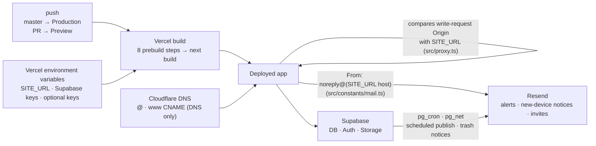

# Deployment

[← README](../../README.en.md)

## Deployment

Written for Vercel, in the order the steps actually bite.

### 1. Create the Vercel project

1. Import the GitHub repo on [Vercel](https://vercel.com).
2. Leave the build settings alone. Next.js and npm are detected automatically, and `prebuild` runs ahead of `npm run build` (table below).
3. Add the environment variables below, then deploy.

Production deploys come from pushes to the repo's default branch (`master`); pull requests get Preview deployments.

`build` runs only `next build`. The `prebuild` before it runs the eight steps below in order, and any failure stops the build. A deployed server cannot read repository files at runtime, so the values it needs are frozen into files at build time.

| Order | Script | What it does |
|---|---|---|
| 1 | `scripts/scan-fonts.mjs` | Writes the font files in `public/fonts/` to `src/config/localFonts.generated.ts` |
| 2 | `scripts/copy-ffmpeg.mjs` | Copies the ESM files of `@ffmpeg/ffmpeg` to `public/vendor/ffmpeg`. Turbopack cannot resolve this package's worker URL, so it is served as static files |
| 3 | `scripts/sync-content-assets.ts` | Copies images, videos, and PDFs under `content/**` to `public/content/**` and removes files whose source is gone |
| 4 | `scripts/gen-about-fallback.ts` | Bakes `content/about/**.md` into `src/data/generated/aboutContent.ts` |
| 5 | `scripts/gen-erd.ts` | Builds the About ERD (`src/data/generated/erdSchema.ts`) from `supabase/setup.sql` |
| 6 | `scripts/gen-api-map.ts` | Builds the API map (`src/data/generated/apiMap.ts`) from the `route.ts` files under `src/app/api` · `src/app/auth` |
| 7 | `scripts/gen-token-sky.ts` | Builds the token list for the About design chapter (`src/data/generated/tokenSky.ts`) from the token CSS |
| 8 | `scripts/gen-about-dict.ts` | Collects the English side of the `{ ko, en }` strings in the About code into a translation source list (`src/data/generated/aboutDict.ts`) |

`npm run dev` runs the same steps except step 1 first. Post and work sync (`sync-posts` · `sync-works`) is not part of the build (see [md-content-guide.md](../md-content-guide.md#2-2-폴더-동기화), Korean only).

The pieces involved in a deployment connect like this.



### 2. Environment variables

Paste the contents of `.env.local` straight into the Key field and Vercel splits it into one row per key. macOS hides dotfiles in the file picker, so press `⌘⇧.` there if you want to import the file itself.

The block below splits the keys in [`.env.example`](../../.env.example) into required and optional. Leaving an optional key empty turns off only that feature. API keys can also be stored in admin Settings › Services › Environment variables, and a stored value wins over the environment variable.

```
Required:
  NEXT_PUBLIC_SUPABASE_URL
  NEXT_PUBLIC_SUPABASE_ANON_KEY
  SUPABASE_SERVICE_ROLE_KEY
  OWNER_EMAIL                  # Site owner account. The baseline for multi-author permissions
  SITE_URL                     # The address the site actually serves (e.g. https://www.your-domain.com)
                               # Basis for the proxy's CSRF Origin check and for the mail sender domain.
                               # Missing in production → every /api/* mutation is 403 (fail-closed)

Optional:
  BLOG_SUBDOMAIN_REDIRECT      # 1 sends /posts/* on the main host to the blog subdomain (turn on after DNS · Vercel domain setup)
  ADMIN_EMAIL                  # Where contact and alert mail goes. The contact email in site settings wins if set
  NEXT_PUBLIC_WEB3FORMS_KEY    # Contact form — Web3Forms
  NEXT_PUBLIC_FORMSPREE_ID     # Contact form — Formspree
  NEXT_PUBLIC_EMAILJS_SERVICE_ID   # Contact form — EmailJS (one set with the three below)
  NEXT_PUBLIC_EMAILJS_TEMPLATE_ID
  NEXT_PUBLIC_EMAILJS_PUBLIC_KEY
  EMAILJS_PRIVATE_KEY          # Private key for calling EmailJS from the server (/api/contact)
  NEXT_PUBLIC_RECAPTCHA_SITE_KEY   # Contact form reCAPTCHA — public site key
  RECAPTCHA_SECRET_KEY         # Contact form reCAPTCHA — server-side secret. With reCAPTCHA on and this empty, the form will not send
  RESEND_API_KEY               # Admin alerts, new-device notices, comment replies, author invites
  UNSPLASH_ACCESS_KEY          # Cover Image — Unsplash
  PEXELS_API_KEY               # Cover Image — Pexels (Unsplash fallback)
  HUGGINGFACE_API_KEY          # Cover Image — AI (HuggingFace)
  NANOBANANA_API_KEY           # Cover Image — AI (NanoBanana)
  DEEPL_API_KEY                # Translation — DeepL
  GOOGLE_TRANSLATE_API_KEY     # Translation — Google
  GEMINI_API_KEY               # Translation + AI Summary — Gemini
  OPENAI_API_KEY               # AI Summary — OpenAI
  GROQ_API_KEY                 # AI Summary — Groq (free tier, OpenAI compatible)
  ANTHROPIC_API_KEY            # Translation + AI Summary — Claude
  FISH_AUDIO_API_KEY           # Slide speech (TTS) — Fish Audio. On failure it falls back to Google → Edge (no key)
  GOOGLE_TTS_API_KEY           # Slide speech (TTS) — Google Cloud TTS
  GITHUB_TOKEN                 # Profile/home GitHub integration (repos, org repos; the contribution
                               # graph is GraphQL and needs auth) + giscus repo lookup. Public-repo read
                               # PAT; the admin Services tab secret takes priority. Orgs may reject
                               # fine-grained tokens with a lifetime over 366 days — issue under 1 year
  CRON_SECRET                  # Secret for calling the scheduled publish · trash purge routes (/api/cron/*) from outside.
                               # Supabase pg_cron runs them normally, so it can stay empty
  E2E_ADMIN_EMAIL              # Sign-in account for the e2e admin tests (test:smoke:admin · test:api). Local .env.local only
  E2E_ADMIN_PASSWORD
```

**Four rules for `SITE_URL`.**

- Use **the address the site actually serves**. If `www` is the primary host, that is `https://www.example.com`. A mismatch makes every create, update and delete request under `/api/*` return 403. Reading pages still works, so nothing looks broken.
- A trailing `/` is fine; the code strips it back to the origin.
- **Do not prefix it with `NEXT_PUBLIC_`.** That prefix ships the value to the browser, and Vercel refuses to store such a variable as a secret, which disables the Save button. This value is read on the server only.
- **Redeploy** after changing it.

### 3. Custom domain (Cloudflare)

A domain bought at Cloudflare cannot move its nameservers, so connect it with DNS records.

1. On Vercel, go to **Settings → Domains** and add both `example.com` and `www.example.com`. Attach one to Production and redirect the other to it (308).
2. In Cloudflare, go to **DNS → Records** and enter exactly what the Vercel screen shows. The value is per project.

| Type | Name | Value | Proxy |
|------|------|-------|-------|
| CNAME | `@` | the `xxxx.vercel-dns-0nn.com` value Vercel shows | **DNS only (grey cloud)** |
| CNAME | `www` | same value | **DNS only (grey cloud)** |

- **Turn the proxy off.** It defaults to orange (Proxied), which blocks certificate issuance or sends the site into a redirect loop.
- **Add both `@` and `www`.** One redirects to the other, so a missing record on the destination side takes the whole site down.
- Cloudflare allows a CNAME at the root. A record's Type cannot be edited, so delete the old A record and create the CNAME fresh.
- The legacy values (A `76.76.21.21`, CNAME `cname.vercel-dns.com`) still work, but Vercel keeps showing **DNS Change Recommended** until you switch to the new ones.
- `SITE_URL` must match the **destination** host, not the one that redirects away.

If the site still fails after fixing DNS, a stale lookup is cached. A "no such host" answer is remembered for up to 30 minutes: clear it with `sudo dscacheutil -flushcache; sudo killall -HUP mDNSResponder`, or check from a phone on mobile data.

### 4. Register the domain with external services

- **Supabase** → Authentication → URL Configuration
  - Site URL: `https://www.example.com`
  - Redirect URLs: `https://www.example.com/auth/callback` (GitHub sign-in returns here)
- **reCAPTCHA**: add the domain to the allowed list in the admin console.
- Contact-form services (Formspree and friends): add it there too if you restricted domains.

### 5. Mail (Resend)

Before domain verification the sender is Resend's temporary address (`onboarding@resend.dev`), which only delivers **to the Resend account owner**. Comment-reply notifications and author invites never arrive, and even your own mail lands in spam easily.

1. Resend → **Domains → Add Domain** (pick a nearby region).
2. Add the DNS records it shows to Cloudflare as-is: DKIM (TXT `resend._domainkey`), SPF (TXT `send`), bounce handling (MX `send`). TXT and MX records have no proxy setting.
3. Hit **Verify**. Once it reads Verified you are done — the sender address is derived in code from the `SITE_URL` host (with `www` stripped), so there is nothing else to configure.

Scheduled publishing and trash purge notices are the exception: **Supabase sends those itself**, and all three Vault secrets must be present.

| Vault secret | Value | Notes |
|---|---|---|
| `resend_api_key` | `re_...` | Missing → only the email is skipped, DB work still runs |
| `admin_email` | Recipient address | |
| `notify_from` | Sender address | Must be **a domain verified in Resend**. A Gmail address gets rejected |

You can also change it from the SQL Editor:

```sql
select vault.update_secret(
  (select id from vault.secrets where name = 'notify_from'),
  'Site <noreply@example.com>'
);
```

### 6. Visitor metrics

`@vercel/analytics` (visits) and `@vercel/speed-insights` (field performance) are already installed. Just press Enable on the **Analytics** and **Speed Insights** tabs of the Vercel dashboard. Both scripts are injected at runtime, so they never appear in the HTML source, and an ad blocker will hide your own visits.

On Hobby, Web Analytics is free up to 50,000 events per month and Speed Insights up to 10,000 events over 30 days. Going over pauses collection instead of charging you.

### 7. First sign-in

Admin pages only open for a session that passed two-factor authentication (authenticator app). After signing in you land on `/admin/mfa`, enroll an authenticator via QR code and enter the 6-digit code. Registering two (phone + password manager) is recommended. Supabase TOTP MFA is free on every plan and enabled by default.

- An unrecognized device is not blocked; it only gets a notice mail. If the mail is nowhere to be seen, **check the spam folder**.
- When deploying onto an existing DB, keep the order: deploy the code → every admin account enrolls at `/admin/mfa` → run `supabase/migrations/2026_10_22_rls_require_aal2.sql` in the SQL Editor ([supabase-setup.md](./supabase-setup.md#2-create-database-tables)).
- If every authenticator is lost, run `delete from auth.mfa_factors where user_id = '<user id>';` in the SQL Editor, then sign in and enroll again.

### Post-deploy checks

- [ ] The site loads on both `@` and `www`
- [ ] A post saves after signing in to admin (403 → check `SITE_URL`)
- [ ] The contact form and comments submit (same CSRF check)
- [ ] After sign-in, enrolling and verifying an authenticator at `/admin/mfa` works
- [ ] The new-device notice mail reaches the inbox
- [ ] Data shows up on the Analytics and Speed Insights tabs

### Common dead ends

| Symptom | Cause | Fix |
|---------|-------|-----|
| Pages render, but saving, comments and the contact form all fail | `SITE_URL` missing or not the served address | Set the real address, then redeploy |
| The environment variable Save button does nothing | `NEXT_PUBLIC_` prefix cannot be stored as a secret | Drop the prefix, or store it as Config |
| Site unreachable after connecting the domain | Only one of `@` / `www` has a record | Add both |
| Still unreachable after fixing it | The "no such host" answer is cached (up to 30 min) | Flush DNS, or check from another network |
| Vercel shows DNS Change Recommended | Legacy record values | Swap in the values Vercel shows |
| Keeps returning to `/admin/mfa` after sign-in | Two-factor step not done yet (aal1 session) | Enter the authenticator's 6-digit code. If the app is lost, see the recovery step in section 7 |
| Only the scheduled-publish mail is missing | Vault `notify_from` is an unverified domain | Point it at the verified domain |

### Other Platforms

Any platform that supports Next.js works. See the [Next.js deployment documentation](https://nextjs.org/docs/app/building-your-application/deploying) for details.
