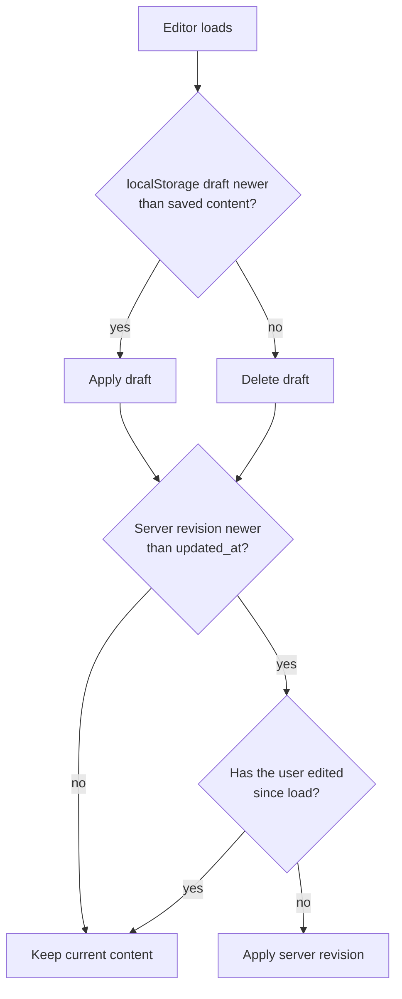

# Trouble Shooting: Architecture · Data

[← Index](../troubleshooting.md)

<strong>11. React reconciliation: changing a component's type in place remounts the subtree</strong>

**Symptom**: The first click on a page, such as the first language switch, brought the loading screen back. From the second click on, everything behaved normally.

**Cause**: At the time, `RecaptchaProvider` flipped `shouldLoad` from `false` to `true` on the first click event, and the render tree changed from `<>{children}</>` to `<GoogleReCaptchaProvider>{children}</GoogleReCaptchaProvider>`. When the component type at the same position changes, React unmounts the whole subtree and mounts it again. The loading screen hook's state was recreated with its initial value (loading), so the loading screen reappeared.

**Fix**: The first fix recorded load completion in a module-level variable, `hasCompletedInitialLoad`, so a remount skipped the loading screen. That variable still exists in `src/hooks/useLoadingProgress.ts`.

The root fix removed the cause of the tree change. The current `RecaptchaProvider` never wraps conditionally. It always renders children inside the same Context Provider. The reCAPTCHA script is loaded by `load()`, which inserts a `<script>` into the head directly. The contact drawer (`ContactDrawerWrapper`) calls `load()` only when it opens and `unload()` when it closes.

**Conclusion**: Wrapping a third-party Provider conditionally (switching between `Fragment` and `Provider`) makes React remount the subtree. If lazy loading is needed, keep the tree shape fixed and load the script imperatively.

<strong>12. Autosave design: when not to save and when it is safe to restore</strong>

**Symptom**: Four problems appeared in turn while building and refining autosave.

1. Opening the editor and changing nothing still created an autosave revision.
2. At first everything was saved only to `localStorage`, so work could not continue in another tab or on another device.
3. Moving or editing blocks in an existing post rolled the whole content back to an old version after autosave.
4. For a new post that had not been saved yet, every autosave request failed with 500.

**Cause**:

1. The baseline used to decide whether anything changed started as an empty string (`""`). On the first comparison, `JSON.stringify` of the current form never matched `""`, so it always counted as a change. Even after the baseline matched the real form, the body editor normalizing loaded HTML into its own format produced automatic changes that created revisions (#837).
2. `localStorage` is readable only in the same browser.
3. Server revision auto-restore loaded "the most recent revision not yet dismissed". Past saves of existing posts did not update `posts.updated_at`, so a revision older than the saved content could not be recognized as stale. For a while, server auto-restore was turned off and only `localStorage` restore was used.
4. `revisions.entity_id` was a uuid column. A new post has no `posts.id` before its first save, so it sent the draft sentinel string `"draft-new-post"` as `entity_id`, and the uuid cast failed.

**Fix**: Saving is split into two layers, and restoring into two stages.

- `useEditorDraft` writes a draft to `localStorage` on every input change. It is a same-device backup against unexpected tab closes and reloads. It is cleared after a successful save.
- `useEditorAutoSave` writes a DB revision with `POST /api/revisions` once 3 seconds pass after the last edit. When the page is left (tab hidden, `beforeunload`, SPA navigation), it sends the last state with `navigator.sendBeacon`. sendBeacon is best effort, so delivery is not guaranteed.

The conditions for not saving are as follows. The baseline is the snapshot hash taken when a valid id first becomes available. Changes made before the user does anything (key input, pointer, paste, drop, IME composition) are treated as automatic changes from loading and are absorbed into the baseline. If the changed span, excluding the common prefix and suffix, is shorter than 10 characters, nothing is saved. A mutex blocks duplicate requests while a save is in flight.

Restore runs in this order. In stage 1, a `localStorage` draft is applied if it is newer than the saved content (`updated_at`), and deleted if it is older. In stage 2, the most recent undismissed server revision is loaded, and it is applied only if it was created after `updated_at` and the user has not edited yet. Saving a post updates `updated_at` and marks all of that post's revisions as dismissed.

`revisions.entity_id` became text through the migration `2026_08_05_revisions_entity_id_text.sql`, and `setup.sql` was updated to match.

**Conclusion**: Deciding when not to save matters more in autosave than saving periodically. The baseline must be the real initial state, and automatic changes from loading must be told apart from user edits. Restoring is safe only when a "newer than the saved content" time comparison holds. A column that must reference an entity that does not exist yet has to be text, not uuid.

<strong>13. SSR inclusion: an overlay covering first paint must ship in the server HTML</strong>

**Symptom**: On page load, content flashed briefly before the loading screen (black background) appeared.

**Cause**: `LoadingScreen` was loaded inside `ClientOverlays` with `dynamic(() => import(...), { ssr: false })`, so it was not in the server HTML. It mounted only after the browser downloaded the JS bundle and React finished hydrating, and the content was visible in between.

**Fix**: `LoadingScreen` switched to a regular import so it is part of the server HTML. The loading state's server snapshot starts with `isLoading: true`, so the HTML arrives with the black cover already drawn. Because `ClientOverlays` sat after the main content and footer, the first panel could still paint before the cover while the HTML streamed. The root layout now renders `<LoadingScreen />` at the very start of `<body>`. The other overlays (Modal, CursorTrail and so on) do not need server rendering and stay lazy-loaded.

**Conclusion**: An overlay that must cover first paint has to be in the server HTML. A component loaded with `ssr: false` appears only after hydration. Because HTML streams, the cover also has to come before the content in the document.

<strong>14. Soft delete and recoverability: restore requires non-destructive deletion</strong>

**Symptom**: A restore feature for deleted (tombstoned) comments brought back empty comments when only `is_deleted` was reverted.

**Cause**: For privacy, tombstoning a comment overwrote `content`, `password_hash` and `commenter_hash` with empty values. The original text no longer existed in the database.

**Fix**: Deletion keeps the content, and exposure is blocked in the public API response.

1. Tombstoning sets only `is_deleted` and `deleted_by` and leaves the content in place.
2. The public GET replaces `content` and `commenter_hash` with empty values for `is_deleted` rows. The UI draws a placeholder for deleted comments. The admin GET returns the original text, which the restore preview uses.
3. The restore endpoint matches only rows with `is_deleted=true`. A comment whose row was hard-deleted does not match and returns 404.

**Conclusion**: Whether something can be restored depends on what deletion erased. If deletion does not destroy data and exposure is blocked at the API response, privacy and recoverability can both hold.

<strong>15. Server cookies vs client navigation: full reload after auth state changes</strong>

**Symptom**: After a successful email login, entering the admin pages required a refresh. The navigation's signed-in indicators (email, notifications, logout) did not appear either.

**Cause**: Login is handled in a server route, and the response's Set-Cookie only plants the session cookie. The browser's Supabase client never receives a SIGNED_IN event. Navigating with `router.push` in that state, the server layout's `getUser()` does not see the new cookie. The Navigation hook, mounted at the root the whole time, checks the cookie once on mount and does not check again.

**Fix**: Navigation after a successful login now uses `window.location.assign`, a full reload. This matches the server redirect used by GitHub OAuth. The full reload remounts Navigation with the new cookie present, and both symptoms disappear.

**Conclusion**: A cookie set by the server does not reach components that are already mounted when navigation happens on the client. Right after the auth state changes, a full navigation is the safe choice.

<strong>16. Measuring external-service reliability: status codes, not console errors</strong>

**Symptom**: The preview iframe for attached office documents was frequently blank, and Chrome showed a "gview download failed" notice.

**Cause**: `docs.google.com/gview?embedded=true` returned an empty 204 to about 5 of 12 iframe requests (`Sec-Fetch-Dest: iframe`). The iframe stays blank, and Chrome treats that navigation as a file download attempt and shows the failure notice. This was the behavior of the service, not of the code.

**Fix**: The viewer changed to Microsoft's (`view.officeapps.live.com/op/embed.aspx`), which returned 200 on all 8 requests under the same conditions. Old gview URLs already stored in saved HTML are rewritten at render time by `migrateOfficeViewerUrls`. The `appChrome is not defined` error in the MS viewer's console does not affect the page. An earlier move to gview was made because of that console error alone, and that move led to the 204 problem.

**Conclusion**: The reliability of an external viewer should be judged by the distribution of status codes, not by console errors. It was measured by calling the URL repeatedly with curl and a `Sec-Fetch-Dest: iframe` header.

<strong>17. Two representations in one column: interpretation must be shared by every consumer</strong>

**Symptom**: The year slot on work cards showed raw JSON such as `{"start":{"year":2024,...}}`.

**Cause**: The editor stores the period input as a JSON string in the `year` column, and the list page printed that value as is. The logic that turns a period into a string existed only in the editor preview.

**Fix**: The `parseStoredPeriod` and `formatWorkYear` utilities were extracted. If the stored value is a JSON period, it becomes a period string in the current language; otherwise the raw value is shown. Every component that renders the year uses these utilities.

**Conclusion**: When a column holds two representations, plain text and JSON, the interpretation logic belongs in one utility shared by every consumer. If it lives only in the editor, public pages expose the raw value.

