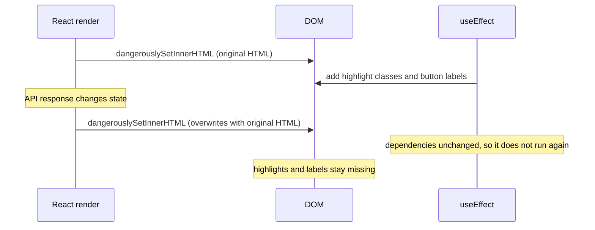

# Trouble Shooting: Markdown · Content Rendering

[← Index](../troubleshooting.md)

<details>
<summary><strong>47. Finish before render: dangerouslySetInnerHTML vs post-hoc DOM mutation</strong></summary>

**Symptom**: In richtext posts written with the Plate editor, code blocks lost their syntax highlighting and the labels of the wrap/scroll toggle buttons. Markdown posts were fine.

**Cause**: Highlighting (highlight.js at the time) and button labels were applied by mutating the DOM in a `useEffect`. After the page loaded, API responses such as like counts, adjacent posts and recommendations changed state and re-rendered the component. `dangerouslySetInnerHTML` then overwrote the DOM with the original HTML, removing the classes and labels the effect had added. The effect's dependencies had not changed, so it did not run again. Markdown posts were unaffected because `MarkdownRenderer` hands over HTML that is already highlighted.



**Fix**: Instead of patching the DOM, the HTML string is completed before render. `processRichtextHtml` inserts the button labels into the HTML inside a `useMemo`. Syntax highlighting is done by the detail page's server component, which pre-renders code block HTML with `highlightRichtextCode` (Shiki). The `useMemo` dependencies hold the label strings rather than the translation function `t`. With `t` as a dependency, settling the language changed only `t`'s identity, which produced a new string with the same content, reset `dangerouslySetInnerHTML` and wiped the post-processing.

```tsx
const processedRichtextHtml = useMemo(() => {
  if (isMarkdown) return "";
  return processRichtextHtml(content, { codeScroll, codeWrap });
}, [isMarkdown, content, codeScroll, codeWrap]);
```

This is the code in `PostArticleView.tsx`. Effects now handle only work that does not rewrite the DOM, such as click delegation, and post-processing that is applied once to a given HTML.

**Conclusion**: Patching content rendered with `dangerouslySetInnerHTML` from a `useEffect` loses the changes on any re-render. The HTML must be complete before render (in useMemo or on the server), and the HTML string should not be rebuilt when its content is the same.


</details>

<details>
<summary><strong>48. Parser extension ordering: postprocess over custom renderers</strong></summary>

**Symptom**: Using a heading (`# Title`) together with a footnote (`[^1]`) in the markdown renderer misnumbered footnotes or left the footnote inside the heading unconverted.

**Cause**: A custom heading renderer ran before the `marked-footnote` extension. It consumed the raw text before the `[^1]` inside the heading became a footnote. The reference in the heading stayed as plain text, and the remaining footnotes were each shifted by one.

```
# Title [^1]     ← the heading renderer runs first, so [^1] is not converted
Body [^2]        ← should be [^1], but the numbering shifts
```

**Fix**: The heading renderer was removed and replaced with a `postprocess` hook. `marked-footnote` processes every footnote first, and postprocess then only adds an `id` attribute to headings. `markedFootnote({ keepLabels: true })` keeps the numbers the author wrote (`[^2]` stays 2).

**Conclusion**: When marked extensions and custom renderers handle the same syntax, execution order decides the result. A postprocess hook runs after every extension has finished.


</details>

<details>
<summary><strong>49. Runtime conversion vs stored values: URLs that only play in the editor</strong></summary>

**Symptom**: A YouTube video inserted with a `youtube.com/watch?v=xxx` URL played in the editor but showed a blank frame on the post detail page.

**Cause**: Inside the editor, `parseEmbed()` converts the watch URL to an embed URL for display. `plateSerializer`, however, serialized the node's `url` property (the original watch URL) into `<iframe src="...">` as is. A watch URL cannot load in an iframe. The URL the editor showed and the URL stored in the database differed.

```
Editor display: youtube.com/embed/xxx  (converted by parseEmbed) → plays
Stored in DB:   youtube.com/watch?v=xxx (original)               → iframe fails to load
```

**Fix**: `fixEmbedUrls()` (`src/utils/htmlUtils.ts`) runs just before HTML is rendered. It rewrites YouTube watch, shorts and youtu.be URLs in iframe `src` to embed URLs, and `vimeo.com/123` to `player.vimeo.com/video/123`. `processRichtextHtml`, shared by the detail page and the preview, calls it.

**Conclusion**: When an editor's runtime conversion differs from the stored value, content shows in the editor but not on the real page. Normalizing URLs right before render also fixes posts that were already saved.


</details>

<details>
<summary><strong>50. DOM outside React: native listeners plus MutationObserver</strong></summary>

**Symptom**: Every image was supposed to switch to `/images/placeholder.svg` when it failed to load. React components' `` worked, but images rendered with `dangerouslySetInnerHTML`, as in `MarkdownRenderer`, and images in richtext areas handled by `useRichtextEnhance` never triggered onError, so broken images stayed visible.

**Cause**: There were three reasons.

1. DOM inserted with `dangerouslySetInnerHTML` is not managed by React, so synthetic event props such as `onError` are never attached.
2. For an image whose request has already failed (`complete && naturalWidth === 0`), a listener attached late never receives an `error` event.
3. Images that the content adds later are not caught by an initial `querySelectorAll`.

**Fix**: `useRichtextEnhance` and `MarkdownRenderer` share `attachImageFallback(root)` from `src/lib/imageFallback.ts`. It attaches a native `error` listener to every `` in the container, with `data-fallback-bound` preventing duplicates. Right after attaching, if `complete && naturalWidth === 0`, the image is swapped immediately. `MutationObserver(root, { childList: true, subtree: true })` handles images added later the same way. The swap also removes `srcset`, because a remaining `srcset` makes the browser try those candidates first and fail again. React components (editor covers, galleries, relation picker chips, the Plate image element and so on) switch state in `onError`.

**Conclusion**: React synthetic events are not attached to DOM inserted with `dangerouslySetInnerHTML`, so native `addEventListener` is required. An image that already failed never fires `error` again, so its state must be checked synchronously right after attaching the listener. Areas whose content changes must also handle new elements through a MutationObserver.


</details>

<details>
<summary><strong>51. Single-sourcing: preview and detail render the same component</strong></summary>

**Symptom**: The admin editor's preview kept drifting from the published detail page in layout, spacing and code block handling.

**Cause**: The preview was a simplified version built separately from the detail page. Every change to the detail page's markup or style had to be repeated in the preview, and changing only one side broke the match. Richtext processing (heading ids, embed URL conversion and so on) also went through different code paths, so the output differed.

**Fix**: The detail page's article view was extracted into shared presentational components, and the detail and preview pages render the same components. For posts, the detail page and the preview page under `admin/(preview)` both use `PostArticleHeader`, `PostArticleBody` and `PostArticleAuthors` from `PostArticleView.tsx`. For works, they share `WorkArticleHeader`, `WorkArticleBody`, `WorkArticleGallery` and others. Only parts the preview does not have, such as comments and the back link, are added on the detail side. Richtext HTML processing happens in one place, `src/utils/processRichtextHtml.ts`, which injects heading ids, converts embed URLs, inserts the wrap toggle labels and adds `data-cursor="zoom"` to images in the same order for both.

**Conclusion**: A preview that differs from the real page is useless as a preview. When the same output is needed, use the same components and the same processing functions instead of synchronizing two versions, so one side cannot change alone.


</details>

<details>
<summary><strong>52. Comment checklists: parser context, DOMPurify value checks and :has() match scope</strong></summary>

**Symptom**: Checklists in comment markdown ran into a series of problems.

1. `- [ ] todo` rendered as a plain bullet instead of a checkbox, even though `type` was in `ALLOWED_ATTR`.
2. Pressing the toolbar's checkbox button on an empty line produced a bullet instead of a checkbox. The `---` divider button produced a heading instead of a divider when the previous line had text.
3. The `:has()` rule that removes bullets from checkbox lists did not apply to some lists and removed ordinary bullets from others.

**Cause**:

1. DOMPurify checks the value of any attribute that is not known to be URI-safe against `ALLOWED_URI_REGEXP`. The default URI-safe list (alt, class, title, value and so on) does not include `type`. The value of `type="checkbox"` failed `/^(?:https?:|mailto:|#|\/(?!\/))/i` and was removed silently. A hook then removed the `<input>` whose type was no longer checkbox, leaving only the bullet. For the same reason, table `align` was removed and markdown table alignment was ignored.
2. GFM parses a task list only when text follows the `- [ ] ` marker. A marker alone on an empty line becomes a `<li>[ ]</li>` bullet. `---` directly under a line of text is read as a setext heading (underline heading syntax). Code fences and tables are also parsed only at the start of a line.
3. `marked` renders a tight list as `<li><input>` and a loose list, with blank lines between items, as `<li><p><input>`. `:has(> li > input)` alone misses loose lists. The descendant combinator `:has(input)` removes the parent list's bullets when an ordinary bullet list contains a checkbox sublist.

**Fix**:

1. `type`, `checked`, `disabled` and `align` were added to `ADD_URI_SAFE_ATTR`, which removes them from the URI value check. These are inert attributes, not URLs. Adding them to `ALLOWED_ATTR` alone is not enough, because the two options cover different axes: whether an attribute is allowed and how its value is checked.
2. Line-prefix actions in the toolbar got a placeholder. Pressed on an empty line, they fill in example text ("todo") and leave it selected. Block inserts first make sure there is a blank line before the insertion.
3. The selector lists only the two real DOM shapes as direct-child paths.

```css
.commentMarkdown ul:has(> li > input[type="checkbox"], > li > p > input[type="checkbox"]) { … }
```

This is the rule in `CommentMarkdown.module.css`. The checkbox itself is drawn with `appearance: none`, with its border and fill in the accent color.

**Conclusion**: When an allowed attribute still disappears, check whether the filter is validating its value as a URL. A markdown insert button must create the context the parser needs to recognize the syntax, not just insert a string. In `:has()`, the combinator defines the match scope, so enumerate every DOM shape the renderer produces and pin them with direct-child paths.


</details>
