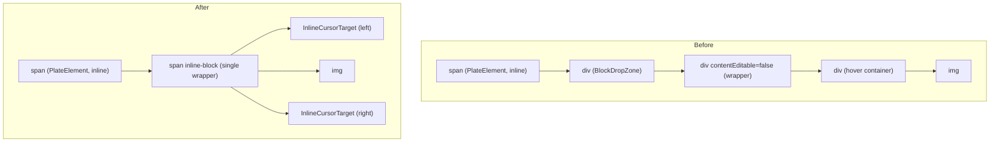

# Trouble Shooting: Plate Editor

[← Index](../troubleshooting.md)

<details>
<summary><strong>33. Preserving inline flow: a div inside an inline void blocks the caret</strong></summary>

**Symptom**: In the Plate (Slate) editor, images were configured as inline voids (`isInline: true, isVoid: true`), but the caret could not be placed on either side of an image by clicking or with arrow keys. Text could not be inserted next to the image.

**Cause**: Slate's normalization automatically adds empty text nodes on both sides of an inline void. Inside `ImageElement`, however, block-level `<div>` elements (BlockDropZone, a wrapper and a hover container) were nested inside the inline `<span>` (PlateElement). The block elements broke the inline flow, and the browser could not place the caret in the adjacent empty text nodes.



**Fix**: A separate render branch for `imgLayout === "inline"` turns every wrapper into a `<span>` and drops BlockDropZone. A 6px-wide `InlineCursorTarget`, positioned absolutely, sits on each side of the image. Clicking it places the caret before or after the image with `editor.api.before()` or `editor.api.after()`.

**Conclusion**: A `<div>` inside an inline void breaks inline flow, and the caret cannot reach the empty text nodes Slate inserted. Only inline tags such as `<span>` should be used inside inline elements.


</details>

<details>
<summary><strong>34. Serialization round-trips: custom attributes survive only if encoded</strong></summary>

**Symptom**: Style properties of two- and three-column layout blocks, such as background color, divider and column widths, disappeared after saving to HTML and loading again.

**Cause**: Plate's column nodes store custom properties such as `layout`, `columnBg` and `columnDivider`. HTML serialization had no rule to keep them. Standard HTML has no concept of a column layout, so converting to a plain `<div>` dropped every custom property.

**Fix**: Both serialization and deserialization now have `data-*` attribute rules. `plateSerializer.ts` writes the column group as `data-column-group` with `data-layout`, `data-column-bg` and `data-column-divider`, and each column gets `data-width`. The HTML deserializer in `column-kit.tsx` reads the same attributes back into node properties. Column widths (%) are included so that the `@platejs/layout` normalizer can see widths summing to 100 when the content is edited again. Without them, normalization repeats.

```html
<div data-column-group data-layout="side" data-column-bg="var(--bg-tertiary)">
  <div data-column data-width="50%">…</div>
  <div data-column data-width="50%">…</div>
</div>
```

The markdown path has its own notation. If a `<!-- columns 50%,50% layout=side bg=… divider=… -->` comment precedes a markdown table, `postProcessMarkedHtml.ts` restores that table as column block HTML.

**Conclusion**: Editor-specific properties that standard HTML lacks must be encoded explicitly at serialization, and deserialization must read them under the same names, for round-trips to hold.


</details>

<details>
<summary><strong>35. Gesture disambiguation: when drag and resize share one element</strong></summary>

**Symptom**: Pressing the resize handle of an inline image was handled as a drag and drop instead of a resize, and the image was deleted.

**Cause**: The inline image's `onPointerDown` handler starts a drag, and it also received pointer presses on the resize handle, handling them as drag and drop.

**Fix**: The start of `onPointerDown` checks `closest("[data-cursor^='resize']")` and does not start a drag on a resize handle. The hit box and the visible handle were split into separate sibling elements, so the detection area and the visible position can be tuned independently.

**Conclusion**: When different gestures such as drag and resize share one element, decide which gesture it is from where the pointer went down before anything else.


</details>

<details>
<summary><strong>36. Scroll container bounds: placement decisions for floating elements</strong></summary>

**Symptom**: When the editor showed a size Tooltip on an image, the Tooltip appeared outside the editor or was clipped once the image scrolled above the editor area.

**Cause**: The Tooltip's `auto` placement only checked the top of the viewport (`rect.top < 60`). It ignored the bounds of the editor's scroll container.

**Fix**: `measure()` finds the trigger's nearest overflow ancestor (an element whose `overflow-y` is auto, scroll or hidden). If the distance between that container's top and the trigger's top is under 40px, the Tooltip is placed below (`bottom`).

**Conclusion**: Placement of floating elements should consider the bounds of the nearest scroll container, not only the viewport.


</details>

<details>
<summary><strong>37. Leaf blocks vs wrappers: finding the current block needs an upward walk</strong></summary>

**Symptom**: Placing the caret inside a blockquote, code block or table did not switch the matching main toolbar button to its active state.

**Cause**: The code reading the current block used `editor.api.block()` to get the nearest block. Inside wrapper blocks (blockquote, code_block, table), a child block (`p`, `code_line` and so on) was returned first, so the block type became `"p"` or `"code_line"`.

**Fix**: `readBlockInfo` in `plate/hooks.ts` checks, when the block type is `"p"` or `"code_line"`, whether a `blockquote`, `code_block` or `table` exists above it with `editor.api.above()`. If one is found, the block type becomes that wrapper type.

**Conclusion**: In a tree-structured editor, the current block returned by `editor.api.block()` is a leaf block. The active state of a wrapper has to be found separately by walking upward.


</details>

<details>
<summary><strong>38. Referential integrity: delete orphan nodes in reverse order</strong></summary>

**Symptom**: Deleting a footnote reference (`footnote_ref`) in the editor left the footnote content (`footnote_content`) at the bottom, and the reverse also happened. Unpaired nodes were serialized and saved to the database.

**Cause**: Footnote references and contents are linked by `footnoteId`, but Plate's `normalizeNode` does not know this relationship. When one side is deleted, the other stays.

**Fix**: A separate `useEffect` scans every footnote on editor changes with a 300ms debounce. Nodes whose `footnoteId` has no partner are deleted from the end backward, so the paths of earlier nodes do not shift. Deleting directly inside `normalizeNode` raised `Cannot find a descendant at path`, so the work moved into the effect.

**Conclusion**: The editor does not maintain referential integrity between nodes, so it has to be checked explicitly. When deleting several nodes, delete from the end so paths do not shift.


</details>

<details>
<summary><strong>39. Two intents in one click: separating navigate from edit</strong></summary>

**Symptom**: Clicking a link inside the editor opened a new tab immediately, so the link URL or text could not be edited.

**Cause**: `LinkElement`'s `onClick` called `window.open()` directly, so the caret could not be placed inside the editor.

**Fix**: A click now only runs `e.preventDefault()`, places the caret inside the link and shows the link editing toolbar. Opening a new tab moved to double-click. To keep the toolbar from flickering when moving from one link to another, `currentLinkKey`, built from the link path, decides whether it is the same link. Instead of `useOutsideClick`, a separate handler ignores clicks inside the editor body.

**Conclusion**: A link inside an editor carries two intents in one click, navigation and editing. Splitting them between click and double-click lets both work.


</details>

<details>
<summary><strong>40. What the default defended: the cost of overriding selection affinity</strong></summary>

**Symptom**: Inside inline code (a `<code>` mark), moving from the second character to the first with ArrowLeft made the caret jump to the previous text node.

**Cause**: `CodePlugin.configure({ rules: { selection: { affinity: "directional" } } })` had replaced Plate's default `"hard"`. `"hard"` affinity keeps the caret inside the mark at mark boundaries. `"directional"` leaves that to the browser's default behavior, so the caret left the `<code>` element at its boundary.

**Fix**: The affinity override was removed and Plate's default (`"hard"`) is used. The plugin list now contains `CodePlugin` itself instead of `CodePlugin.configure(...)`.

**Conclusion**: Before overriding a library default, check what behavior that default was preventing.


</details>

<details>
<summary><strong>41. Out of flow vs inside a paragraph: float images against inline voids</strong></summary>

**Symptom**: Float images beside body text had to satisfy three conditions at once. Dragging or selecting the neighboring text block must not take the image with it. No empty line should be visible above or below the image. Clicks and arrow keys must not put the caret into an invisible empty spot. The three conditions conflicted with each other.

**Cause**: CSS `float` takes the image out of the flow, but in Plate (Slate) the image is an inline void, so it must live inside a paragraph with forced empty text (ZWSP) on both sides.

1. If the image shares a paragraph with text, a block drag moves the image and the text together.
2. If the image is split into its own paragraph, only a ZWSP line remains in the flow and shows as an empty line.
3. Collapsing that empty line with `line-height: 0` or similar gives the block zero height and breaks the caret and handles. Covering it with the next block leaves an invisible spot that clicks and arrow keys can still put the caret into, causing a flicker.

**Fix**: Data, layout and input were handled together.

1. Data: on every change, paragraphs mixing text and an image are split with `splitNodes` so the image has its own paragraph. Dragging and selection then work independently of the text.
2. Layout: instead of collapsing the image block to zero height, the next block is pulled up one line with `margin-bottom: -1lh` to cover the empty line. The image block itself is unchanged, so the caret and handles work. The float wrapper gets a `z-index` so the move handle is not covered.
3. Input: clicks (mousedown) and arrow keys (keydown) are handled first in the capture phase. When the caret would go to the empty spot, the image is selected or the caret is sent to the adjacent block. This runs before Slate's default movement, so there is no flicker.

**Conclusion**: float (out of flow) and an inline void (forced text inside a paragraph) conflict structurally, and fixing one place does not resolve it. normalize recreates the inline void's ZWSP, so it cannot be removed. It was handled by covering it visually and keeping the caret from reaching it. Correcting the caret after Slate moves it causes a one-frame flicker, so input has to be handled first in the capture phase.


</details>

<details>
<summary><strong>42. Scroll event propagation: listen for nested scrolling in the capture phase</strong></summary>

**Symptom**: The editor's top bar (back, save, revisions and so on) should collapse when scrolling down and expand when scrolling up. The first version used an ordinary scroll listener on window, and it did not react when scrolling inside an element with its own scroll, such as the editor body.

**Cause**: The scroll event does not bubble. A scroll inside an element fires only on that element, so a bubble-phase listener on window receives only the document's own scroll. At the time the body was an inner scroll area, so the page scroll position barely changed and `position: sticky` never pinned either. For a while the top bar was switched to `position: fixed` with a spacer reserving its height. Later a cover (about 35vh) was added above the editor as page content, the page itself scrolled, and the top bar went back to `position: sticky`.

**Fix**: `AdminEditorShell` listens in the capture phase with `window.addEventListener("scroll", onScroll, true)`. In the capture phase, scroll events from descendants pass through window, so a single listener receives them. If `e.target` is the document, the handler uses the change in `window.scrollY`. If it is the editor body (`[data-slate-editor]`), it uses that element's `scrollTop` change. Scrolling inside popups such as the emoji picker is ignored. Changes in the same direction accumulate, and the bar collapses past 120px and expands past -120px. Whether the bar is pinned under the nav is decided on every scroll from the position of a sentinel element, and an unpinned bar does not collapse.

**Conclusion**: The scroll event does not bubble, so receiving nested scroll areas in one listener requires listening in the capture phase (`useCapture = true`). `position: sticky` works only when an ancestor container actually scrolls.


</details>

<details>
<summary><strong>43. Protecting IME composition: inputs outside the editor model and deferred parent re-renders</strong></summary>

**Symptom**: Korean input broke in two places. Typing Korean into form inputs inside the editor, such as poll and tab blocks, broke or dropped the character being composed. Typing Korean while the slash menu was open entered the first character twice.

**Cause**: In both cases a re-render happened during IME composition. When a form input sits inside the Slate editing model, Slate re-renders during composition and the composition state breaks. In the slash menu, the first jamo of a composition matched no command, so the open state changed, which called the parent's (`PlateEditor`) `setSlashOpen`. The parent re-rendered, and its sibling, the Slate `Editable`, was reconciled in the middle of composition.

**Fix**:

1. Poll and tab inputs sit outside the Slate editing model, as void elements using the shared `EditorTextInput`. `EditorTextInput` is `contentEditable={false}` and commits its value on blur. `onMouseDown` calls `nativeEvent.stopImmediatePropagation()` to block Slate's selection handling. This is the same approach used for image captions.
2. The slash menu defers only the `onOpenChange` notification to the parent during composition. The menu's own `open` state is unchanged, so display and search filtering keep working. `composing` is a dependency of the effect, so the notification goes out automatically when composition ends.

```tsx
React.useEffect(() => { if (composing != null) return; onOpenChange?.(open); }, [open, onOpenChange, composing]);
```

This is the code in `SlashMenu.tsx`.

**Conclusion**: A re-render of the parent or the editor during IME composition breaks the composition. Form inputs inside the editor should be separated from the editing model, and notifications that change parent state should wait until composition ends.


</details>

<details>
<summary><strong>44. Blocking native drag: it cannot coexist with pointer drags</strong></summary>

**Symptom**: Dragging an editor block by its handle let the browser's HTML5 native drag take over, and the custom pointer drag did not work.

**Cause**: When the handle is draggable, the browser starts a native drag session. During that session pointer events are suppressed, so the custom drag logic received no coordinates.

**Fix**: Native drag was turned off and replaced with a custom drag layer. The `useDraggable` preview was disabled and the handle got `draggable={false}`. A custom `BlockDragLayer` draws a ghost cloned from the DOM at the cursor position and scrolls automatically near the editor edges. The cursor shape is set with a `data-cursor` attribute rather than CSS `cursor`, and CursorTrail draws it.

**Conclusion**: A pointer-based custom drag requires HTML5 native drag to be turned off explicitly. When both are active, native drag blocks the pointer events.


</details>

<details>
<summary><strong>45. Normalizing value types: numeric node values vs string options</strong></summary>

**Symptom**: The toolbar's line-height Select could not show values missing from the presets, such as the 1.25 used by headings, and appeared blank. The console also warned about duplicate option keys.

**Cause**: The value types disagreed in two places. `setLineHeight` stores the line height on the node as a number (for example `1.6`), while the toolbar preset options were strings (`"1.6"`). The same value entered the options twice and the keys collided. The detection logic that finds the nearest preset from the DOM's computed value also returned an empty string when the difference was 0.05 or more, so values such as the heading's 1.25 were not shown.

**Fix**: `readToolbarState` in `plate/hooks.ts` converts the node's line height with `String(...)`, so it compares with the string presets as the same type. `computedLineHeight` in the same file returns the preset when the value is close to one, and otherwise the actual ratio rounded to two decimals. `MainToolbar.tsx` adds the current value to the top of the Select options when it is not a preset.

**Conclusion**: Values stored on Slate nodes as numbers must be normalized with `String` before they are compared with or rendered as string options. Preset matching has to handle both cases, "close to a preset" and "actual value", or blanks appear.


</details>

<details>
<summary><strong>46. History snapshots: undoing exactly one conversion</strong></summary>

**Symptom**: After deleting a bullet created by markdown auto-conversion, continuing to press Backspace brought the bullet back or moved the caret to another line instead of deleting characters.

**Cause**: The logic that treats Backspace right after an auto-conversion as "undo the conversion" called undo without checking history. If another edit came after the conversion, undo reverted that edit. A detection bug that mistook a space typed in the middle of a paragraph for a conversion was also present.

**Fix**: The history position is recorded before the trigger is inserted, and just before undoing, the code checks that history is still exactly as it was right after the conversion. If it is, only the operations after that point are inverted to restore the markdown marker. Otherwise Backspace behaves normally. Backspace at the start of a block reverts to the markdown marker (`- `, `## `, `> `) even when it is not right after an auto-conversion.

**Conclusion**: `editor.undo()` reverts the last batch of operations as a whole. To revert only a specific conversion, snapshot the history position and invert only the operations after it.


</details>
