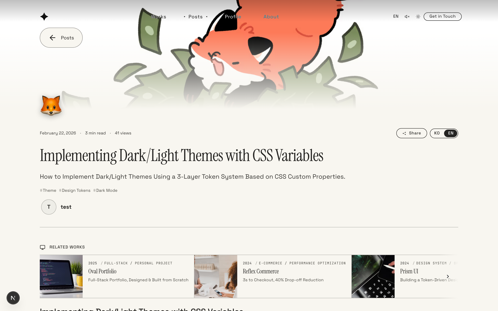
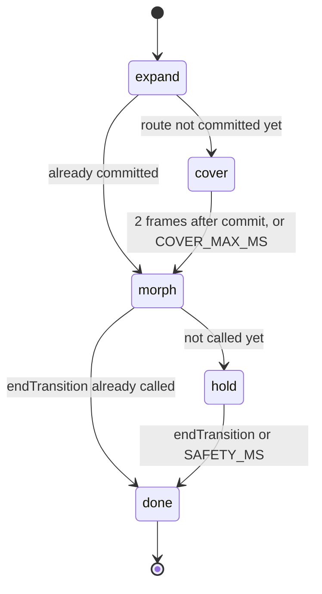
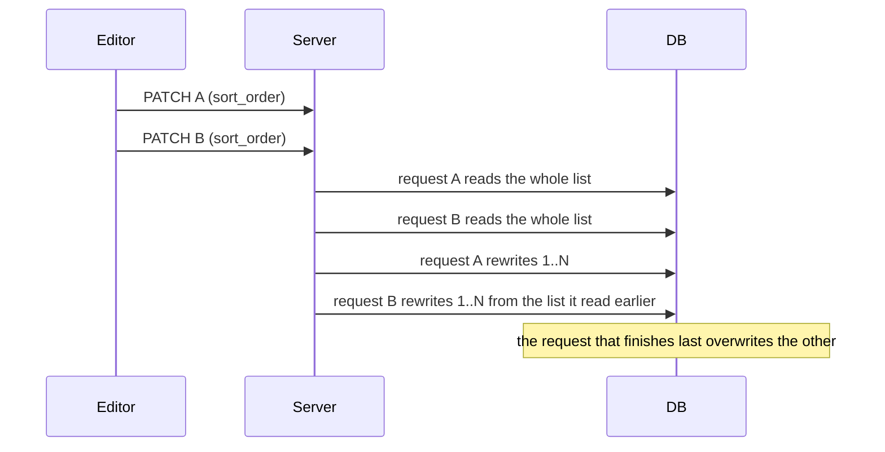

# Trouble Shooting: Top 10 Deep Dives

[← Index](../troubleshooting.md)

<details>
<summary><strong>1. Bundler downleveling: a regex that passes every test but dies only in the browser</strong></summary>

**Symptom**: In the editor's code blocks, only HTML (xml) code got no syntax colors. Language detection worked and the label read "HTML / XML", but the code stayed monochrome. Other languages such as CSS were fine. `npm run build`, `tsc` and the tests all passed. The problem reproduced only in the browser.

**Cause**: Three conditions combined.

1. hljs `xml.js` defines tag names as `/[\p{L}_]/u`.
2. The bundler expands that regex. Even when browserslist targets a recent browser (chrome 148), Next compiles node_modules against a conservative target. `\p{L}` becomes explicit codepoint ranges, and those ranges include astral ranges (`\u{10000}-…`). A braced escape cannot be parsed without the `u` flag.
3. hljs's `countMatchGroups` re-parses the regex with `new RegExp(re.toString() + "|")`, without flags. This step throws a `SyntaxError`.

```
SyntaxError: Invalid regular expression: /<(?=[A-Z…\u{10000}-\u{1000B}…
    at countMatchGroups (core.js:456)
```

Plate catches the exception and falls back to plaintext. The screen only shows missing colors, and the cause appears only in the console. CSS was unaffected because `css.js` contains no `\p{}`.

It does not reproduce under node. Node uses the untranspiled source (`\p{L}` with the `u` flag). The expanded regex exists only in the browser bundle. Checking the DOM, classes, CSS and served chunks did not reveal the cause. The browser console's stack trace did.

**Fix**: The two paths were handled separately.

1. The markdown reader and comments moved to Prism. Prism does not use Unicode property escapes and was already a dependency. `utils/prismHighlight.ts` became the single entry point, and every hljs import was removed from `highlightCodeBlocks.ts`. Bash, which the Prism bundle lacks, is defined by hand.
2. The editor patches the grammar. Plate's code-block plugin takes a lowlight instance as its API, so it cannot switch to Prism. At registration the grammar object is walked, astral escapes are removed and the `u` flag is dropped (`browserSafeGrammar` in `lowlightInstance.ts`). Astral-plane characters are not used in tag names in practice, and the BMP (Korean, CJK, Latin extended) stays intact. Plate has a workaround of the same kind for python (`ensureStablePythonGrammar`).

The first attempt converted only `RegExp` instances and fixed nothing. hljs's `regex.concat()` returns a concatenated source string, not a RegExp (`core.js: return joined`), and the astral escapes were inside that string. Strings were therefore added to the conversion.

```ts
export function browserSafeGrammar(node: any, seen = new WeakMap<object, any>()): any {
  if (typeof node === "string") return node.includes("\\u{") ? stripAstral(node) : node;
  if (node instanceof RegExp) return toBrowserSafeRegex(node);
  if (Array.isArray(node)) return node.map((n) => browserSafeGrammar(n, seen));
  /* …objects recurse, with a WeakMap breaking cycles */
}
```

This is the conversion function in `lowlightInstance.ts`. It recurses through strings, RegExps, arrays and objects. Because node cannot reproduce the real failure, the test (`plate/__tests__/browserSafeGrammar.test.ts`) synthesizes the bundled form of the regex. It checks that the synthetic input really breaks the re-parse, that it survives after conversion, and that Korean still matches.

**Conclusion**: When the test environment (node) differs from the runtime environment (the browser bundle), bugs that live in the difference cannot be caught by tests. Library source can be correct while the bundler's downleveling produces code that fails only in the browser. When a library swallows the exception, the symptom is far from the cause, so the console stack trace should be checked first.


</details>

<details>
<summary><strong>2. CSS invalidation scope: global recalc from `:has(:hover)` with a universal descendant</strong></summary>

**Symptom**: While typing in the work editor, about two keystrokes in ten triggered a style recalculation of all 6,357 elements, and input-delay p90 spiked. Moving the mouse caused the same recalculation.

**Cause**: A single rule, `.chip:has([data-close-trigger]:hover) .label *`, was responsible. Typing changes the element under the pointer, which triggers hover recalculation. When `:hover` sits inside `:has()` and a universal `*` descendant follows, Chrome invalidates the whole body subtree. The same selector without `*` had no problem. The rule was found by deleting rules from the CSSOM and halving the search range each time.

**Fix**: The selector structure stayed and only the hover condition moved to JS. The close button's `onPointerEnter` and `onPointerLeave` add and remove a `data-remove-hover` attribute on the chip, and the CSS matches that attribute.

```css
.chip[data-remove-hover] .label * {
  text-decoration: line-through;
  text-decoration-color: var(--text-accent);
}
```

This is the rule in `Chip.module.css`. The attribute is set on one chip only, so invalidation stays inside that chip.

**Conclusion**: Combining `:hover` inside `:has()` with a universal descendant selector causes global style invalidation. Moving the condition to an attribute set by JS narrows the scope.


</details>

<details>
<summary><strong>3. Resource priority and streaming reveal: the serial gates that delay LCP</strong></summary>

<p align="center">
  
</p>

**Symptom**: LCP regressed on the mobile post list and post detail. The cover image arrived late while sharing bandwidth with CSS and fonts, and the reveal was delayed even after it arrived.

**Cause**: Two things combined. Next 16's `priority` only adds a preload in the head and does not set the `fetchpriority` attribute, so the LCP image was requested at Low priority. React 19.2 also reveals a Suspense boundary that arrives after the shell has painted 300ms after the first frame. An LCP element inside the loading.tsx boundary inherits that delay.

**Fix**: Wherever `priority` is passed, `fetchPriority="high"` is passed with it. The detail cover moved out of the loading boundary into `DetailShell` in `[slug]/layout.tsx`, so it paints with the shell.

```tsx
<Image priority={priority} fetchPriority={priority ? "high" : undefined} … />
```

This is the code in `ProgressiveImage.tsx`. Up to Next 15, `priority` alone gave high priority. In 16 it has to be set separately.

**Conclusion**: LCP passes through two serial gates, request priority and reveal timing. Fixing only one does not move the metric. The LCP element belongs in a layout outside the streaming boundary.


</details>

<details>
<summary><strong>4. State signals over timelines: lift the transition cover on route commit</strong></summary>

**Symptom**: When navigating from a list to a detail page, the list page stayed visible for about half a second after the transition cover lifted. In an earlier version the opposite happened: the cover shrank to hero size and then stayed on screen.

**Cause**: The morph transition ran on a fixed timeline (380ms expand, then a 260ms morph), and the cover always lifted at 640ms. The commit time of the new route has nothing to do with that timeline. List card links do not prefetch, so the RSC payload is fetched only after the click. On the deployed build the commit happened at 1161ms.

The stuck cover came from the end signal. `onAnimationStart` on the detail hero's `motion.div` was supposed to call `endTransition()`. During the transition both `initial` and `animate` had opacity 1, and framer-motion does not call that callback when the value does not change. The phase stayed at `hold`.

**Fix**: A `cover` phase was added. If the expand finishes before the route changes, the screen stays covered until the commit, and the morph starts after the commit is confirmed. The commit signal comes from `usePathname()` inside the overlay. The overlay is mounted only during a transition, so the subscription exists only then.

```tsx
const t = setTimeout(() => onPhase(navPendingRef.current ? "cover" : "morph"), EXPAND_MS);

useEffect(() => {
  if (phase !== "cover" || navPending) return;
  const raf1 = requestAnimationFrame(() => {
    raf2 = requestAnimationFrame(() => onPhase("morph"));
  });
  /* … the COVER_MAX_MS cap lifts the cover if the commit never arrives */
}, [phase, navPending, onPhase]);
```

This is the code in `PageTransitionProvider.tsx`. When the expand ends, the next phase depends on whether the route has committed. Once the cover phase sees the commit, it waits two frames before moving to morph, so the new tree paints under the cover first.

The end signal no longer depends on an animation callback. When the detail layout (`DetailLayout`) mounts, a `useEffect` calls `endTransition()` after 80ms. In case that call never comes, the provider ends the transition itself after `SAFETY_MS` (5000ms). If the new page is ready before the morph finishes, the request is recorded in `endRequestedRef`, and the transition ends right after the morph, skipping `hold`.



**Conclusion**: A transition built on a fixed timeline exposes the screen whenever network timing drifts. The cover has to lift on a state signal, the actual route commit. Animation lifecycle callbacks do not fire when values are equal, so they should not be the only trigger for an important state change. An effect-based call and a time cap are needed with them. Verification used Playwright video recordings turned into per-frame contact sheets with ffmpeg.


</details>

<details>
<summary><strong>5. Static prerender lacks context: hydration mismatch from a path-less 404</strong></summary>

**Symptom**: 404 pages such as `/admin/nonexistent` threw React #418 (HTML mismatch). Missing public URLs did not.

**Cause**: Unmatched URLs receive the static `/_not-found` HTML rendered at build time. That HTML was rendered without a path, so it contains the public navigation and footer. The root layout's Navigation and Footer change shape based on the path prefix (`/admin`, `/design-system`), so the browser's re-render does not match the server HTML.

**Fix**: Each prefix that changes the layout gets a catch-all route (`[...missing]`) that calls `notFound()`. That 404 is rendered at request time with the real path, so the paths match. Making the root not-found fully dynamic was rejected because every 404 would then query the database.

```tsx
// src/app/admin/[...missing]/page.tsx
export default function AdminMissingPage() {
  notFound();
}
```

The same file exists at `src/app/design-system/[...missing]/page.tsx`.

**Conclusion**: If the root layout changes shape based on the path, the 404 for each such prefix must be rendered with that path. A static 404 is rendered with no path.


</details>

<details>
<summary><strong>6. Shorthand resets and specificity: a global transition erasing component transitions</strong></summary>

**Symptom**: To smooth the dark/light theme switch, a global `html[data-theme-ready] *` rule added color transitions. After that, components that transition `max-height`, `opacity` or `transform`, such as the collapsing editor toolbar and toggles, changed instantly with no transition.

**Cause**: `transition` is a shorthand property. Declaring `transition: background-color 0.3s, color 0.3s` replaces the component's whole `transition: max-height 0.3s`. The global selector `html[data-theme-ready] *` has specificity (0,1,1), and a single CSS Module class has (0,1,0), so the global rule always won.

```css
html[data-theme-ready] * { transition: background-color 0.3s, color 0.3s; }  /* (0,1,1) */
.toolbar { transition: max-height 0.3s ease; }                                  /* (0,1,0) */
```

When both rules apply to the same element, the first one wins and the toolbar's `max-height` transition disappears.

**Fix**: The first fix moved the global rule to a `data-theme-transitioning` attribute that was present only for the 350ms of a theme switch. Component transitions worked normally the rest of the time, but the same conflict remained during a switch. Some components therefore needed (0,2,0) compound selectors or `!important`.

There is no global transition rule now. `ThemeProvider` calls `document.startViewTransition()` when the theme changes, and inside the callback `flushSync` finishes the theme commit and its effects synchronously. The browser cross-fades the before and after snapshots of the page in one step. Browsers without support, and users with reduced motion, get an immediate switch.

```tsx
const reduce = window.matchMedia("(prefers-reduced-motion: reduce)").matches;
if (!document.startViewTransition || reduce) {
  commitTheme(next);
  return;
}
document.startViewTransition(() => flushSync(() => commitTheme(next)));
```

This is `setTheme` in `ThemeProvider.tsx`. The only CSS is in `_base.css`, which sets `animation-duration` on `::view-transition-old(root)` and `::view-transition-new(root)`. The `!important` declarations and compound selectors added to work around the conflict were removed in the same change.

**Conclusion**: `transition` is a shorthand, so a global rule that names only some properties removes every other transition on the component. Shortening the time the rule applies still leaves the conflict. A page-wide color switch done with View Transitions instead of per-element transitions does not touch component rules.


</details>

<details>
<summary><strong>7. Backdrop Root: why backdrop-filter and mix-blend-mode cannot feed each other</strong></summary>

<p align="center">
  
</p>

**Symptom**: To build a popover readable on any background, the panel got `backdrop-filter` and the text inside got `mix-blend-mode: difference`. The text's blend did not reflect the page behind it.

**Cause**: `backdrop-filter` and `isolation: isolate` create a Backdrop Root, which cuts the backdrop that descendants can see at that element. Descendants' blend therefore composites against the panel's transparent background, not the page. The output of `backdrop-filter` is also not an input to the blend of elements painted after it. Moving the blur to a `::before` sibling layer gave the same result. Per-text difference inside the popover cannot be built.

**Fix**: The blend is applied to the whole panel, and color inversion restores the original colors. The panel gets `mix-blend-mode: difference`, and the content gets colors pre-inverted with `filter: invert(1)`. The composite becomes `|background − (1 − color)|`, which yields the original color on light backgrounds.

```css
.dropdown.dropdownDifference > * {
  filter: invert(1);
}
```

This is the rule in `Popover.module.css`. The approach merges all colors inside the panel into one composite. The default variant is therefore `glass`, a translucent background with blur, and `difference` remains a variant for popovers with simple content.

**Conclusion**: `backdrop-filter` and `mix-blend-mode` both deal with what is behind an element, but neither can be the other's input. Before combining them on one element, check where the Backdrop Root cuts the backdrop.


</details>

<details>
<summary><strong>8. Write races and server reassignment: parallel PATCHes shuffling sort order</strong></summary>

**Symptom**: Changing the sort order in the work editor changed other works' order before saving. After saving, the order differed from what was intended.

**Cause**: The drag list's onChange sent a PATCH for every work that shifted, in parallel. On each sort_order PATCH, the server read the whole list and renumbered it from 1. Each request read the list at a different moment and overwrote the others, so the result depended on arrival order.



**Fix**: The editor applies order changes to the preview only and sends nothing for other works. On save it sends only its own position. The server's `placeWork` (`src/lib/api/placeWork.ts`) inserts the work at the requested position, renumbers the rest 1..N within that one request, and writes only rows whose number changed. The bug was reproduced by running the real route in vitest against an in-memory fake client, with a different read delay on each call to reverse the write order.

**Conclusion**: Parallel writes to an API that renumbers everything on each request produce results that depend on arrival order. Derived state such as order should be sent as one request at save time, and the server should finish the reordering inside that request.


</details>

<details>
<summary><strong>9. Designing fallback conditions: an empty result is not an unavailable source</strong></summary>

**Symptom**: After every work was unpublished in admin, the public list showed the static demo list bundled in the code instead.

**Cause**: `getWorks` keeps a static `data/projects.ts` fallback so a fresh clone without a database still renders. But "the table has no rows" and "there are rows, all unpublished" both came back as the same empty array. Falling back on array length alone meant that unpublishing everything let the demo list take its place.

**Fix**: The fallback condition changed from "the result is empty" to "the source could not be read". Cases where the database is unusable (missing environment variables, failed query) return `null`. No published works returns an empty array. Only `null` falls back to static data. The seed that inserted demo data as published into an empty table was also removed. That seed was why seven demo works came back on the next visit after every work was deleted.

```ts
async function fetchRankedProjects(): Promise<Project[] | null> { /* … */ }

if (ranked === null) return toWorkItems(projects);
```

This is the code in `getHomeWorks.ts`. An empty array is a valid answer meaning nothing is published, so the list renders empty.

**Conclusion**: A fallback condition should be defined by whether the source is usable, not by whether the result is empty. When two states return the same value, split the return type or query once more to tell them apart.


</details>

<details>
<summary><strong>10. Package resolution: optional peers must still be resolvable</strong></summary>

**Symptom**: `npm i @vercel/analytics` failed with an ERESOLVE peer conflict on `@sveltejs/vite-plugin-svelte`. This project has no Svelte.

**Cause**: `@vercel/analytics` declares vue, nuxt, svelte and others as optional peers for its framework entry points. npm 11 validates the peers of candidates that will not be installed. On that path `@sveltejs/vite-plugin-svelte@5` requires `vite ^6`, which conflicts with this repo's vite 8.

**Fix**: `overrides` got `"@sveltejs/vite-plugin-svelte": "^7"`, which swaps the candidate npm validates for a version that supports vite 8. No svelte package enters the installed tree. `--legacy-peer-deps` was not used because it turns off peer checking entirely and would hide other real conflicts.

```jsonc
// package.json
"overrides": {
  "@sveltejs/vite-plugin-svelte": "^7"
}
```

**Conclusion**: Optional peers still have to be resolvable for the install to pass. Overriding only the conflicting candidate keeps peer checking on while letting the install succeed.


</details>
