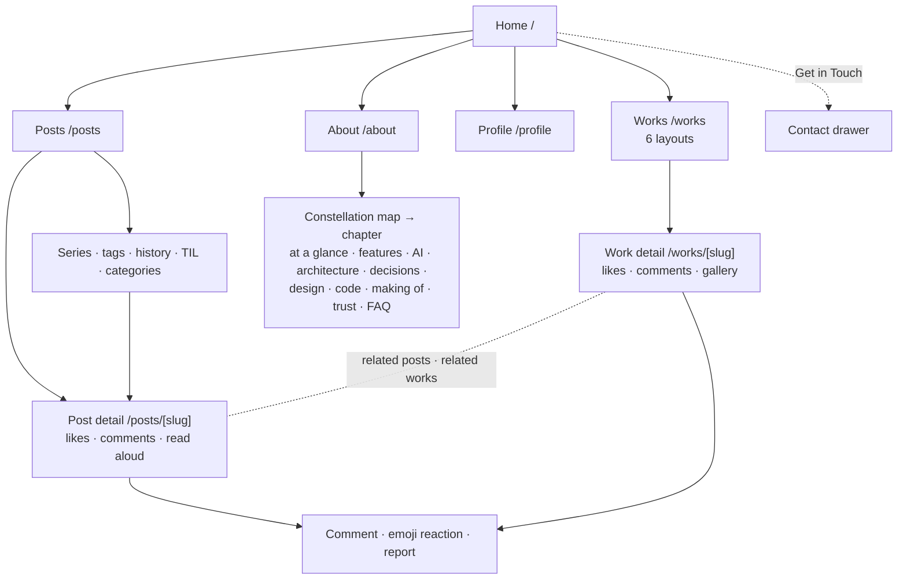
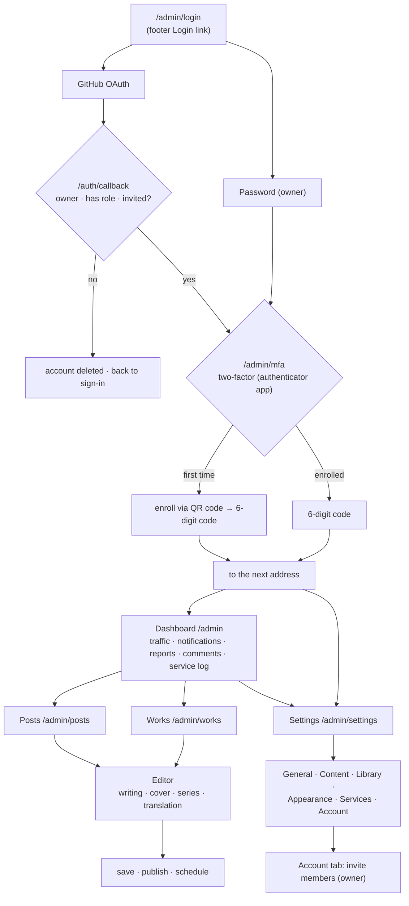

# User Flow

### Visitor flow

Visitors move between pages through the five navigation items (Home · Works · Posts · Profile · About) and the footer. The diagram below shows only the main paths.

- **Works**: Browsed in the layout chosen in admin settings (default: the horizontal-scroll Flow). The detail page shows IP-based likes, comments, the gallery, and related posts and series.
- **Posts**: Found through the sub pages and search, categories, tags, and sorting. Posts in a series link to the previous and next post.
- **Comments**: Written without sign-in. The same browser is verified automatically, and other devices use a password to edit or delete. When the admin switches the comment provider to giscus, a GitHub Discussions widget appears in the same place.
- **About**: Picking a star on the central constellation map (`src/app/about/_components/prezi/PreziStage.tsx`) flies into that chapter, and the view pulls back to the map when the chapter ends. The page is drawn by `src/app/about/_components/AboutNext.tsx`.

### Admin flow

- Either sign-in passes two-factor authentication before reaching admin pages (unless the owner turned off the requirement in Settings › Account › Security). GitHub sign-in goes to the `next` address (default `/admin`). Password sign-in goes to `/admin/settings` when there is no `next`.
- When an author (level 1) opens an admin-only screen (dashboard, notifications, reports, comments), the proxy sends them to `/admin/posts`. Only the owner opens the service log.
- Of the six settings tabs, only the owner opens the five other than Account. What each tab holds is in [Supabase setup](./supabase-setup.md#5-admin-login).
- The editor autosaves and keeps revision history, and saving an unpublished post asks whether to publish now.
- Signing out in one tab sends the other open tabs to the sign-in screen through `AdminAuthSync`.
