# 기능

[← README](../README.md)

방문자와 관리자가 화면에서 쓰는 기능을 페이지별로 적는다. 구현 방식과 설계 이유는 [Security](./security.md) · [DB 설계 결정](./db-design.md) · [컴포넌트](./components.md) · [디자인 시스템](./design-system.md) 에 있다.

## 공통

- **다크 · 라이트 테마**: 내비게이션의 단추로 바꾼다. 테마 색과 프리셋은 관리자 설정 › 외관에서 정한다.
- **한국어 · 영어**: 내비게이션의 언어 단추로 화면 글을 바꾼다. 글 · 작업물은 ko · en 칸을 따로 가진다. 그 밖의 언어로 읽을 때는 번역해 캐시해 둔 글(`content_translations`)을 보여 준다.
- **부드러운 스크롤 · 페이지 전환**: Lenis 스크롤을 쓰고, 상세 페이지로 갈 때 카드 이미지가 히어로 자리로 옮겨 가는 전환을 쓴다.
- **커서**: 마우스를 따라오는 커서가 링크 · 이미지 · 드래그 영역에 따라 모양과 라벨을 바꾼다.
- **BGM**: 내비게이션에서 배경 음악을 켜고 끈다. 음원은 관리자 설정 › 일반에서 올린다.
- **문의**: "Get in Touch" 서랍에서 문의를 보낸다. 서버(`/api/contact`)가 고른 공급자(Web3Forms · Formspree · EmailJS)로 보내고, 첨부 파일은 비공개 저장소에 올려 내려받기 링크로 붙인다.
- **동작 줄이기**: 기기의 "동작 줄이기" 설정을 켜면 저절로 움직이는 영상 · 마퀴 · 자동 넘김 · 회전이 멈춘다.

## 홈

- 히어로 · 소개 · 서비스 · 마퀴 · 작업물 · CTA 섹션으로 이뤄진다.
- Three.js(R3F) 3D 오브젝트 두 가지가 있다. 스크롤에 따라 도는 토러스와, CTA 섹션의 마우스를 따라 도는 커피잔이다.

  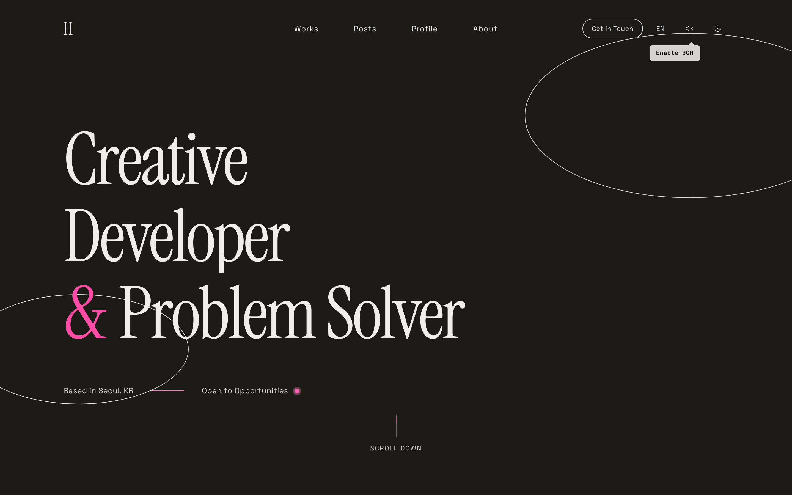
  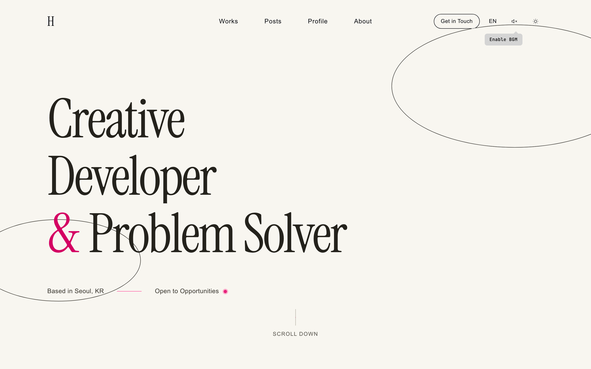

## 작업물 (`/works`)

- **레이아웃 6종**: Flow(기본, 가로 스크롤) · Fullscreen · Cinematic · Grid · Split · Cylinder(Three.js 원통). 관리자 설정 › 콘텐츠 › 작업물에서 고르고, `?layout=` 으로 바로 볼 수도 있다.
- 1024px 이하에서는 가로 스크롤 대신 세로로 쌓인다.
- **상세 (`/works/[slug]`)**: 메타 · 정보 그리드(연도 · 카테고리 · 역할 · 기술 노트 · 관련 글과 시리즈) · AI 요약 · 본문 · 슬라이드 갤러리 · 팀 멤버 카드 · 좋아요 · 댓글. 옛 주소(`/works/<id>`, `/works/01`)는 slug 주소로 보낸다.
- 갤러리 장마다 대본과 음성을 붙일 수 있고, 상세에서 읽어 주기(브라우저 음성)를 들을 수 있다.

  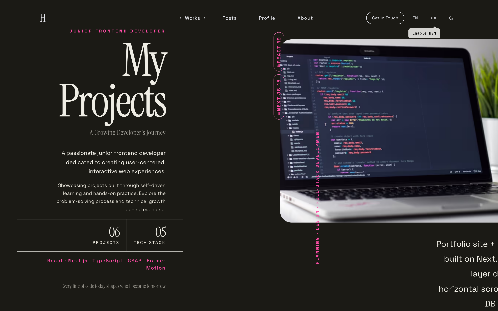
  

  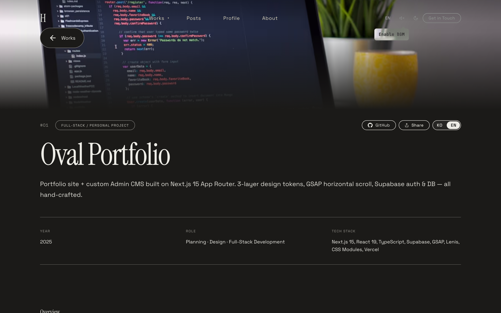
  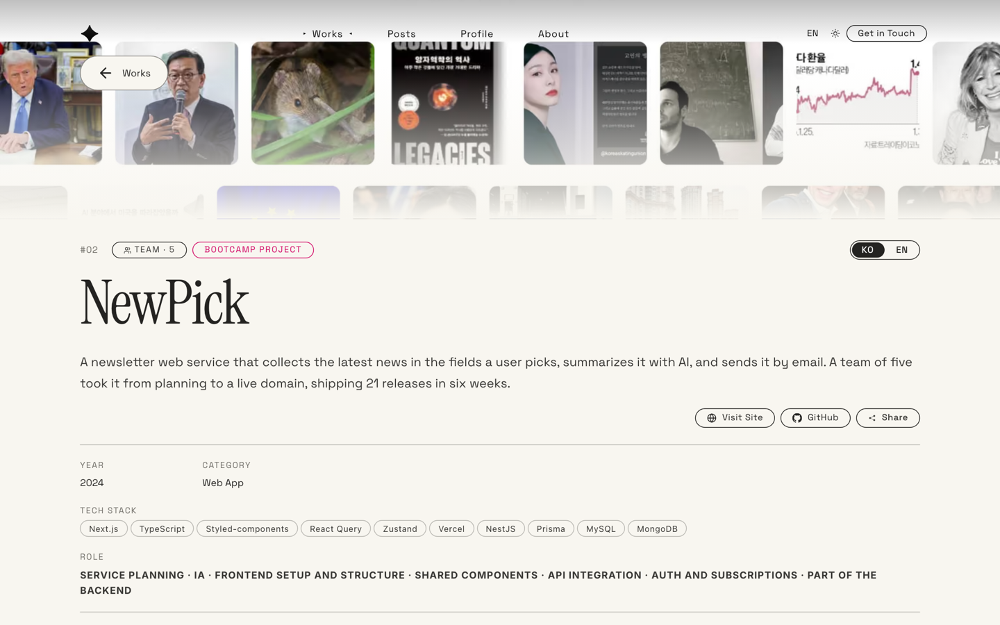

## 글 (`/posts`)

- **하위 페이지**: 전체 · 시리즈(`/posts/series`) · 태그(`/posts/tags`) · 히스토리(`/posts/history`, 시간순 타임라인) · TIL(`/posts/til`) · 카테고리(`/posts/categories`).
- **목록 레이아웃**: magazine · grid · list · compact · blog · journal · masonry · featured 중 하나를 관리자 설정에서 고른다. 사이트 전체에 적용된다.
- **배너**: 고정한 글을 위쪽 배너로 보여 준다. 배너 모양과 전환 방식은 관리자 설정에서 고른다.
- **찾기**: 검색(제목 · 본문 범위 선택, 검색 이력), 2단계 카테고리, 태그 다중 선택, 정렬(최신 · 인기 · 제목, 인기는 종합 · 조회 · 댓글 · 좋아요), 랜덤 섞기.
- **사이드바**: 3D 태그 클라우드, 인기 글, 랜덤 글, 최근 댓글.
- **시리즈**: 글을 시리즈로 묶어 순서대로 읽는다. 시리즈 카드에 올리면 소속 글 미리보기가 펼쳐지고, 상세에서는 이전 · 다음 글로 이동한다.
- **상세 (`/posts/[slug]`)**: 목차, AI 요약, 글 읽어 주기, 공유, 좋아요, 관련 작업물, 댓글.
- **읽어 주기**: 브라우저 음성(Web Speech API)으로 제목 → 요약 → 정보 → 본문 블록 순서로 읽고 읽는 블록을 강조한다. 아래 떠 있는 막대에서 이전 · 일시정지 · 다음 · 빠르기(1 · 1.25 · 1.5 · 0.75배) · 멈춤을 고르고, 문단을 누르면 거기서부터 읽는다. 코드 블록 · 수식 · 동영상은 종류만 알리고, 표는 행마다 머리글을 붙여 읽는다. 작업물 상세에도 있다.
- 블로그 서브도메인(`blog.hyeoniverse.com`)에서도 같은 글을 짧은 주소로 연다.

  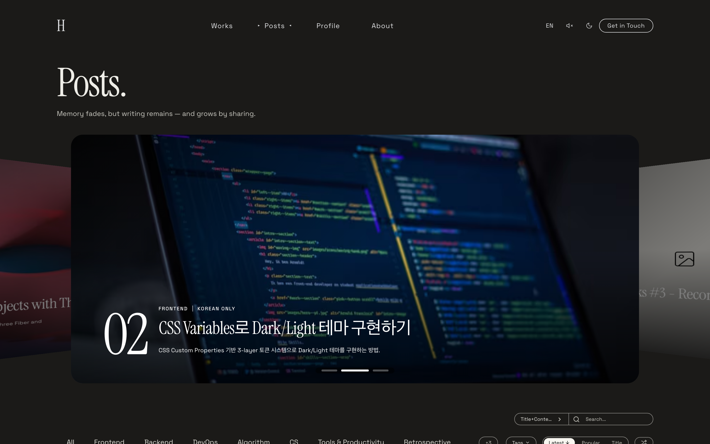
  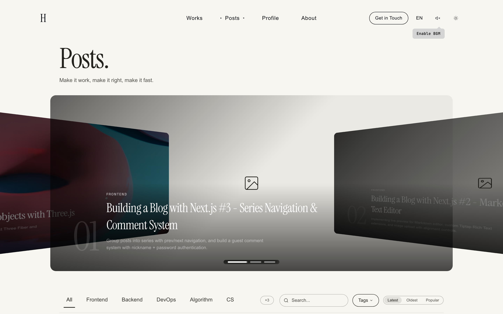

## 댓글 · 반응

- **로그인 없는 댓글**: 대댓글, 닉네임 셔플, 같은 브라우저는 자동 인증하고 다른 기기에서는 비밀번호로 수정 · 삭제한다. 이메일을 남기면 답글 알림을 받는다.
- **마크다운 작성**: 작성 · 미리보기 탭과 서식 툴바가 있다. 이미지는 업로드 없이 외부 URL 만 받는다.
- **이모지 반응**: 고정 8종(👍 👎 😄 🎉 😕 ❤️ 🚀 👀).
- **신고**: 댓글마다 사유를 적어 신고하고, 관리자 신고 화면에 쌓인다.
- **giscus 전환**: 관리자 설정 › 서비스에서 댓글 공급자를 giscus 로 바꾸면 GitHub Discussions 위젯이 같은 자리에 뜬다.
- **좋아요**: 글 · 작업물 · 댓글에 IP 기준으로 한 번씩 남긴다.

## 프로필 (`/profile`)

- 소개 섹션과 3D 캐릭터, GitHub 연동(저장소 목록 · 활동 잔디)을 보여 준다. 활동 잔디는 `GITHUB_TOKEN` 이 있어야 그려진다.

  
  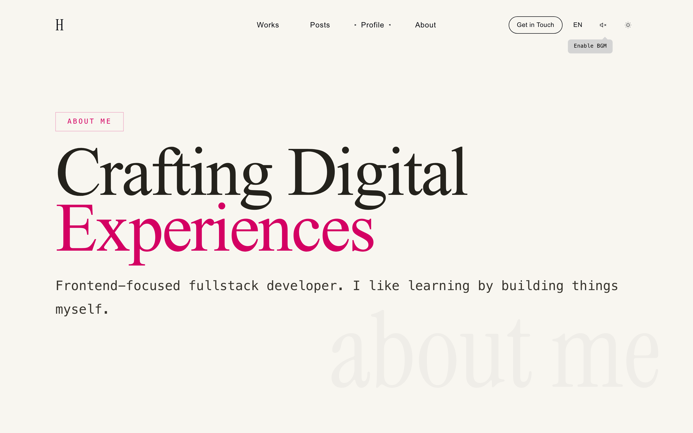

## About (`/about`)

- 가운데 별자리 지도에서 장으로 날아 들어가는 구성이다(`PreziStage`). 장은 한눈에 보기 · 기능 · AI · 구조 · 설계 결정 · 디자인 · 코드 · 만든 과정 · 신뢰 · 질문 순서다.
- 첫 화면에 방문자 시각 · 날씨와 발행된 글 수 · 최근 글 · 작업물 수가 나온다.
- 구조 장의 ERD 와 API 지도는 빌드 전에 `supabase/setup.sql` 과 라우트 파일에서 만든다. 설계 결정 · 보안 · 작업 과정은 `content/about/` 의 md 에서 만든다([md-content-guide.md](./md-content-guide.md)). 관리자 화면에서 고치지 않는다.
- AI 장에는 번역 · 요약 · 커버 · 음성을 직접 돌려 보는 라이브 데모가 있다. 하루 사용 횟수에 상한이 있다.

  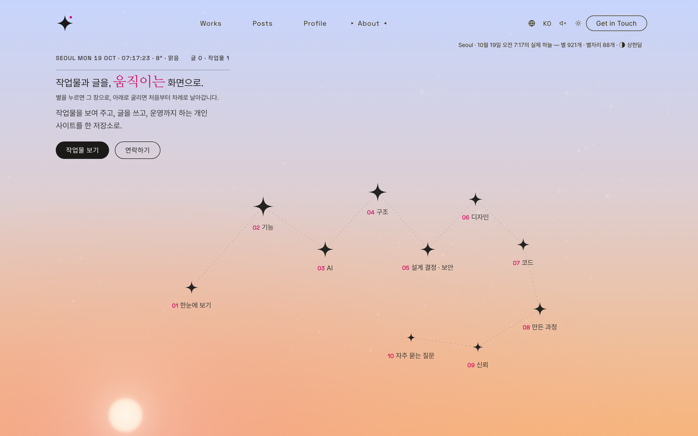
  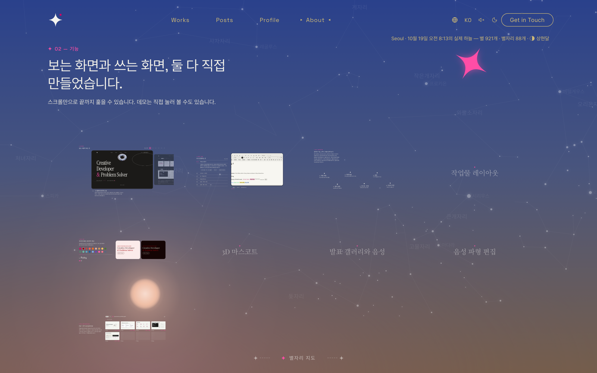

## 관리자

로그인 화면은 `/admin/login` 이다. 멤버는 GitHub OAuth, 소유자는 비밀번호로도 들어온다. 자세한 흐름은 [Supabase 세팅](./supabase-setup.md#5-admin-로그인-방법)과 [Security](./security.md) 에 있다.

- **대시보드 (`/admin`)**: 조회 · 방문 추세, 기기 · 유입 · 국가 분포, 방문 히트맵. 트래픽 화면에서는 IP 별 방문과 UTM 링크 만들기를 쓴다.
- **알림 · 신고 · 댓글 관리**: 새 댓글 · 로그인 · 실패한 외부 호출 같은 시스템 알림, 신고 처리(해결 · 기각 · 삭제), 글 · 작업물 댓글 일괄 관리.
- **서비스 기록 (`/admin/service-log`, 소유자 전용)**: AI · 메일 · GitHub · 예약 작업 호출의 성공과 실패.
- **글 · 작업물 목록**: 발행 상태 즉시 전환, 일괄 선택, 순서 바꾸기, 휴지통(복원 · 기한 연장), `.md` 업로드 · 내보내기([md-content-guide.md](./md-content-guide.md)).
- **편집기**: Markdown ↔ Rich Text 전환, 슬래시 메뉴, 투표 · 탭 · 캘린더 · 다이어그램 · 코드 플레이그라운드 · mermaid 블록, 자동 번역, 커버 이미지 선택기(프리셋 · 저장소 이미지 · Unsplash · Pexels · AI · 이력), 커버가 없는 글의 공유 카드 자동 생성(제목 카드), SEO 점검, 미리보기. 문법과 단축키는 [editor-guide.md](./editor-guide.md) 에 있다.
- **저장**: 자동 저장과 리비전 기록, diff 비교와 되돌리기, 두 탭에서 같은 글을 고칠 때 충돌 확인, 예약 발행.
- **설정 (`/admin/settings`)**: 일반 · 콘텐츠 · 라이브러리 · 외관 · 서비스 · 계정 6탭. 계정 탭을 뺀 다섯 탭은 소유자만 연다. 탭 내용은 [Supabase 세팅](./supabase-setup.md#5-admin-로그인-방법) 의 표에 있다.
- **멤버**: 소유자가 이메일로 저자 · 편집자를 초대한다. 저자는 자기 글과 팀원으로 등록된 작업물만 고친다.
- **보안**: 5회 실패 시 15분 잠금, 처음 보는 기기의 메일 승인, 모든 기기에서 로그아웃.

## 디자인 시스템 (`/design-system`)

토큰과 공용 컴포넌트를 한 화면에서 본다. 규칙은 [design-system.md](./design-system.md), 토큰 값은 [tokens.md](./tokens.md) 에 있다.

  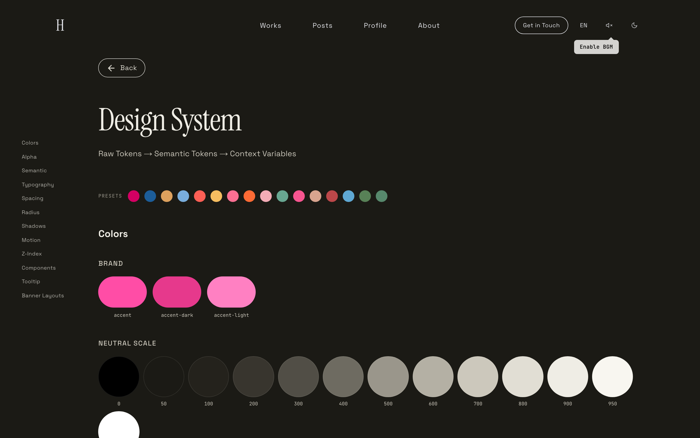
  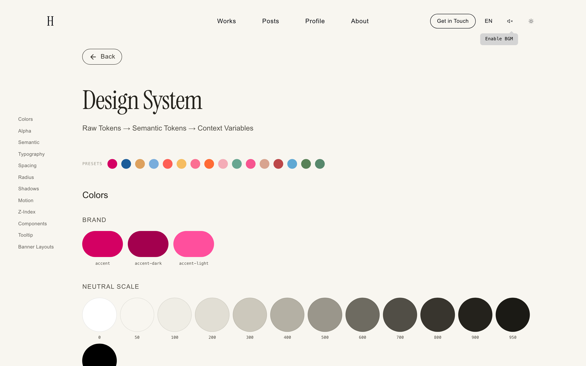

