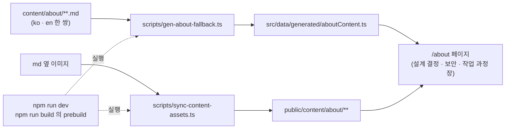

# .md 콘텐츠 가이드

글(posts), 작업물(works), About 은 저장소의 마크다운 파일로도 쓸 수 있다. 세 가지는 파일이 화면에 닿는 길이 다르다.

| 대상 | 파일 위치 | 화면에 닿는 길 |
| --- | --- | --- |
| 글 | `content/posts/*.md` | 동기화 스크립트가 Supabase `posts` 표에 쓴다 |
| 작업물 | `content/works/*.md` | 동기화 스크립트가 Supabase `works` 표에 쓴다 |
| About | `content/about/**.md` | 빌드 전에 TS 파일로 구워 페이지가 직접 읽는다 |

---

## 1. About

### 1-1. 파일이 화면까지 가는 길

About 페이지의 본문은 DB 나 관리자 설정을 거치지 않는다. `content/about/` 의 md 를 빌드 전에 `src/data/generated/aboutContent.ts` 로 구워 넣고, 페이지가 그 파일을 import 한다. 관리자 설정의 About 편집 화면과 내보내기 버튼은 없어졌다.



`gen-about-fallback.ts` 와 `sync-content-assets.ts` 는 `npm run dev` 와 `prebuild` 에 들어 있다. 그래서 md 를 고친 뒤 개발 서버를 다시 띄우거나 빌드하면 화면에 반영된다. 생성 파일을 손으로 고치지 않는다. 직접 다시 만들려면 다음 명령을 쓴다.

```bash
npm run gen-about-fallback
```

생성 파일이 md 와 맞는지만 확인할 때는 `npx tsx scripts/gen-about-fallback.ts --check` 를 쓴다.

페이지가 DB 에서 읽는 것은 첫 화면의 숫자뿐이다. 발행된 글 수, 최근 글, 작업물 수가 그것이다.

`npm run sync-about` 은 같은 md 를 `site_settings` 에 쓰는 스크립트다. 지금 About 페이지는 그 값을 읽지 않으므로, 화면을 바꾸는 데 이 스크립트는 필요 없다.

### 1-2. 폴더

| 폴더 · 파일 | 내용 | 지금 About 페이지에서 쓰는 곳 |
| --- | --- | --- |
| `content/about/decisions/` | 설계 결정 | 설계 결정 장 |
| `content/about/security/` | 보안 계층 | 보안 장 |
| `content/about/process/` | 작업 과정 단계 | 작업 과정 장 · 크레딧 |
| `content/about/features/` | 기능 | 생성 파일에는 들어가지만 페이지가 읽지 않는다 |
| `content/about/overview.md` · `credits.md` | 개요 · 크레딧 | 생성 파일에 들어가지 않는다 |

폴더 목록은 [`src/lib/about/contentSources.ts`](../src/lib/about/contentSources.ts) 한 곳에 있고 생성 스크립트와 동기화 스크립트가 같이 본다.

### 1-3. 파일 형식

한 항목은 파일 두 개다. `<이름>.md` 가 한국어, `<이름>.en.md` 가 영어다. en 파일이 없으면 ko 내용을 그대로 쓴다. 파일명 앞의 번호가 표시 순서다. 순서를 바꾸려면 번호만 고친다.

**설계 결정**은 머리말, 제목, 인용 한 줄, 소제목 네 개로 이뤄진다.

```md
---
id: role-stored-in-app-metadata
section: 인증 / 인가
difficulty: 2
tags: [auth, jwt, rls]
---
# 권한 데이터의 신뢰 경계 설계

> 역할 정보를 어디에 저장할 것인가

## Context
...
## Considerations
...
## Decision
...
## Key Insight
...
```

| 키 | 뜻 |
| --- | --- |
| `id` | 항목 식별자. 없으면 파일명에서 번호를 뗀 값을 쓴다 |
| `section` | 묶음 이름 |
| `difficulty` | 1(쉬움) · 2(보통) · 3(어려움) |
| `tags` | 태그 목록 |

제목(`# `) 아래 인용 한 줄(`> `)은 요약이다. 없으면 제목을 그대로 쓴다.

**보안 · 기능 · 작업 과정**은 머리말, 제목 한 줄, 본문으로 끝난다.

```md
---
layer: SQL Injection
icon: db
scope: 모든 DB 쿼리
---
# SQL Injection 방지

모든 DB 쿼리에 Supabase **파라미터화 쿼리**를 사용합니다. …
```

| 폴더 | 머리말 키 |
| --- | --- |
| `security/` | `layer` · `icon` · `scope` |
| `features/` | `icon` · `tech: [a, b]` · `image` |
| `process/` | `step` |

### 1-4. 이미지

이미지는 그 항목의 md 옆 폴더에 두고 상대 경로로 참조한다. VS Code 미리보기에서 그대로 보이고, 항목을 지우면 폴더째 같이 지워진다.

```
content/about/decisions/
  01-role-stored-in-app-metadata.md
  01-role-stored-in-app-metadata/
    permission-storage-flow.svg
```

```md


*세 기준을 차례로 적용하면 `app_metadata` 하나가 남는다.*
```

이미지 바로 다음 줄의 `*...*` 한 줄은 그 이미지의 캡션이 된다. 생성 스크립트는 `./` 로 시작하는 경로를 `/content/about/<폴더>/...` 로 바꿔 적는다.

Next 는 `content/` 를 서빙하지 않는다. 그래서 `sync-content-assets.ts` 가 개발 서버 시작과 빌드 전에 이미지를 `public/content/` 로 복사한다. 원본이 사라진 파일은 함께 지우므로 md 에서 뺀 이미지가 배포에 남지 않는다. `public/content/` 는 생성물이라 git 에 넣지 않는다. 수동 실행은 `npm run sync-content-assets` 다.

### 1-5. 걸리기 쉬운 것

**소제목 철자.** 설계 결정의 네 소제목(`Context` · `Considerations` · `Decision` · `Key Insight`)은 철자 그대로 써야 한다. 다른 이름을 쓰면 그 단이 빈다.

**`vizKey` 와 `[[viz]]`.** 예전 About 패널은 머리말 `vizKey` 와 본문의 `[[viz]]` 표시로 도형을 그렸다. 파서는 지금도 두 값을 읽어 생성 파일에 넣는다. 그러나 지금 About 페이지는 이 값으로 도형을 그리지 않는다. 새 항목에는 넣지 않아도 된다.

**같은 `id` 두 개.** 두 파일이 같은 `id` 를 쓰지 않게 한다. 파일명을 바꿀 때 머리말의 `id` 도 함께 확인한다.

---

## 2. 글 · 작업물

### 2-1. 관리자 화면에서 올리기

관리자의 글 목록과 작업물 목록에 `.md 업로드` 버튼이 있다. 여러 파일을 한 번에 고를 수 있다.

- 머리말의 `title` 이 없으면 파일명(확장자 제외)이 제목이 된다.
- 본문이 글은 `content`, 작업물은 `content_ko` 에 들어간다.
- 새로 만든 항목은 비공개 초안이다.
- 커버(글은 `cover_image`, 작업물은 `image`)가 없으면 무작위 프리셋 커버를 만들어 붙인다.
- 글에 등록되지 않은 카테고리가 있으면 새로 만들지 먼저 묻는다.

### 2-2. 폴더 동기화

`content/posts/` · `content/works/` 에 md 를 두고 명령으로 DB 에 쓴다. 쓰기 방향은 파일에서 DB 로 한쪽뿐이다.

```bash
npm run sync-posts:dry    # 무엇이 바뀌는지만 출력한다(DB 쓰기 없음)
npm run sync-posts
npm run sync-works:dry
npm run sync-works
npm run sync-all          # 글 → 작업물 → About 순서로 셋 다 돌린다
```

실행 전 `.env.local` 에 `NEXT_PUBLIC_SUPABASE_URL` 과 `SUPABASE_SERVICE_ROLE_KEY` 가 있어야 한다. 둘 중 하나라도 없으면 아무것도 하지 않고 끝난다.

동기화는 빌드에 붙어 있지 않다. `build` 는 `next build` 만 실행하고, `prebuild` 에도 동기화 스크립트는 없다. 배포한다고 파일이 DB 에 들어가지 않으므로 필요할 때 직접 실행한다.

| | 글 | 작업물 |
| --- | --- | --- |
| 기존 항목을 찾는 기준 | `slug` | `title`(휴지통에 있는 항목은 제외) |
| 없을 때 | 비공개 초안으로 INSERT | 비공개 초안으로 INSERT |
| 있을 때 | 파일 수정 시각이 DB `updated_at` 보다 나중이면 UPDATE | 같은 조건으로 UPDATE |
| UPDATE 가 지키는 값 | 공개 여부 등 관리자 화면 몫 | 공개 여부. `sort_order` 는 DB 값이 0 일 때만 파일의 `order` 로 채운다 |
| 파일이 없는 DB 항목 | 건드리지 않는다 | 건드리지 않는다 |

작업물 동기화는 DB 에 쓰기 전에 본문 · 커버 · 갤러리에 적힌 로컬 주소(`/content/…`)의 파일을 Supabase 저장소에 올리고 저장소 주소로 바꾼다. 저장 이름에 파일 내용의 해시가 붙어, 같은 파일은 다시 올리지 않는다. 로컬에 없는 파일은 주소를 그대로 두고 경고만 남긴다. 글 동기화에는 이 단계가 없다.

### 2-3. DB 에서 .md 로 내보내기

목록 화면에서 전체 · 선택 · 개별 단위로 내려받는다. 글은 시리즈 단위로도 내려받는다. 내보낸 파일을 `content/posts/` · `content/works/` 에 넣으면 동기화 대상이 된다.

```
GET /api/posts/export?id=<post-id>           # 글 하나
GET /api/posts/export?all=true               # 전체
GET /api/posts/export?series_id=<series-id>  # 시리즈 하나
GET /api/works/export?id=<work-id>           # 작업물 하나
GET /api/works/export?all=true               # 전체
```

### 2-4. 글 머리말

```markdown
---
title: Next.js 15 마이그레이션 가이드
title_en: Migrating to Next.js 15
slug: nextjs-15-migration
category: 프론트엔드
tags: [Next.js, React, Migration]
excerpt: Next.js 14에서 15로 옮긴 과정
icon: 🚀
github_url: https://github.com/me/next15-demo
pinned: true
cover_image: https://example.com/image.jpg
date: 2024-03-15
---

## 개요

본문 내용...
```

| 필드 | 타입 | 설명 | 기본값 |
|------|------|------|--------|
| `title` | string | 제목 | 파일명 |
| `title_en` | string | 영문 제목 | 없음 |
| `slug` | string | URL 슬러그 | 제목에서 생성 |
| `category` | string | 카테고리. 2단계 중 소분류를 적고, 대분류는 자동으로 정해진다 | `기타` |
| `tags` | string[] | 태그 목록 | 없음 |
| `excerpt` / `excerpt_en` | string | 요약 (한/영) | 없음 |
| `language` | `ko` \| `en` | 기본 언어 | ko |
| `icon` | string | 아이콘 (이모지 또는 이미지 URL) | 없음 |
| `github_url` | string | 연결할 GitHub URL | 없음 |
| `pinned` | boolean | 상단 고정. `is_pinned` 로 써도 된다 | false |
| `cover_image` | string | 커버 이미지 URL | 없음 |
| `cover_position` | number | 커버 세로 위치 % (0~100) | 50 |
| `cover_zoom` | number | 커버 확대 배율 (1~2.5) | 1 |
| `date` | string | 작성 시각 (ISO 8601 또는 `YYYY-MM-DD`) | 만든 시점 |

`tags` 는 `[React, Next.js]` 처럼 목록으로 쓰거나 `React` 처럼 하나만 쓴다. `date` 는 `2024-03-15` 와 `2024-03-15T14:30:00+09:00` 둘 다 받는다. 발행하려면 제목 · 슬러그 · 카테고리 · 본문이 필요하다. 초안은 제목만 있어도 만들어진다.

다른 정적 블로그(Jekyll · Hugo)에서 옮길 때는 md 파일을 `content/posts/` 에 복사하고 `sync-posts:dry` 로 결과를 먼저 본다. 위 표에 없는 머리말 키(`layout`, `permalink` 등)는 무시된다.

### 2-5. 작업물 머리말

```markdown
---
title: NewPick
title_en: NewPick
slug: newpick
subtitle: 관심 분야만 골라 AI 가 요약해 주는 뉴스레터 서비스
category: 웹앱
nature: 부트캠프 프로젝트
order: 7
year: 2024
tech: [Next.js 15, TypeScript, NestJS]
description: 관심 분야를 고르면 뉴스를 모아 요약해 보내는 서비스입니다.
role: 기획 · 프론트엔드 셋업 · 유저 인증
image: https://example.com/thumb.jpg
live_url: https://example.com
github_url: https://github.com/user/repo
---


## 개요

본문 내용...
```

| 필드 | 타입 | 들어가는 칼럼 |
|------|------|------|
| `title` / `title_en` | string | `title` / `title_en`. `title` 이 없으면 파일명 |
| `slug` | string | `slug`. 없으면 제목에서 생성 |
| `subtitle` / `subtitle_en` | string | `subtitle_ko` / `subtitle_en` |
| `category` / `category_en` | string | `categories_ko` / `categories_en`. 쉼표로 여러 개 |
| `nature` / `nature_en` | string | `nature_ko` / `nature_en` |
| `year` | string | `year` |
| `tech` | string[] | `tech` |
| `description` / `description_en` | string | `description_ko` / `description_en` |
| `role` / `role_en` | string | `role_ko` / `role_en` |
| `icon` | string | `icon` |
| `image` | string | `image` (대표 이미지) |
| `live_url` · `github_url` | string | `live_url` · `github_url` |
| `order` | number | `sort_order`. 작을수록 목록 앞 |
| `format` | `richtext` | 본문이 편집기가 저장하는 HTML 이면 `content_type` 을 `richtext` 로 둔다 |

작업물은 `slug` 가 있어도 동기화가 `title` 로 기존 항목을 찾는다. 제목을 바꾸면 새 작업물로 들어가므로, 제목을 고칠 때는 관리자 화면에서 바꾼다.

작업물 이미지는 `content/works/<slug>/` 폴더에 두고 `/content/works/<slug>/파일명` 으로 적는다. 개발 서버와 빌드는 이 폴더를 `public/content/` 로 복사하고, 동기화는 2-2 의 규칙대로 저장소에 올린다.
