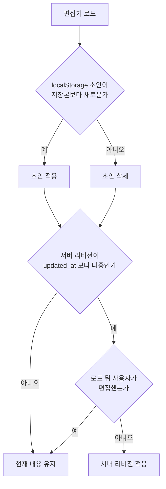

# Trouble Shooting: 아키텍처 · 데이터

[← 전체 목차](../troubleshooting.md)

<strong>11. React 재조정: 같은 자리의 컴포넌트 타입이 바뀌면 서브트리가 리마운트된다</strong>

**증상**: 페이지에서 처음 언어를 전환하는 것처럼 첫 클릭을 하면 로딩 화면이 다시 나타났다. 두 번째부터는 정상으로 동작했다.

**원인**: 당시 `RecaptchaProvider` 는 첫 클릭 이벤트에서 `shouldLoad` 를 `false` 에서 `true` 로 바꿨고, 그에 따라 렌더 트리가 `<>{children}</>` 에서 `<GoogleReCaptchaProvider>{children}</GoogleReCaptchaProvider>` 로 바뀌었다. React 는 같은 위치의 컴포넌트 타입이 바뀌면 하위 트리 전체를 언마운트한 뒤 다시 마운트한다. 로딩 화면 훅의 상태도 초기값(로딩 중)으로 다시 만들어져 로딩 화면이 다시 나타났다.

**해결**: 먼저 로딩 완료 여부를 모듈 수준 변수 `hasCompletedInitialLoad` 로 기록해 리마운트되어도 로딩 화면을 건너뛰게 했다. 이 변수는 지금도 `src/hooks/useLoadingProgress.ts` 에 있다.

근본 수정으로 트리 구조가 바뀌는 원인을 없앴다. 지금의 `RecaptchaProvider` 는 조건부로 감싸지 않고 항상 같은 Context Provider 로 children 을 렌더링한다. reCAPTCHA 스크립트는 `load()` 가 `<script>` 를 직접 head 에 넣어 불러오고, 연락 서랍(`ContactDrawerWrapper`)이 열릴 때만 `load()` 를, 닫힐 때 `unload()` 를 호출한다.

**결론**: 서드파티 Provider 를 조건부로 감싸면(`Fragment` 와 `Provider` 전환) React 가 하위 트리를 리마운트한다. 지연 로딩이 필요하면 트리 모양은 고정하고 스크립트 로딩만 명령형으로 처리해야 한다.

<strong>12. 자동저장 설계: 저장하지 않을 조건과 복원해도 되는 조건</strong>

**증상**: 자동저장을 만들고 다듬는 동안 네 가지 문제가 차례로 나왔다.

1. 편집기를 열고 아무것도 고치지 않았는데 자동저장 리비전이 생겼다.
2. 처음에는 `localStorage` 에만 저장해서 다른 탭이나 기기에서 이어 쓸 수 없었다.
3. 기존 글에서 블록을 옮기거나 편집하면 자동저장 뒤 내용이 통째로 옛 버전으로 되돌아갔다.
4. 아직 저장하지 않은 새 글에서는 자동저장 요청이 모두 500 으로 실패했다.

**원인**:

1. 변경 여부를 판단하는 비교 기준의 초기값이 빈 문자열(`""`)이었다. 첫 비교에서 현재 폼의 `JSON.stringify` 결과와 `""` 가 항상 달라 변경으로 판단했다. 기준을 실제 폼으로 맞춘 뒤에도, 본문 편집기가 저장된 HTML 을 불러와 자기 형식으로 다듬으면서 생기는 자동 변경이 리비전을 만들었다(#837).
2. `localStorage` 는 같은 브라우저 안에서만 읽힌다.
3. 서버 리비전 자동복원은 "아직 무시(dismiss)되지 않은 최근 리비전" 을 불러왔다. 그런데 기존 글의 과거 저장은 `posts.updated_at` 을 갱신하지 않았다. 그래서 저장본보다 오래된 리비전을 오래됐다고 판정하지 못했다. 한동안은 서버 자동복원을 끄고 `localStorage` 복원만 썼다.
4. `revisions.entity_id` 가 uuid 타입이었다. 저장 전의 새 글은 `posts.id` 가 없어 draft sentinel 문자열(`"draft-new-post"`)을 `entity_id` 로 보냈고, uuid 캐스팅에서 실패했다.

**해결**: 저장은 두 층으로 나누고, 복원은 두 단계로 나눴다.

- `useEditorDraft` 는 입력이 바뀔 때마다 `localStorage` 에 초안을 쓴다. 예상하지 못한 탭 종료나 새로고침에 대비한 같은 기기용 백업이다. 실제 저장에 성공하면 지운다.
- `useEditorAutoSave` 는 마지막 편집 뒤 3초가 지나면 `POST /api/revisions` 로 DB 리비전을 남긴다. 페이지를 떠날 때(탭 숨김, `beforeunload`, SPA 이동)는 `navigator.sendBeacon` 으로 마지막 상태를 보낸다. sendBeacon 은 최선 노력 방식이라 전송이 보장되지는 않는다.

저장하지 않는 조건은 다음과 같다. 비교 기준은 처음 유효한 id 를 얻었을 때의 스냅숏 해시로 잡는다. 사용자가 키 입력, 포인터, 붙여넣기, 끌어 놓기, IME 조합 중 하나라도 하기 전의 변경은 불러오기 과정의 자동 변경으로 보고 기준에 흡수한다. 공통 접두사와 접미사를 뺀 실제 변경 구간이 10자 미만이면 저장하지 않는다. 저장 중에는 mutex 로 중복 요청을 막는다.

복원은 다음 순서로 한다. 1단계에서 `localStorage` 초안이 있고 저장본(`updated_at`)보다 새로우면 적용하고, 오래됐으면 지운다. 2단계에서 서버의 가장 최근 미무시 리비전을 불러오되, 그 리비전이 `updated_at` 보다 나중에 만들어졌고 사용자가 아직 편집하지 않았을 때만 적용한다. 글을 저장하면 `updated_at` 을 갱신하고 그 글의 리비전을 모두 dismissed 로 표시한다.

`revisions.entity_id` 는 마이그레이션 `2026_08_05_revisions_entity_id_text.sql` 로 text 타입으로 바꿨고 `setup.sql` 에도 반영했다.

**결론**: 자동저장은 주기적으로 저장하는 것보다 저장하지 않을 조건을 정하는 일이 더 중요하다. 비교 기준을 실제 초기 상태로 잡고, 불러오기의 자동 변경과 사용자 편집을 구분해야 한다. 복원은 저장본보다 나중이라는 시각 비교가 성립할 때만 안전하다. 아직 존재하지 않는 엔티티를 임시로 참조해야 하면 그 컬럼은 uuid 가 아니라 text 여야 한다.

<strong>13. SSR 포함 여부: 첫 화면을 덮는 오버레이는 서버 HTML 에 실려야 한다</strong>

**증상**: 페이지를 불러오면 콘텐츠가 잠깐 보인 뒤에 로딩 화면(검은 배경)이 나타났다.

**원인**: `LoadingScreen` 을 `ClientOverlays` 안에서 `dynamic(() => import(...), { ssr: false })` 로 불러왔다. 그래서 서버 HTML 에 포함되지 않았다. 브라우저가 JS 번들을 받고 하이드레이션을 마친 뒤에야 `LoadingScreen` 이 마운트되었고, 그 사이에 콘텐츠가 보였다.

**해결**: `LoadingScreen` 을 일반 import 로 바꿔 서버 HTML 에 포함시켰다. 서버 스냅숏의 로딩 상태 초기값이 `isLoading: true` 이므로 검은 덮개가 HTML 에 그려진 채 도착한다. 이후 `ClientOverlays` 가 본문과 푸터 뒤에 있어서 HTML 스트리밍 중 첫 패널이 덮개보다 먼저 그려지는 문제가 남았다. 지금은 루트 레이아웃이 `<body>` 맨 앞에서 `<LoadingScreen />` 을 렌더링한다. 나머지 오버레이(Modal, CursorTrail 등)는 서버에서 그릴 필요가 없어 지연 로딩을 유지했다.

**결론**: 첫 화면을 덮어야 하는 오버레이는 서버 HTML 에 들어 있어야 한다. `ssr: false` 로 불러온 컴포넌트는 하이드레이션 뒤에 나타난다. HTML 은 스트리밍되므로 덮개는 문서에서 콘텐츠보다 앞에 있어야 한다.

<strong>14. 소프트 삭제와 복구성: 되살리려면 삭제가 파괴적이면 안 된다</strong>

**증상**: 삭제(tombstone)된 댓글을 되살리는 기능을 만들었는데, `is_deleted` 만 되돌리면 내용이 빈 댓글이 복구됐다.

**원인**: 댓글을 tombstone 처리할 때 프라이버시를 위해 `content`, `password_hash`, `commenter_hash` 를 모두 빈 값으로 덮어썼다. 복구할 원문이 DB 에 남아 있지 않았다.

**해결**: 삭제할 때 내용은 보존하고, 노출은 공개 API 응답에서 막는다.

1. tombstone 처리는 `is_deleted` 와 `deleted_by` 만 설정하고 내용은 그대로 둔다.
2. 공개 GET 은 `is_deleted` 행의 `content` 와 `commenter_hash` 를 응답에서 빈 값으로 바꾼다. UI 는 삭제된 댓글에 placeholder 를 그린다. 관리자 GET 은 원문을 그대로 주므로 복구 미리보기에 쓸 수 있다.
3. 복구 엔드포인트는 `is_deleted=true` 인 행만 대상으로 한다. 하드 삭제로 행이 사라진 댓글은 매칭되지 않아 404 를 반환한다.

**결론**: 복구할 수 있는지는 삭제할 때 무엇을 지웠는지에 달려 있다. 삭제가 데이터를 파괴하지 않고 노출을 API 응답 단계에서 막으면 프라이버시와 복구성을 함께 지킬 수 있다.

<strong>15. 서버 쿠키와 클라 내비게이션: 인증 상태가 바뀌면 전체 리로드</strong>

**증상**: 이메일 로그인에 성공해도 관리자 페이지에 들어가려면 새로고침이 필요했다. 네비게이션의 로그인 상태 표시(이메일, 알림, 로그아웃)도 나타나지 않았다.

**원인**: 로그인은 서버 라우트에서 처리되고, 응답의 Set-Cookie 로 세션 쿠키만 심긴다. 브라우저의 Supabase 클라이언트는 SIGNED_IN 이벤트를 받지 못한다. 이 상태에서 `router.push` 로 이동하면 서버 layout 의 `getUser()` 가 새 쿠키를 보지 못한다. 루트에 계속 마운트되어 있던 Navigation 의 훅은 마운트할 때 한 번만 쿠키를 확인하므로 다시 확인하지 않는다.

**해결**: 로그인 성공 후 이동을 `window.location.assign` 으로 바꿔 전체 리로드를 한다. GitHub OAuth 의 서버 redirect 와 같은 방식이다. 전체 리로드로 Navigation 이 새 쿠키를 가진 상태에서 다시 마운트되어 두 증상이 함께 사라졌다.

**결론**: 서버가 심은 쿠키는 클라이언트 내비게이션으로 이미 마운트된 컴포넌트에 전달되지 않는다. 인증 상태를 바꾼 직후에는 전체 내비게이션을 하는 것이 안전하다.

<strong>16. 외부 서비스 신뢰성 측정: 콘솔 오류가 아니라 상태 코드 분포로</strong>

**증상**: 첨부한 오피스 문서의 미리보기 iframe 이 수시로 비었고, Chrome 이 "gview 다운로드 실패" 알림을 띄웠다.

**원인**: `docs.google.com/gview?embedded=true` 는 iframe 요청(`Sec-Fetch-Dest: iframe`)에 12번 중 5번꼴로 204 빈 응답을 돌려줬다. 그러면 iframe 이 비고, Chrome 은 그 이동을 파일 다운로드 시도로 처리해 실패 알림을 띄운다. 코드가 아니라 서비스 자체의 동작이었다.

**해결**: MS 뷰어(`view.officeapps.live.com/op/embed.aspx`)로 바꿨다. 같은 조건에서 8번 모두 200 을 받았다. 저장된 HTML 에 남아 있는 예전 gview 주소는 렌더링할 때 `migrateOfficeViewerUrls` 가 바꾼다. MS 뷰어 콘솔의 `appChrome is not defined` 오류는 화면과 관계가 없다. 이전에 이 콘솔 오류만 보고 gview 로 옮겼다가 204 문제를 만났다.

**결론**: 외부 뷰어의 신뢰성은 콘솔 오류가 아니라 상태 코드 분포로 판단해야 한다. curl 에 `Sec-Fetch-Dest: iframe` 헤더를 넣고 반복 호출해 측정했다.

<strong>17. 한 컬럼 두 표현: 해석 로직은 소비자 전원이 공유해야 한다</strong>

**증상**: 작업물 카드의 연도 자리에 `{"start":{"year":2024,...}}` 같은 JSON 원문이 그대로 표시됐다.

**원인**: 편집기는 기간 입력을 JSON 문자열로 `year` 컬럼에 저장하는데, 목록 화면은 그 값을 그대로 출력했다. 기간을 문자열로 조립하는 로직은 편집기 미리보기에만 있었다.

**해결**: `parseStoredPeriod` 와 `formatWorkYear` 유틸을 분리했다. 저장값이 JSON 기간이면 언어에 맞는 기간 문자열로 바꾸고, 아니면 원문을 그대로 보여 준다. 연도를 그리는 컴포넌트들이 이 유틸을 함께 쓴다.

**결론**: 한 컬럼에 평문과 JSON 두 표현이 함께 있으면 해석 로직은 유틸 한 곳에 두고 모든 소비자가 공유해야 한다. 편집기에만 두면 공개 화면에 원문이 노출된다.

