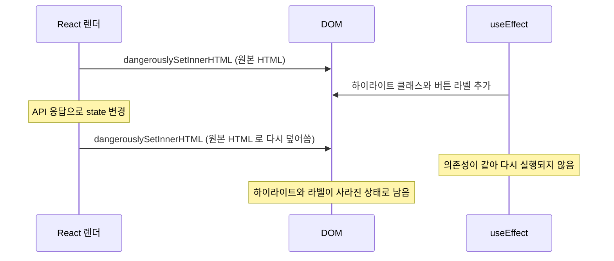

# Trouble Shooting: 마크다운 · 콘텐츠 렌더링

[← 전체 목차](../troubleshooting.md)

<details>
<summary><strong>47. 렌더 전 완성 원칙: dangerouslySetInnerHTML 과 DOM 조작의 충돌</strong></summary>

**증상**: Plate 에디터로 작성한 richtext 글의 코드블록에서 구문 하이라이팅과 줄바꿈/스크롤 토글 버튼 라벨이 사라졌다. 마크다운 글에서는 정상이었다.

**원인**: 하이라이팅(당시 highlight.js)과 버튼 라벨을 `useEffect` 에서 DOM 을 직접 바꿔 적용했다. 페이지가 뜬 뒤 좋아요 수, 인접 글, 추천 글 같은 API 응답이 도착하면 state 가 바뀌어 컴포넌트가 다시 렌더링된다. 이때 `dangerouslySetInnerHTML` 이 원본 HTML 로 DOM 을 다시 덮어써 effect 가 넣은 클래스와 라벨이 모두 사라졌다. effect 의 의존성은 바뀌지 않았으므로 다시 실행되지 않았다. 마크다운 글은 `MarkdownRenderer` 가 하이라이팅이 끝난 HTML 을 만들어 넘기므로 영향이 없었다.



**해결**: DOM 을 고치는 대신 렌더 전에 HTML 문자열을 완성한다. 버튼 라벨은 `processRichtextHtml` 이 `useMemo` 안에서 HTML 에 넣는다. 구문 하이라이팅은 상세 페이지 서버 컴포넌트가 `highlightRichtextCode`(Shiki)로 코드블록 HTML 을 미리 칠해서 넘긴다. `useMemo` 의 의존성에는 번역 함수 `t` 대신 라벨 문자열만 둔다. `t` 를 두었을 때 언어가 확정되며 `t` 의 참조만 바뀌어도 같은 내용으로 새 문자열이 만들어졌고, `dangerouslySetInnerHTML` 이 다시 설정되어 후처리가 사라졌다.

```tsx
const processedRichtextHtml = useMemo(() => {
  if (isMarkdown) return "";
  return processRichtextHtml(content, { codeScroll, codeWrap });
}, [isMarkdown, content, codeScroll, codeWrap]);
```

`PostArticleView.tsx` 의 코드다. effect 는 클릭 이벤트 위임처럼 DOM 을 바꾸지 않는 일과, 같은 HTML 에 한 번만 걸리는 후처리만 맡는다.

**결론**: `dangerouslySetInnerHTML` 로 그린 콘텐츠를 `useEffect` 에서 고치면 어떤 이유로든 다시 렌더링될 때 변경이 사라진다. HTML 은 렌더 전(useMemo 나 서버)에 완성해야 하고, 그 HTML 문자열은 내용이 같으면 새로 만들지 않아야 한다.


</details>

<details>
<summary><strong>48. 파서 확장의 실행 순서: renderer 대신 postprocess</strong></summary>

**증상**: 마크다운 렌더러에서 제목(`# 제목`)과 각주(`[^1]`)를 함께 쓰면 각주 번호가 어긋나거나 제목 안의 각주가 변환되지 않았다.

**원인**: 커스텀 heading renderer 가 `marked-footnote` 확장보다 먼저 실행됐다. 제목 안의 `[^1]` 이 각주로 바뀌기 전에 renderer 가 원본 텍스트를 처리해 버렸다. 그 결과 제목 안의 각주 참조가 일반 텍스트로 남고, 나머지 각주의 번호도 하나씩 밀렸다.

```
# 제목 [^1]     ← heading renderer 가 먼저 처리해 [^1] 이 변환되지 않음
본문 [^2]        ← [^1] 이어야 할 번호가 밀림
```

**해결**: heading renderer 를 지우고 `postprocess` 훅으로 대체했다. `marked-footnote` 가 모든 각주를 먼저 처리한 뒤, postprocess 에서 제목에 `id` 속성만 추가한다. 또 `markedFootnote({ keepLabels: true })` 로 작성자가 입력한 각주 번호(`[^2]` 는 2)를 그대로 쓴다.

**결론**: marked 확장과 커스텀 renderer 가 같은 구문을 다루면 실행 순서가 결과를 정한다. postprocess 훅을 쓰면 모든 확장이 처리된 뒤에 후처리할 수 있다.


</details>

<details>
<summary><strong>49. 런타임 변환과 저장값의 괴리: 에디터에서만 재생되는 URL</strong></summary>

**증상**: 에디터에서 YouTube 영상을 넣을 때 `youtube.com/watch?v=xxx` 형태의 주소를 입력하면 에디터에서는 재생됐지만 글 상세 페이지에서는 빈 화면이 나왔다.

**원인**: 에디터 안에서는 `parseEmbed()` 가 watch 주소를 embed 주소로 바꿔 보여 준다. 그런데 `plateSerializer` 는 노드의 `url` 속성(원본 watch 주소)을 그대로 `<iframe src="...">` 로 직렬화했다. watch 주소는 iframe 에서 불러올 수 없다. 에디터가 보여 주는 주소와 DB 에 저장된 주소가 달랐다.

```
에디터 표시: youtube.com/embed/xxx  (parseEmbed 가 변환) → 재생됨
DB 저장:    youtube.com/watch?v=xxx (원본 그대로)       → iframe 로드 실패
```

**해결**: `fixEmbedUrls()`(`src/utils/htmlUtils.ts`)를 만들어 HTML 을 렌더링하기 직전에 iframe `src` 의 YouTube watch, shorts, youtu.be 주소를 embed 주소로, `vimeo.com/123` 을 `player.vimeo.com/video/123` 으로 바꾼다. 상세 페이지와 미리보기가 함께 쓰는 `processRichtextHtml` 이 이 함수를 호출한다.

**결론**: 에디터 안의 런타임 변환과 저장값이 다르면 에디터에서는 보이지만 실제 페이지에서는 보이지 않는 버그가 생긴다. 렌더링 직전에 주소를 정규화하는 단계를 두면 이미 저장된 글까지 함께 고칠 수 있다.


</details>

<details>
<summary><strong>50. React 밖의 DOM: native 리스너와 MutationObserver</strong></summary>

**증상**: 이미지를 불러오지 못하면 `/images/placeholder.svg` 로 바꾸도록 모든 이미지를 통일하려 했다. React 컴포넌트의 `` 는 동작했지만, `MarkdownRenderer` 처럼 `dangerouslySetInnerHTML` 로 그린 이미지와 `useRichtextEnhance` 가 다루는 richtext 영역의 이미지에서는 onError 가 실행되지 않아 깨진 이미지가 그대로 보였다.

**원인**: 세 가지가 있었다.

1. `dangerouslySetInnerHTML` 로 넣은 DOM 은 React 가 관리하지 않으므로 `onError` 같은 합성 이벤트 prop 이 연결되지 않는다.
2. 이미 요청이 끝나 실패한 이미지(`complete && naturalWidth === 0`)는 리스너를 늦게 달면 `error` 이벤트가 다시 발생하지 않는다.
3. 콘텐츠가 나중에 이미지를 추가하는 경우에는 처음의 `querySelectorAll` 로 잡히지 않는다.

**해결**: `src/lib/imageFallback.ts` 의 `attachImageFallback(root)` 를 `useRichtextEnhance` 와 `MarkdownRenderer` 가 함께 쓴다. 이 함수는 컨테이너 안의 모든 `` 에 native `error` 리스너를 달고, `data-fallback-bound` 로 중복 부착을 막는다. 리스너를 단 직후 `complete && naturalWidth === 0` 이면 바로 대체 이미지로 바꾼다. `MutationObserver(root, { childList: true, subtree: true })` 로 나중에 추가되는 이미지도 같은 방식으로 처리한다. 대체할 때는 `srcset` 도 지운다. `srcset` 이 남아 있으면 브라우저가 그 후보를 먼저 시도해 다시 깨질 수 있다. React 컴포넌트(편집기 커버, 갤러리, 관계 선택 칩, Plate 이미지 요소 등)는 `onError` 에서 state 를 바꾸는 방식을 쓴다.

**결론**: `dangerouslySetInnerHTML` 로 들어온 DOM 에는 React 합성 이벤트가 연결되지 않으므로 native `addEventListener` 를 써야 한다. 이미 실패한 이미지는 `error` 가 다시 발생하지 않으므로 리스너를 단 직후 상태를 동기로 확인해야 한다. 내용이 바뀌는 영역은 MutationObserver 로 새로 들어온 요소도 처리해야 한다.


</details>

<details>
<summary><strong>51. 단일 소스화: 미리보기와 상세가 같은 컴포넌트를 그리게</strong></summary>

**증상**: 관리자 편집기의 미리보기 화면이 실제 게시된 상세 페이지와 레이아웃, 간격, 코드블록 처리에서 계속 조금씩 달랐다.

**원인**: 미리보기는 상세 페이지와 별개로 만든 단순화 버전이었다. 상세 페이지의 마크업이나 스타일이 바뀔 때마다 미리보기를 따로 맞춰야 했고, 한쪽만 고치면 바로 어긋났다. richtext 처리(heading id, embed 주소 변환 등)도 서로 다른 코드 경로를 거쳐 출력이 달랐다.

**해결**: 상세 페이지의 본문 뷰를 공용 프레젠테이션 컴포넌트로 추출해 상세와 미리보기가 같은 컴포넌트를 그리게 했다. 글은 `PostArticleView.tsx` 의 `PostArticleHeader`, `PostArticleBody`, `PostArticleAuthors` 를, 작업물은 `WorkArticleHeader`, `WorkArticleBody`, `WorkArticleGallery` 등을 상세와 `admin/(preview)` 의 미리보기 페이지가 함께 쓴다. 댓글, 뒤로 가기처럼 미리보기에 없는 부분만 상세 쪽에서 더한다. richtext HTML 처리는 `src/utils/processRichtextHtml.ts` 한 곳에서 heading id 주입, embed 주소 변환, 줄바꿈 토글 라벨 삽입, 이미지 `data-cursor="zoom"` 주입을 같은 순서로 한다.

**결론**: 미리보기가 본 화면과 다르면 미리보기로서 쓸모가 없다. 같은 출력이 필요하면 동기화하는 대신 같은 컴포넌트와 같은 처리 함수를 쓰게 만들어, 한쪽만 바뀌는 상태가 생기지 않게 해야 한다.


</details>

<details>
<summary><strong>52. 댓글 체크리스트: 파서 문맥, DOMPurify 값 검사, :has() 매칭 범위</strong></summary>

**증상**: 댓글 마크다운의 체크리스트에서 문제가 이어서 나왔다.

1. `- [ ] 할 일` 이 체크박스가 아니라 일반 불릿으로 렌더링됐다. `ALLOWED_ATTR` 에 `type` 을 넣어 두었는데도 같았다.
2. 툴바의 체크박스 버튼을 빈 줄에서 누르면 체크박스가 아니라 불릿이 됐다. `---` 구분선 버튼은 앞 줄에 글이 있으면 구분선이 아니라 제목이 됐다.
3. 체크박스 목록의 불릿을 지우는 `:has()` 규칙이 어떤 목록에서는 적용되지 않았고, 어떤 목록에서는 일반 불릿까지 지웠다.

**원인**:

1. DOMPurify 는 URI-safe 로 알려진 속성이 아니면 그 값을 `ALLOWED_URI_REGEXP` 로 검사한다. 기본 URI-safe 목록(alt, class, title, value 등)에는 `type` 이 없다. 그래서 `type="checkbox"` 의 값이 `/^(?:https?:|mailto:|#|\/(?!\/))/i` 에 걸려 조용히 제거됐다. 이어서 훅이 `type` 이 checkbox 가 아닌 `<input>` 을 지워 불릿만 남았다. 같은 이유로 표의 `align` 도 제거되어 마크다운 표 정렬이 적용되지 않았다.
2. GFM 은 `- [ ] ` 마커 뒤에 텍스트가 있어야 task list 로 파싱한다. 빈 줄에 마커만 넣으면 `<li>[ ]</li>` 불릿이 된다. `---` 는 앞 줄에 텍스트가 붙어 있으면 setext 제목(밑줄 제목 문법)으로 해석된다. 코드 펜스와 표도 줄 첫머리에서만 파싱된다.
3. `marked` 는 tight list 를 `<li><input>` 으로, 항목 사이에 빈 줄이 있는 loose list 를 `<li><p><input>` 으로 만든다. `:has(> li > input)` 만 쓰면 loose list 에서 빗나간다. 자손 조합자 `:has(input)` 를 쓰면 일반 불릿 목록 안에 체크박스 하위 목록이 있을 때 부모 목록의 불릿까지 지운다.

**해결**:

1. `ADD_URI_SAFE_ATTR` 에 `type`, `checked`, `disabled`, `align` 을 넣어 URI 값 검사에서 뺐다. 이 속성들은 URL 이 아닌 inert 속성이다. `ALLOWED_ATTR` 에 넣는 것만으로는 부족하다. 두 옵션은 허용 여부와 값 검사 방식이라는 서로 다른 축을 다룬다.
2. 툴바의 줄머리 삽입 액션에 placeholder 를 두었다. 빈 줄에서 누르면 예시 텍스트("할 일")를 채우고 그 부분을 선택 상태로 둔다. 블록 삽입은 앞에 빈 줄을 확보한 뒤 넣는다.
3. 선택자는 실제 DOM 형태 두 가지를 직계 경로로만 나열한다.

```css
.commentMarkdown ul:has(> li > input[type="checkbox"], > li > p > input[type="checkbox"]) { … }
```

`CommentMarkdown.module.css` 의 규칙이다. 체크박스 자체는 `appearance: none` 으로 직접 그려 테두리와 채움을 강조색으로 표시한다.

**결론**: "허용했는데 사라진다" 면 필터가 그 속성의 값을 URL 로 검사하고 있는지 확인해야 한다. 마크다운 삽입 버튼은 문자열만 넣는 것이 아니라 파서가 그 문법을 인식할 문맥까지 만들어야 한다. `:has()` 는 조합자가 곧 매칭 범위이므로, 렌더러가 만드는 실제 DOM 형태를 모두 나열해 직계 경로로 지정해야 한다.


</details>
