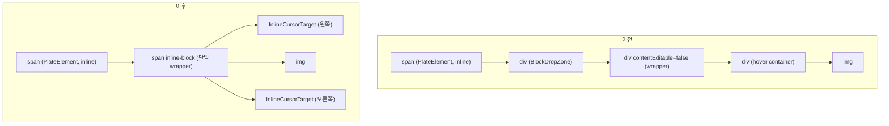

# Trouble Shooting: Plate 에디터

[← 전체 목차](../troubleshooting.md)

<details>
<summary><strong>33. 인라인 흐름 보존: 인라인 void 안의 div 가 커서를 막는다</strong></summary>

**증상**: Plate(Slate) 에디터에서 이미지를 인라인 void(`isInline: true, isVoid: true`)로 설정했는데, 이미지 양옆을 클릭하거나 방향키로 이동해 커서를 놓을 수 없었다. 그래서 이미지 옆에 텍스트를 넣을 수 없었다.

**원인**: Slate 의 정규화는 인라인 void 양옆에 빈 텍스트 노드를 자동으로 넣는다. 그런데 `ImageElement` 안에서는 블록 요소인 `<div>`(BlockDropZone, wrapper, hover 컨테이너)가 인라인 `<span>`(PlateElement) 안에 들어 있었다. 블록 요소가 인라인 흐름을 깨뜨려 브라우저가 옆의 빈 텍스트 노드에 커서를 둘 수 없었다.



**해결**: `imgLayout === "inline"` 일 때 별도 렌더링 분기를 만들어 모든 wrapper 를 `<span>` 으로 바꾸고 BlockDropZone 을 뺐다. 이미지 양쪽에는 absolute 로 배치한 6px 너비의 `InlineCursorTarget` 을 두었다. 이 영역을 클릭하면 `editor.api.before()` 또는 `editor.api.after()` 로 이미지 앞뒤에 커서를 놓는다.

**결론**: 인라인 void 요소 안에 `<div>` 가 들어가면 인라인 흐름이 깨져 Slate 가 넣은 빈 텍스트 노드에 커서를 둘 수 없다. 인라인 요소 안에는 `<span>` 같은 인라인 태그만 써야 한다.


</details>

<details>
<summary><strong>34. 직렬화 round-trip: 커스텀 속성은 인코딩해야 살아남는다</strong></summary>

**증상**: 2열, 3열 레이아웃 블록의 배경색, 구분선, 열 너비 같은 스타일 속성이 HTML 로 저장했다가 다시 불러오면 사라졌다.

**원인**: Plate 의 열 노드에는 `layout`, `columnBg`, `columnDivider` 같은 커스텀 속성이 저장된다. HTML 로 직렬화할 때 이 값을 남기는 규칙이 없었다. 표준 HTML 에는 열 레이아웃 개념이 없으므로 단순한 `<div>` 로 바꾸면 커스텀 속성이 모두 빠진다.

**해결**: 직렬화와 역직렬화 양쪽에 `data-*` 속성 규칙을 두었다. `plateSerializer.ts` 는 열 그룹을 `data-column-group` 에 `data-layout`, `data-column-bg`, `data-column-divider` 를 붙여 쓰고, 각 열에는 `data-width` 를 붙인다. `column-kit.tsx` 의 HTML deserializer 가 같은 속성을 읽어 노드 속성으로 되돌린다. 열 너비(%)를 함께 싣는 것은 다시 편집할 때 `@platejs/layout` normalizer 가 너비 합 100 을 확인할 수 있게 하기 위해서다. 그렇지 않으면 normalize 가 반복된다.

```html
<div data-column-group data-layout="side" data-column-bg="var(--bg-tertiary)">
  <div data-column data-width="50%">…</div>
  <div data-column data-width="50%">…</div>
</div>
```

마크다운 경로에는 별도 표기가 있다. 마크다운 표 앞에 `<!-- columns 50%,50% layout=side bg=… divider=… -->` 주석이 있으면, `postProcessMarkedHtml.ts` 가 그 표를 열 블록 HTML 로 복원한다.

**결론**: 표준 HTML 에 없는 에디터 고유 속성은 직렬화할 때 명시적으로 인코딩하고, 역직렬화가 같은 이름으로 읽어야 round-trip 이 보존된다.


</details>

<details>
<summary><strong>35. 제스처 분기: 드래그와 리사이즈가 한 요소에서 겹칠 때</strong></summary>

**증상**: 인라인 이미지의 리사이즈 핸들을 누르면 리사이즈 대신 드래그 앤 드롭으로 처리되어 이미지가 삭제됐다.

**원인**: 인라인 이미지의 `onPointerDown` 핸들러가 드래그를 시작하는데, 리사이즈 핸들 위에서 누른 포인터도 이 핸들러가 받아 드래그와 드롭으로 처리했다.

**해결**: `onPointerDown` 맨 앞에서 `closest("[data-cursor^='resize']")` 를 확인해 리사이즈 핸들이면 드래그를 시작하지 않는다. 히트박스와 시각적 핸들은 별개의 형제 요소로 나눠 감지 범위와 보이는 위치를 따로 조정할 수 있게 했다.

**결론**: 한 요소에서 드래그와 리사이즈처럼 다른 제스처가 겹치면 포인터가 내려온 지점을 보고 어느 제스처인지 먼저 갈라야 한다.


</details>

<details>
<summary><strong>36. 스크롤 컨테이너 경계: 떠 있는 요소의 배치 판정</strong></summary>

**증상**: 에디터에서 이미지에 크기 정보 Tooltip 을 표시할 때, 이미지가 에디터 영역 위로 스크롤되어 나가면 Tooltip 이 에디터 밖에 뜨거나 잘렸다.

**원인**: Tooltip 의 `auto` 배치 판정은 뷰포트 상단(`rect.top < 60`)만 기준으로 삼았다. 에디터 스크롤 컨테이너의 경계는 고려하지 않았다.

**해결**: `measure()` 함수에서 trigger 의 가장 가까운 overflow 부모(`overflow-y` 가 auto, scroll, hidden 인 요소)를 찾는다. 그 컨테이너 상단과 trigger 상단의 거리가 40px 미만이면 Tooltip 을 아래쪽(`bottom`)으로 배치한다.

**결론**: 떠 있는 요소의 배치는 뷰포트 경계뿐 아니라 가장 가까운 스크롤 컨테이너의 경계도 함께 보고 정해야 한다.


</details>

<details>
<summary><strong>37. 잎 블록과 wrapper: '현재 블록' 판정은 위로 올라가야 한다</strong></summary>

**증상**: 에디터에서 인용문, 코드 블록, 표 안에 커서를 두어도 메인 툴바의 해당 버튼이 활성 상태로 바뀌지 않았다.

**원인**: 현재 블록 정보를 읽는 코드가 `editor.api.block()` 으로 가장 가까운 블록을 가져왔다. wrapper 블록(blockquote, code_block, table) 안에서는 자식 블록(`p`, `code_line` 등)이 먼저 반환되어 블록 타입이 `"p"` 나 `"code_line"` 이 됐다.

**해결**: `plate/hooks.ts` 의 `readBlockInfo` 는 블록 타입이 `"p"` 나 `"code_line"` 이면 `editor.api.above()` 로 상위에 `blockquote`, `code_block`, `table` 이 있는지 차례로 찾는다. 찾으면 블록 타입을 그 wrapper 타입으로 바꾼다.

**결론**: 트리 구조 에디터에서 `editor.api.block()` 이 돌려주는 현재 블록은 잎 블록이다. wrapper 의 활성 상태는 위로 올라가며 따로 찾아야 한다.


</details>

<details>
<summary><strong>38. 참조 정합성: 고아 노드는 역순으로 지운다</strong></summary>

**증상**: 에디터에서 각주 참조(`footnote_ref`)를 지워도 아래쪽 각주 내용(`footnote_content`)이 남았고, 반대 경우도 같았다. 짝을 잃은 노드가 직렬화되어 DB 에 저장됐다.

**원인**: 각주 참조와 내용은 `footnoteId` 로 연결되지만 Plate 의 `normalizeNode` 는 이 관계를 알지 못한다. 그래서 한쪽이 지워져도 다른 쪽이 남는다.

**해결**: 별도 `useEffect` 에서 300ms debounce 로 에디터 변경 때마다 전체 각주를 검사한다. `footnoteId` 가 짝을 찾지 못한 노드를 뒤에서부터 삭제해 앞쪽 노드의 path 가 밀리지 않게 한다. `normalizeNode` 안에서 직접 삭제하면 `Cannot find a descendant at path` 오류가 나서 effect 로 분리했다.

**결론**: 노드 사이의 참조 정합성은 에디터가 지켜 주지 않으므로 직접 검사해야 한다. 여러 노드를 지울 때는 뒤에서부터 지워야 path 가 밀리지 않는다.


</details>

<details>
<summary><strong>39. 한 클릭 두 의도: 링크의 이동과 편집을 가르기</strong></summary>

**증상**: 에디터 안의 링크를 클릭하면 바로 새 탭이 열려 링크 주소나 텍스트를 편집할 수 없었다.

**원인**: `LinkElement` 의 `onClick` 이 `window.open()` 을 바로 호출해 에디터 안에 커서를 놓을 수 없었다.

**해결**: 클릭하면 `e.preventDefault()` 만 실행해 커서를 링크 안에 두고, 링크 편집 툴바를 자동으로 띄운다. 새 탭 이동은 더블클릭에 연결했다. 링크에서 다른 링크로 옮길 때 툴바가 깜빡이지 않도록, 링크 path 로 만든 `currentLinkKey` 로 같은 링크인지 판단한다. `useOutsideClick` 대신 에디터 본문 클릭은 무시하는 별도 핸들러를 쓴다.

**결론**: 편집기 안의 링크는 이동과 편집이라는 두 의도가 한 클릭에 겹친다. 클릭과 더블클릭으로 의도를 나눠야 두 기능을 함께 쓸 수 있다.


</details>

<details>
<summary><strong>40. 기본값이 방어하던 것: selection affinity 오버라이드의 대가</strong></summary>

**증상**: 인라인 코드(`<code>` mark) 안에서 ArrowLeft 로 두 번째 글자에서 첫 번째 글자로 이동하면 커서가 이전 텍스트 노드로 넘어갔다.

**원인**: `CodePlugin.configure({ rules: { selection: { affinity: "directional" } } })` 로 Plate 기본값 `"hard"` 를 바꿔 두었다. `"hard"` affinity 는 mark 경계에서 커서를 mark 안쪽에 유지한다. `"directional"` 은 이 처리를 브라우저 기본 동작에 맡기므로 `<code>` 경계에서 커서가 밖으로 나갔다.

**해결**: affinity 오버라이드를 지우고 Plate 기본값(`"hard"`)을 쓴다. 플러그인 목록에는 `CodePlugin.configure(...)` 대신 `CodePlugin` 을 그대로 넣는다.

**결론**: 라이브러리 기본값을 바꿀 때는 그 기본값이 어떤 동작을 막고 있었는지 먼저 확인해야 한다.


</details>

<details>
<summary><strong>41. 흐름 밖과 문단 안: float 이미지와 inline void 의 충돌</strong></summary>

**증상**: float 이미지를 본문 옆에 흘리면서 세 가지를 동시에 만족시키려 했다. 옆 텍스트 블록을 드래그하거나 선택할 때 이미지가 함께 묶이지 않아야 하고, 이미지 위아래에 빈 줄이 보이지 않아야 하며, 클릭이나 방향키로 보이지 않는 빈 자리에 커서가 들어가지 않아야 했다. 세 조건이 서로 충돌했다.

**원인**: CSS `float` 은 이미지를 흐름 밖으로 빼지만, Plate(Slate)에서 이미지는 inline void 라서 반드시 문단 안에 있고 양옆에 빈 텍스트(ZWSP)가 강제된다.

1. 이미지가 텍스트와 같은 문단에 있으면 블록 드래그가 이미지와 텍스트를 함께 옮긴다.
2. 이미지를 독립 문단으로 분리하면 흐름에는 ZWSP 한 줄만 남아 빈 줄로 보인다.
3. 그 빈 줄을 `line-height: 0` 등으로 접으면 블록 높이가 0 이 되어 커서와 핸들이 깨진다. 다음 블록으로 덮으면 보이지 않는 그 자리에 클릭이나 방향키로 커서가 들어가 깜빡인다.

**해결**: 데이터, 레이아웃, 입력 세 층을 함께 처리했다.

1. 데이터: 변경이 일어날 때마다 텍스트와 이미지가 섞인 문단을 `splitNodes` 로 나눠 이미지를 자기 문단에 둔다. 드래그와 선택이 텍스트와 따로 동작한다.
2. 레이아웃: 이미지 블록을 0 높이로 접지 않고, 다음 블록을 `margin-bottom: -1lh` 로 한 줄 끌어올려 빈 줄을 덮는다. 이미지 블록은 그대로 있으므로 커서와 핸들이 정상으로 동작한다. float wrapper 에 `z-index` 를 주어 이동 핸들이 가려지지 않게 했다.
3. 입력: 클릭(mousedown)과 방향키(keydown)를 capture 단계에서 먼저 받는다. 빈 자리로 갈 상황이면 이미지를 선택하거나 인접 블록으로 커서를 보낸다. Slate 의 기본 이동보다 먼저 처리하므로 깜빡임이 없다.

**결론**: float(흐름 밖)과 inline void(문단 안의 강제 텍스트)는 구조적으로 충돌하므로 한 곳만 고쳐서는 해결되지 않는다. inline void 의 ZWSP 는 normalize 가 다시 만들어 지울 수 없으므로, 보이지 않게 덮고 커서가 닿지 않게 막는 방식으로 처리했다. Slate 가 커서를 옮긴 뒤 교정하면 한 프레임 깜빡이므로 입력은 capture 단계에서 먼저 처리해야 한다.


</details>

<details>
<summary><strong>42. scroll 이벤트의 전파: 중첩 스크롤은 캡처 단계에서 듣는다</strong></summary>

**증상**: 에디터 상단 바(뒤로 가기, 저장, 리비전 등)는 아래로 스크롤하면 접히고 위로 스크롤하면 펼쳐져야 한다. 처음에는 window 의 일반 scroll 리스너로 구현했는데, 에디터 본문처럼 자기 스크롤을 가진 요소 안에서 스크롤하면 반응하지 않았다.

**원인**: scroll 이벤트는 버블링되지 않는다. 요소 안에서 일어난 scroll 은 그 요소에서만 발생하므로 window 에 버블 단계로 단 리스너는 문서 자체의 스크롤만 받는다. 당시 본문이 내부 스크롤 영역이어서 페이지 스크롤 위치가 거의 변하지 않았고, `position: sticky` 도 핀이 걸리지 않았다. 그래서 한때 상단 바를 `position: fixed` 와 높이 예약용 spacer 로 바꿨다. 이후 편집기 위에 커버(약 35vh)가 페이지 콘텐츠로 들어가 페이지가 실제로 스크롤되면서 상단 바는 다시 `position: sticky` 로 돌아왔다.

**해결**: `AdminEditorShell` 은 `window.addEventListener("scroll", onScroll, true)` 로 캡처 단계에서 듣는다. 캡처 단계에서는 하위 요소의 scroll 도 window 를 거쳐 가므로 한 리스너로 받을 수 있다. 핸들러는 `e.target` 이 document 이면 `window.scrollY` 의 변화를, 에디터 본문(`[data-slate-editor]`)이면 그 요소의 `scrollTop` 변화를 쓴다. 이모지 피커 같은 팝업 내부 스크롤은 무시한다. 같은 방향의 변화량을 누적해 120px 을 넘으면 접고 -120px 을 넘으면 펼친다. 바가 nav 아래에 붙었는지는 매 스크롤마다 sentinel 요소의 위치로 판단하고, 붙지 않았으면 접지 않는다.

**결론**: scroll 이벤트는 버블링되지 않으므로 중첩된 스크롤 영역까지 한 리스너로 받으려면 캡처 단계(`useCapture = true`)에서 들어야 한다. `position: sticky` 는 조상 중 실제로 스크롤되는 컨테이너가 있어야 동작한다.


</details>

<details>
<summary><strong>43. IME 조합 보호: 편집 모델 밖 입력과 부모 재렌더 미루기</strong></summary>

**증상**: 두 곳에서 한글 입력이 깨졌다. poll, tab 블록 같은 에디터 내부 폼 input 에 한글을 입력하면 조합 중인 글자가 깨지거나 사라졌다. 슬래시 메뉴를 연 상태에서 한글을 입력하면 첫 글자가 두 번 입력됐다.

**원인**: 두 경우 모두 IME 조합 중에 재렌더가 일어났다. 폼 input 이 Slate 편집 모델 안에 있으면 Slate 가 조합 도중 다시 렌더링하면서 조합 상태가 끊긴다. 슬래시 메뉴는 조합 중 첫 자모가 어떤 명령과도 맞지 않아 열림 상태가 바뀌었고, 이때 부모(`PlateEditor`)의 `setSlashOpen` 이 호출됐다. 부모가 재렌더되면서 형제인 Slate `Editable` 이 조합 도중 재조정됐다.

**해결**:

1. poll, tab 입력은 void element 와 공용 `EditorTextInput` 으로 Slate 편집 모델 밖에 둔다. `EditorTextInput` 은 `contentEditable={false}` 이고 blur 할 때 값을 커밋한다. `onMouseDown` 에서 `nativeEvent.stopImmediatePropagation()` 을 호출해 Slate 의 selection 처리를 막는다. 이미지 캡션과 같은 방식이다.
2. 슬래시 메뉴는 조합 중에 부모에게 보내는 `onOpenChange` 알림만 미룬다. 메뉴 자체의 `open` 상태는 그대로 두어 메뉴 표시와 검색 필터는 정상으로 동작한다. `composing` 이 effect 의존성에 있으므로 조합이 끝나면 알림이 자동으로 나간다.

```tsx
React.useEffect(() => { if (composing != null) return; onOpenChange?.(open); }, [open, onOpenChange, composing]);
```

`SlashMenu.tsx` 의 코드다.

**결론**: IME 조합 중 부모나 에디터의 재렌더는 조합을 깨뜨린다. 에디터 안의 폼 입력은 편집 모델과 분리하고, 조합 중에는 부모 상태를 바꾸는 알림을 조합이 끝난 뒤로 미뤄야 한다.


</details>

<details>
<summary><strong>44. native drag 차단: pointer 드래그와 공존할 수 없다</strong></summary>

**증상**: 에디터 블록을 핸들로 드래그할 때 브라우저의 HTML5 native drag 가 끼어들어 커스텀 pointer 드래그가 동작하지 않았다.

**원인**: 핸들이 draggable 로 잡혀 있으면 브라우저가 native drag 세션을 시작한다. 그 동안 pointer 이벤트 발생이 억제되어 커스텀 드래그 로직이 좌표를 받지 못했다.

**해결**: native drag 를 끄고 커스텀 드래그 레이어로 대체했다. `useDraggable` 의 preview 를 끄고 핸들에 `draggable={false}` 를 지정했다. 커스텀 `BlockDragLayer` 가 DOM 을 복제한 고스트를 커서 위치에 그리고, 에디터 가장자리에서는 자동으로 스크롤한다. 커서 모양은 CSS `cursor` 가 아니라 `data-cursor` 속성으로 지정해 CursorTrail 이 그린다.

**결론**: pointer 기반 커스텀 드래그를 쓰려면 HTML5 native drag 를 명시적으로 꺼야 한다. 둘이 함께 켜져 있으면 native drag 가 pointer 이벤트를 막는다.


</details>

<details>
<summary><strong>45. 값 타입 정규화: 숫자 노드값과 문자열 옵션</strong></summary>

**증상**: 툴바의 줄간격(line-height) Select 가 제목처럼 프리셋에 없는 값(예: 1.25)에서는 값을 표시하지 못해 빈칸으로 보였다. 콘솔에는 옵션 key 중복 경고도 났다.

**원인**: 값의 타입이 두 곳에서 어긋났다. `setLineHeight` 는 노드에 줄간격을 숫자(예: `1.6`)로 저장하는데, 툴바 프리셋 옵션은 문자열(`"1.6"`)이었다. 그래서 같은 값이 옵션에 두 번 들어가 key 가 중복됐다. 또 DOM 계산값에서 가장 가까운 프리셋을 찾는 감지 로직은 차이가 0.05 이상이면 빈 문자열을 돌려줬다. 그래서 제목의 1.25 처럼 프리셋과 맞지 않는 값은 표시되지 않았다.

**해결**: `plate/hooks.ts` 의 `readToolbarState` 가 노드의 줄간격을 `String(...)` 으로 바꿔 문자열 프리셋과 같은 타입으로 비교한다. 같은 파일의 `computedLineHeight` 는 프리셋에 가까우면 프리셋 값을, 아니면 실제 비율을 소수 둘째 자리로 반올림해 돌려준다. `MainToolbar.tsx` 는 현재 값이 프리셋에 없으면 그 값을 Select 옵션 맨 위에 추가한다.

**결론**: Slate 노드에 숫자로 저장되는 값은 문자열 옵션과 비교하거나 렌더링하기 전에 `String` 으로 정규화해야 한다. 프리셋 매칭은 "가까우면 프리셋, 아니면 실제 값" 두 경우를 모두 처리해야 빈칸이 생기지 않는다.


</details>

<details>
<summary><strong>46. history 스냅숏: '방금 그 변환만' 되돌리기</strong></summary>

**증상**: 마크다운 자동변환으로 만든 불릿을 지우고 계속 Backspace 를 누르면 글자가 지워지는 대신 불릿이 되살아나거나 커서가 다른 줄로 이동했다.

**원인**: 자동변환 직후의 Backspace 를 변환 취소로 처리하는 로직이 history 를 확인하지 않고 undo 를 호출했다. 변환 뒤에 다른 편집이 있으면 undo 가 그 편집을 되돌렸다. 문단 중간에서 입력한 스페이스를 변환으로 잘못 판정하는 버그도 함께 있었다.

**해결**: trigger 를 넣기 전에 history 위치를 기록해 두고, 되돌리기 직전에 history 가 변환 직후 그대로인지 확인한다. 그대로이면 그 이후의 연산만 역으로 적용해 마크다운 표시를 복원하고, 아니면 일반 Backspace 로 동작한다. 블록 맨 앞의 Backspace 는 자동변환 직후가 아니어도 마크다운 표시(`- `, `## `, `> `)로 되돌린다.

**결론**: `editor.undo()` 는 마지막 연산 묶음을 통째로 되돌린다. 특정 변환만 되돌리려면 history 시점을 스냅숏으로 남기고 그 이후의 연산만 골라 역으로 적용해야 한다.


</details>
