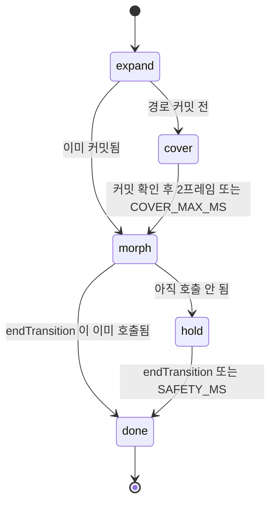
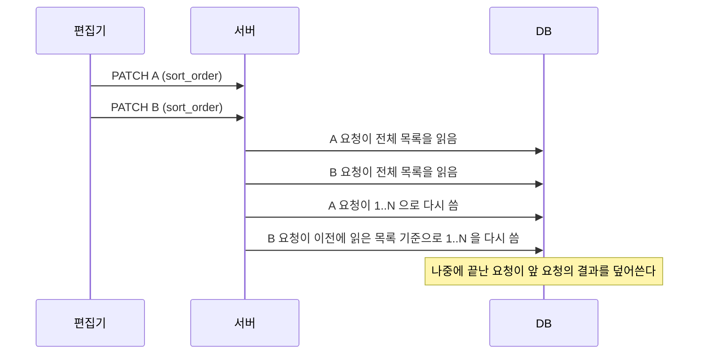

# Trouble Shooting: Top 10 Deep Dives

[← 전체 목차](../troubleshooting.md)

<details>
<summary><strong>1. 번들 타깃 다운레벨링: 테스트는 통과하는데 브라우저에서만 죽는 정규식</strong></summary>

**증상**: 에디터 코드블록에서 HTML(xml) 코드에만 색이 붙지 않았다. 언어 감지는 정상이어서 라벨에는 "HTML / XML" 이 표시됐지만 코드는 무채색이었다. CSS 같은 다른 언어는 정상이었다. `npm run build`, `tsc`, 테스트가 모두 통과했고 브라우저에서만 재현됐다.

**원인**: 세 가지 조건이 겹쳤다.

1. hljs 의 `xml.js` 는 태그명을 `/[\p{L}_]/u` 로 정의한다.
2. 번들러가 이 정규식을 전개한다. browserslist 가 최신 브라우저(chrome 148)를 가리켜도 Next 는 node_modules 를 보수적인 타깃으로 컴파일한다. 그 결과 `\p{L}` 이 실제 코드포인트 범위로 풀리고, 그 범위에 아스트랄 영역(`\u{10000}-…`)이 들어간다. 중괄호 형태의 이스케이프는 `u` 플래그 없이는 파싱되지 않는다.
3. hljs 의 `countMatchGroups` 는 `new RegExp(re.toString() + "|")` 로 정규식을 플래그 없이 다시 파싱한다. 이 단계에서 `SyntaxError` 가 난다.

```
SyntaxError: Invalid regular expression: /<(?=[A-Z…\u{10000}-\u{1000B}…
    at countMatchGroups (core.js:456)
```

Plate 는 이 예외를 잡아 plaintext 로 처리한다. 그래서 화면에는 색이 붙지 않는 현상만 보이고 원인은 콘솔에만 남는다. CSS 가 정상이었던 이유는 `css.js` 에 `\p{}` 가 없기 때문이다.

node 에서는 재현되지 않는다. node 는 트랜스파일되지 않은 원본(`\p{L}` 과 `u` 플래그)을 쓰기 때문이다. 전개된 정규식은 브라우저 번들에만 존재한다. DOM, 클래스, CSS, 서빙된 청크를 확인해도 원인이 드러나지 않았고, 브라우저 콘솔의 스택 트레이스로 원인을 찾았다.

**해결**: 경로를 둘로 나눠 처리했다.

1. 마크다운 리더뷰와 댓글은 Prism 으로 옮겼다. Prism 은 유니코드 속성 이스케이프를 쓰지 않고, 이미 의존성에 있었다. `utils/prismHighlight.ts` 를 단일 진입점으로 두고 `highlightCodeBlocks.ts` 의 hljs import 를 모두 제거했다. Prism 번들에 없는 bash 문법은 직접 정의했다.
2. 에디터는 문법 객체를 고쳤다. Plate 의 code-block 플러그인은 lowlight 인스턴스를 API 로 받으므로 Prism 으로 바꿀 수 없다. 그래서 문법을 등록할 때 객체를 순회하며 아스트랄 이스케이프를 지우고 `u` 플래그를 뗀다(`lowlightInstance.ts` 의 `browserSafeGrammar`). 태그명에 아스트랄 영역 문자는 실제로 쓰이지 않고, BMP 범위(한글, CJK, 라틴 확장)는 그대로 남는다. Plate 도 python 문법에 같은 방식의 우회(`ensureStablePythonGrammar`)를 두고 있다.

처음에는 `RegExp` 인스턴스만 변환했는데 아무것도 고쳐지지 않았다. hljs 의 `regex.concat()` 은 RegExp 가 아니라 소스를 이어 붙인 문자열을 반환하고(`core.js: return joined`), 아스트랄 이스케이프는 그 문자열 안에 있었다. 그래서 변환 대상에 문자열을 포함했다.

```ts
export function browserSafeGrammar(node: any, seen = new WeakMap<object, any>()): any {
  if (typeof node === "string") return node.includes("\\u{") ? stripAstral(node) : node;
  if (node instanceof RegExp) return toBrowserSafeRegex(node);
  if (Array.isArray(node)) return node.map((n) => browserSafeGrammar(n, seen));
  /* …객체는 WeakMap 으로 순환 참조를 끊으며 재귀 */
}
```

위 코드는 `lowlightInstance.ts` 의 변환 함수다. 문자열, RegExp, 배열, 객체를 모두 재귀로 처리한다. node 에서는 실물 재현이 되지 않으므로 테스트(`plate/__tests__/browserSafeGrammar.test.ts`)는 번들된 형태의 정규식을 합성해서 확인한다. 합성한 입력이 실제로 재파싱을 깨뜨리는지, 변환 뒤에는 통과하는지, 한글이 유지되는지를 검사한다.

**결론**: 테스트가 도는 환경(node)과 코드가 실행되는 환경(브라우저 번들)이 다르면 그 차이에서 생기는 버그는 테스트로 잡히지 않는다. 라이브러리 소스가 정상이어도 번들러의 다운레벨 변환이 브라우저에서만 실패하는 코드를 만들 수 있다. 라이브러리가 예외를 삼키는 경우에는 증상과 원인이 멀리 떨어지므로 콘솔의 스택 트레이스를 먼저 확인해야 한다.


</details>

<details>
<summary><strong>2. CSS 무효화 범위: `:has(:hover)` 와 universal 자손이 부르는 전역 재계산</strong></summary>

**증상**: 작업물 편집기에서 글자를 입력할 때 열 번 중 두 번꼴로 요소 6,357개 전체의 스타일 재계산이 일어나 입력 지연 p90 이 튀었다. 마우스만 움직여도 같은 재계산이 일어났다.

**원인**: `.chip:has([data-close-trigger]:hover) .label *` 규칙 하나가 원인이었다. 글자를 입력하면 포인터 아래 요소가 바뀌어 hover 재계산이 일어난다. `:has()` 안에 `:hover` 가 있고 그 뒤에 universal `*` 자손이 붙으면 Chrome 은 body 서브트리 전체를 무효화한다. `*` 를 뺀 같은 모양의 선택자는 문제가 없었다. 원인 규칙은 CSSOM 에서 규칙을 지워 가며 범위를 반씩 좁히는 방식으로 찾았다.

**해결**: 선택자 구조는 유지하고 hover 조건만 JS 로 옮겼다. 닫기 버튼의 `onPointerEnter` 와 `onPointerLeave` 가 칩에 `data-remove-hover` 속성을 붙였다 떼고, CSS 는 이 속성으로 매칭한다.

```css
.chip[data-remove-hover] .label * {
  text-decoration: line-through;
  text-decoration-color: var(--text-accent);
}
```

`Chip.module.css` 의 규칙이다. 속성은 칩 하나에만 붙으므로 무효화 범위도 그 칩 내부로 한정된다.

**결론**: `:has()` 안의 `:hover` 와 universal 자손 선택자를 함께 쓰면 전역 스타일 무효화가 일어난다. 같은 조건은 JS 가 붙이는 속성으로 옮기면 범위를 좁힐 수 있다.


</details>

<details>
<summary><strong>3. 리소스 우선순위와 스트리밍 공개: LCP 를 미는 직렬 관문</strong></summary>

<p align="center">
  
</p>

**증상**: 모바일 글 목록과 글 상세의 LCP 가 회귀했다. 커버 이미지가 CSS, 글꼴과 회선을 나누며 늦게 도착했고, 도착한 뒤에도 화면 공개가 늦어졌다.

**원인**: 두 가지가 겹쳤다. Next 16 의 `priority` 는 head 에 preload 만 넣고 `fetchpriority` 속성을 붙이지 않는다. 그래서 LCP 이미지가 Low 우선순위로 요청됐다. 또 React 19.2 는 셸이 먼저 칠해진 뒤 늦게 도착한 Suspense 경계를 첫 프레임 기준 300ms 뒤에 공개한다. LCP 요소가 loading.tsx 경계 안에 있으면 이 지연을 그대로 받는다.

**해결**: `priority` 를 주는 자리에 `fetchPriority="high"` 를 함께 넘긴다. 상세 페이지의 커버는 loading 경계 밖인 `[slug]/layout.tsx` 의 `DetailShell` 로 옮겨 셸과 함께 칠해지게 했다.

```tsx
<Image priority={priority} fetchPriority={priority ? "high" : undefined} … />
```

`ProgressiveImage.tsx` 의 코드다. Next 15 까지는 `priority` 만으로 high 우선순위가 붙었지만 16 에서는 따로 지정해야 한다.

**결론**: LCP 에는 요청 우선순위와 공개 시점이라는 두 관문이 직렬로 걸린다. 하나만 고치면 수치가 움직이지 않는다. LCP 요소는 스트리밍 경계 밖의 레이아웃에 두어야 한다.


</details>

<details>
<summary><strong>4. 시간표가 아니라 상태 신호: 전환 덮개는 경로 커밋에 맞춰 걷는다</strong></summary>

**증상**: 목록에서 상세로 넘어갈 때 전환 덮개가 걷힌 뒤 약 0.5초 동안 떠나온 목록 화면이 그대로 보였다. 이전 구현에서는 반대로 덮개가 히어로 크기로 줄어든 뒤 사라지지 않고 화면에 남는 일도 있었다.

**원인**: morph 전환은 고정 시간표(확대 380ms, 이어서 morph 260ms)로 진행됐고, 덮개는 640ms 시점에 무조건 걷혔다. 새 경로의 커밋 시각은 이 시간표와 무관하다. 목록 카드의 링크는 선불러오기를 하지 않으므로 누른 뒤에야 RSC 페이로드를 받는다. 배포본에서 측정한 커밋 시각은 1161ms 였다.

덮개가 남던 문제는 종료 신호에서 생겼다. 상세 페이지 히어로의 `motion.div` 에 건 `onAnimationStart` 가 `endTransition()` 을 호출하도록 되어 있었다. 전환 중에는 `initial` 과 `animate` 의 opacity 가 둘 다 1 이었고, framer-motion 은 값이 바뀌지 않으면 이 콜백을 호출하지 않는다. 그래서 단계가 `hold` 에서 멈췄다.

**해결**: 확대가 끝났는데 경로가 아직 바뀌지 않았으면 화면을 덮은 채 기다리는 `cover` 단계를 추가했다. 커밋을 확인한 뒤에 morph 를 시작한다. 커밋 신호는 오버레이 안에서 `usePathname()` 으로 받는다. 오버레이는 전환 중에만 마운트되므로 이 구독도 그 동안에만 존재한다.

```tsx
const t = setTimeout(() => onPhase(navPendingRef.current ? "cover" : "morph"), EXPAND_MS);

useEffect(() => {
  if (phase !== "cover" || navPending) return;
  const raf1 = requestAnimationFrame(() => {
    raf2 = requestAnimationFrame(() => onPhase("morph"));
  });
  /* … COVER_MAX_MS 상한으로 커밋이 끝내 오지 않으면 덮개를 걷는다 */
}, [phase, navPending, onPhase]);
```

`PageTransitionProvider.tsx` 의 코드다. 확대가 끝난 시점에 커밋 여부로 다음 단계를 고른다. cover 단계에서 커밋을 확인하면 두 프레임을 미룬 뒤 morph 로 넘어가므로 새 트리가 덮개 아래에서 먼저 그려진다.

종료 신호는 애니메이션 콜백에 의존하지 않는다. 상세 레이아웃(`DetailLayout`)이 마운트되면 `useEffect` 에서 80ms 뒤 `endTransition()` 을 호출한다. 이 호출이 오지 않는 경우에 대비해 provider 가 `SAFETY_MS`(5000ms) 뒤 직접 종료한다. 새 페이지가 morph 보다 먼저 준비되면 `endRequestedRef` 에 요청을 기록해 두고, morph 가 끝나는 즉시 `hold` 를 건너뛰고 종료한다.



**결론**: 전환 연출을 시간표로 짜면 네트워크 시간이 어긋날 때 화면이 노출된다. 덮개는 실제 경로 커밋이라는 상태 신호에 맞춰 걷어야 한다. 애니메이션 라이프사이클 콜백은 값이 같으면 호출되지 않으므로 중요한 상태 전이의 유일한 트리거로 쓰면 안 되고, effect 기반 호출과 시간 상한을 함께 두어야 한다. 검증은 Playwright 녹화 영상을 ffmpeg 로 프레임별 콘택트 시트로 만들어 확인했다.


</details>

<details>
<summary><strong>5. 정적 프리렌더의 문맥 부재: 경로를 모르는 404 가 만드는 하이드레이션 불일치</strong></summary>

**증상**: `/admin/없는주소` 같은 404 화면에서 React #418(HTML 불일치) 오류가 났다. 공개 영역의 없는 주소에서는 오류가 나지 않았다.

**원인**: 매칭되지 않는 주소는 빌드 때 그려 둔 정적 `/_not-found` HTML 을 받는다. 이 HTML 은 경로 없이 그려졌으므로 공개용 네비게이션과 푸터가 들어 있다. 루트 레이아웃의 Navigation 과 Footer 는 경로 앞머리(`/admin`, `/design-system`)에 따라 모양을 바꾸므로, 브라우저에서 다시 그린 결과가 서버 HTML 과 어긋난다.

**해결**: 경로에 따라 모양이 바뀌는 앞머리마다 catch-all 라우트(`[...missing]`)를 두고 그 안에서 `notFound()` 를 호출한다. 이 404 는 요청 시점에 해당 경로로 그려지므로 경로가 일치한다. 루트 not-found 를 통째로 동적으로 만드는 방법은 모든 404 가 DB 를 조회하게 되어 쓰지 않았다.

```tsx
// src/app/admin/[...missing]/page.tsx
export default function AdminMissingPage() {
  notFound();
}
```

같은 파일이 `src/app/design-system/[...missing]/page.tsx` 에도 있다.

**결론**: 루트 레이아웃이 경로를 보고 모양을 바꾸면 그 앞머리마다 404 도 같은 경로에서 그려져야 한다. 정적 404 는 경로가 없는 상태로 그려진다.


</details>

<details>
<summary><strong>6. shorthand 리셋과 특이도: 전역 transition 이 컴포넌트 전환을 지운다</strong></summary>

**증상**: 다크/라이트 테마 전환을 부드럽게 하려고 전역 CSS 에 `html[data-theme-ready] *` 규칙으로 색 transition 을 걸었다. 그 뒤 에디터 툴바 접기, 토글 열기처럼 `max-height`, `opacity`, `transform` 에 transition 을 쓰는 컴포넌트들이 전환 없이 바로 바뀌었다.

**원인**: `transition` 은 shorthand 속성이다. `transition: background-color 0.3s, color 0.3s` 를 선언하면 컴포넌트가 선언한 `transition: max-height 0.3s` 전체를 대체한다. 전역 선택자 `html[data-theme-ready] *` 의 특이도는 (0,1,1) 이고 CSS Module 의 단일 클래스는 (0,1,0) 이므로 전역 규칙이 항상 이겼다.

```css
html[data-theme-ready] * { transition: background-color 0.3s, color 0.3s; }  /* (0,1,1) */
.toolbar { transition: max-height 0.3s ease; }                                  /* (0,1,0) */
```

두 규칙이 같은 요소에 걸리면 위 규칙이 이기고, 툴바의 `max-height` 전환은 사라진다.

**해결**: 처음에는 전역 규칙을 `data-theme-transitioning` 속성으로 바꿔 테마를 바꾸는 350ms 동안만 적용했다. 평소에는 컴포넌트 transition 이 정상으로 동작했지만, 전환 중에는 같은 충돌이 남았다. 그래서 일부 컴포넌트는 (0,2,0) 복합 선택자나 `!important` 로 특이도를 올려야 했다.

지금은 전역 transition 규칙이 없다. `ThemeProvider` 는 테마를 바꿀 때 `document.startViewTransition()` 을 호출하고, 콜백 안에서 `flushSync` 로 테마 커밋과 그 효과까지 동기로 끝낸다. 브라우저는 바꾸기 전과 후의 화면을 한 번에 교차 페이드한다. 지원하지 않는 브라우저나 움직임 줄이기 설정에서는 바로 바꾼다.

```tsx
const reduce = window.matchMedia("(prefers-reduced-motion: reduce)").matches;
if (!document.startViewTransition || reduce) {
  commitTheme(next);
  return;
}
document.startViewTransition(() => flushSync(() => commitTheme(next)));
```

`ThemeProvider.tsx` 의 `setTheme` 이다. CSS 는 `_base.css` 에서 `::view-transition-old(root)` 와 `::view-transition-new(root)` 의 `animation-duration` 만 정한다. 이 변경과 함께 충돌을 피하려고 넣었던 `!important` 와 복합 선택자도 정리했다.

**결론**: `transition` 은 shorthand 라서 전역에서 일부 속성만 지정해도 컴포넌트의 다른 transition 을 모두 지운다. 적용 시간을 줄이는 것만으로는 충돌이 남는다. 화면 전체의 색 전환은 요소별 transition 대신 View Transitions 로 처리하면 컴포넌트 규칙과 겹치지 않는다.


</details>

<details>
<summary><strong>7. Backdrop Root: backdrop-filter 와 mix-blend-mode 가 서로의 입력이 못 되는 이유</strong></summary>

<p align="center">
  
</p>

**증상**: 어떤 배경 위에서도 읽히는 popover 를 만들려고 패널에 `backdrop-filter` 를 걸고 내부 텍스트에 `mix-blend-mode: difference` 를 걸었다. 텍스트의 blend 가 뒤 배경을 반영하지 않았다.

**원인**: `backdrop-filter` 와 `isolation: isolate` 는 Backdrop Root 를 만들어 자손이 볼 수 있는 backdrop 범위를 그 요소에서 자른다. 그래서 자손의 blend 는 페이지 배경이 아니라 패널의 투명 배경과 합성된다. 또 `backdrop-filter` 의 출력은 뒤에 그려지는 요소의 blend 입력이 되지 않는다. blur 를 `::before` 형제 레이어로 빼도 결과는 같았다. 따라서 popover 안의 텍스트별 difference 는 구현할 수 없다.

**해결**: blend 를 패널 단위로 걸고 색 반전으로 원래 색을 되살렸다. 패널에 `mix-blend-mode: difference` 를 걸고, 콘텐츠에는 `filter: invert(1)` 로 미리 반전한 색을 넣는다. 합성 결과는 `|배경 − (1 − 색)|` 이 되어 밝은 배경에서는 원래 색이 나온다.

```css
.dropdown.dropdownDifference > * {
  filter: invert(1);
}
```

`Popover.module.css` 의 규칙이다. 이 방식은 패널 안의 색 구분이 한 덩어리로 합성되는 제약이 있다. 그래서 기본 variant 는 반투명 배경과 blur 를 쓰는 `glass` 로 두고, `difference` 는 내용이 단순한 popover 를 위한 variant 로 남겼다.

**결론**: `backdrop-filter` 와 `mix-blend-mode` 는 둘 다 뒤 배경을 다루지만 서로의 입력이 되지 않는다. 한 요소에서 두 효과를 조합하기 전에 Backdrop Root 가 어디서 범위를 자르는지 먼저 확인해야 한다.


</details>

<details>
<summary><strong>8. 쓰기 경쟁과 서버 재할당: 병렬 PATCH 가 순서를 뒤섞는다</strong></summary>

**증상**: 작업물 편집기에서 정렬 순서를 바꾸면 저장하기 전인데도 다른 작업물의 순서가 바뀌었다. 저장하면 의도와 다른 순서가 됐다.

**원인**: 드래그 목록의 onChange 가 순서가 밀리는 작업물마다 PATCH 를 병렬로 보냈다. 서버는 sort_order PATCH 를 받을 때마다 전체 목록을 읽고 1부터 다시 번호를 매겼다. 각 요청이 서로 다른 시점의 목록을 읽고 덮어쓰므로 결과가 요청 도착 순서에 따라 달라졌다.



**해결**: 편집기는 순서 변경을 미리보기에만 반영하고 다른 작업물에는 요청을 보내지 않는다. 저장할 때 자기 위치 하나만 보낸다. 서버의 `placeWork`(`src/lib/api/placeWork.ts`)가 한 요청 안에서 그 작업물을 받은 자리에 끼우고 나머지를 1..N 으로 다시 매기며, 번호가 달라진 행만 쓴다. 재현은 실제 라우트를 vitest 에서 메모리 표 가짜 클라이언트로 돌리고, 호출마다 읽기 지연을 다르게 주어 쓰기 순서를 뒤집는 방식으로 했다.

**결론**: 요청마다 서버가 전체를 다시 매기는 API 에 병렬 쓰기를 보내면 결과가 도착 순서에 좌우된다. 순서 같은 파생 상태는 저장 시점에 한 요청으로 보내고, 서버가 한 요청 안에서 재배치를 끝내야 한다.


</details>

<details>
<summary><strong>9. 폴백 조건 설계: '결과가 비었다' 와 '원천을 못 읽었다' 는 다르다</strong></summary>

**증상**: 관리자 화면에서 작업물을 모두 미발행으로 바꿨더니 공개 목록에 코드에 들어 있는 정적 데모 목록이 대신 표시됐다.

**원인**: `getWorks` 는 DB 가 없는 새 클론에서도 화면이 나오도록 정적 `data/projects.ts` 폴백을 둔다. 그런데 "표에 행이 없다" 와 "행은 있지만 모두 미발행이다" 가 같은 빈 배열로 돌아왔다. 배열 길이만 보고 폴백하면 작업물을 모두 내리는 순간 데모 목록이 그 자리를 채운다.

**해결**: 폴백 조건을 "결과가 비었다" 에서 "원천을 읽지 못했다" 로 바꿨다. DB 를 쓸 수 없는 경우(환경변수 없음, 조회 실패)는 `null` 로, 발행된 작업물이 없는 경우는 빈 배열로 구분하고, `null` 일 때만 정적 데이터로 돌아간다. 빈 표에 데모 데이터를 발행 상태로 넣던 seed 도 제거했다. 작업물을 모두 지워도 다음 방문에 데모 7개가 되살아나던 원인이 이 seed 였다.

```ts
async function fetchRankedProjects(): Promise<Project[] | null> { /* … */ }

if (ranked === null) return toWorkItems(projects);
```

`getHomeWorks.ts` 의 코드다. 빈 배열은 "발행된 작업물이 없다" 는 정상 응답이므로 그대로 빈 목록을 그린다.

**결론**: 폴백 조건은 결과가 비었는지가 아니라 원천을 쓸 수 있는지로 정해야 한다. 두 상태가 같은 값으로 돌아오면 반환 타입을 나누거나 한 번 더 조회해서 구분해야 한다.


</details>

<details>
<summary><strong>10. 패키지 의존성 해석: optional peer 도 '해결 가능해야 통과' 다</strong></summary>

**증상**: `npm i @vercel/analytics` 가 `@sveltejs/vite-plugin-svelte` 의 peer 충돌(ERESOLVE)로 실패했다. 이 프로젝트에는 Svelte 가 없다.

**원인**: `@vercel/analytics` 는 프레임워크별 진입점을 위해 vue, nuxt, svelte 등을 optional peer 로 선언한다. npm 11 은 설치되지 않을 후보의 peer 까지 따라가 검증한다. 그 경로에 있는 `@sveltejs/vite-plugin-svelte@5` 가 `vite ^6` 을 요구했고, 이 저장소의 vite 8 과 충돌했다.

**해결**: `overrides` 에 `"@sveltejs/vite-plugin-svelte": "^7"` 을 넣어 npm 이 검증하는 후보를 vite 8 을 지원하는 버전으로 바꿨다. 실제 설치 트리에는 svelte 관련 패키지가 들어오지 않는다. `--legacy-peer-deps` 는 peer 검사 전체를 끄므로 다른 실제 충돌까지 놓친다. 그래서 쓰지 않았다.

```jsonc
// package.json
"overrides": {
  "@sveltejs/vite-plugin-svelte": "^7"
}
```

**결론**: optional peer 도 해결할 수 있어야 설치가 통과한다. 충돌하는 후보만 `overrides` 로 바꾸면 peer 검사를 유지한 채 설치할 수 있다.


</details>
