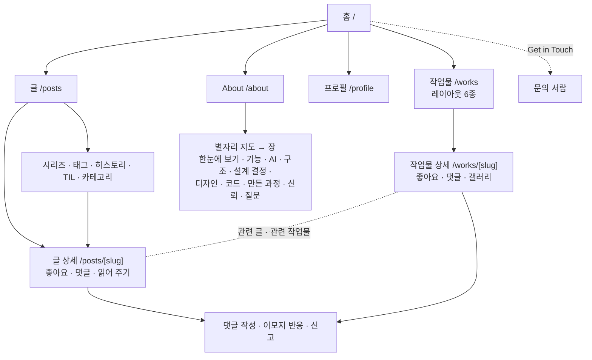
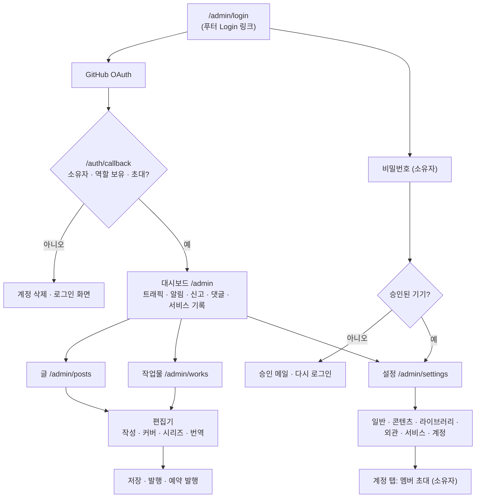

# User Flow

### 방문자 플로우

방문자는 내비게이션의 다섯 항목(홈 · Works · Posts · Profile · About)과 푸터에서 페이지를 오간다. 아래 그림은 주요 이동만 그린 것이다.

- **작업물**: 관리자 설정에서 고른 레이아웃(기본은 가로 스크롤 Flow)으로 탐색한다. 상세에서는 IP 기준 좋아요, 댓글, 갤러리, 관련 글 · 시리즈를 본다.
- **글**: 하위 페이지와 검색 · 카테고리 · 태그 · 정렬로 글을 찾는다. 시리즈 소속 글에서는 이전 · 다음 글로 넘어간다.
- **댓글**: 로그인 없이 쓴다. 같은 브라우저는 자동으로 본인 확인을 하고, 다른 기기에서는 비밀번호로 수정 · 삭제한다. 관리자가 댓글 공급자를 giscus 로 바꾸면 같은 자리에 GitHub Discussions 위젯이 뜬다.
- **About**: 가운데 별자리 지도(`src/app/about/_components/prezi/PreziStage.tsx`)에서 별을 고르면 그 장으로 날아 들어가고, 장이 끝나면 지도로 물러난다. 페이지는 `src/app/about/_components/AboutNext.tsx` 가 그린다.

### 관리자 플로우

- GitHub 로그인은 `next` 주소(기본 `/admin`)로, 비밀번호 로그인은 `next` 가 없으면 `/admin/settings` 로 간다.
- 저자(권한 1)가 관리자 전용 화면(대시보드 · 알림 · 신고 · 댓글)을 열면 proxy 가 `/admin/posts` 로 보낸다. 서비스 기록은 소유자만 연다.
- 설정의 여섯 탭 중 계정 탭을 뺀 다섯 탭은 소유자만 연다. 탭 내용은 [Supabase 세팅](./supabase-setup.md#5-admin-로그인-방법)에 있다.
- 편집기는 자동 저장과 리비전 기록을 남기고, 미발행 글을 저장하면 지금 발행할지 묻는다.
- 한 탭에서 로그아웃하면 `AdminAuthSync` 가 열린 다른 탭도 로그인 화면으로 보낸다.
